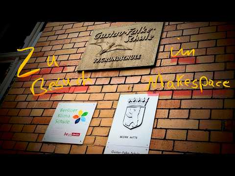

Falko besucht die **Gustav-Falke-Grundschule** in Berlin und schaut sich ihren Makespace an.

<a class="video-link" href="https://www.youtube.com/watch?v=sJzpJVTg7kQ" target="_blank" rel="noopener">
  
  <span class="video-play">▶ Video auf YouTube ansehen</span>
</a>

```
0:28 Rundgang durch den Make Space
1:53 Ausstattung und Sicherheit im Kreativraum
4:06 Kreative Projekte der Kinder
7:53 Making für Teilhabe und Inklusion
9:34 Faire Preise und Unterstützung durch Eltern
10:28 Arbeitssicherheit beim 3D-Druck
12:12 Werkzeuge und getrennte Werkstattbereiche
14:06 Filamentpflege und praktische Druckhelfer
```

Was Falko vorab über die Initiative notiert hat:

- **Making im Stundenplan:** Making ist dort fest in den Stundenplan integriert – **seit 2020**.
- **Auch die Kleinen:** Die 1., 2. und 3. Klassen kommen ebenfalls in den Makespace.
- **Offener Makespace:** einmal pro Woche von 16 bis 18 Uhr.
- **Schulfirma:** Für die Klassen 5 und 6 gibt es eine Schulfirma-AG.

Mehr dazu auf der Website der Schule:

- [Tüftelzeit im Makespace](https://gustav-falke-schule.de/tueftelzeit-im-makerspace/)
- [Schulfirma](https://gustav-falke-schule.de/schuelerfirma/)

Videos aus dem Makespace gibt es auf dem YouTube-Kanal [@machensachen](https://youtube.com/@machensachen).
