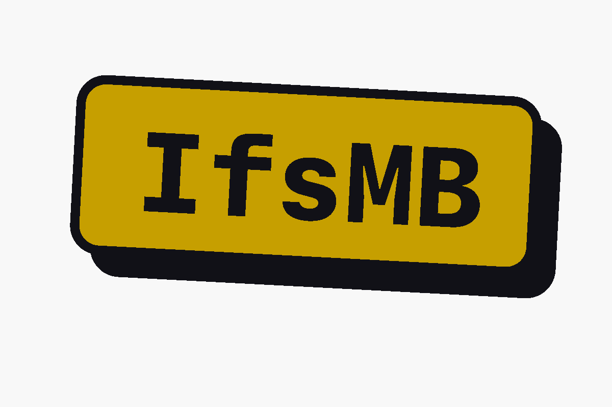
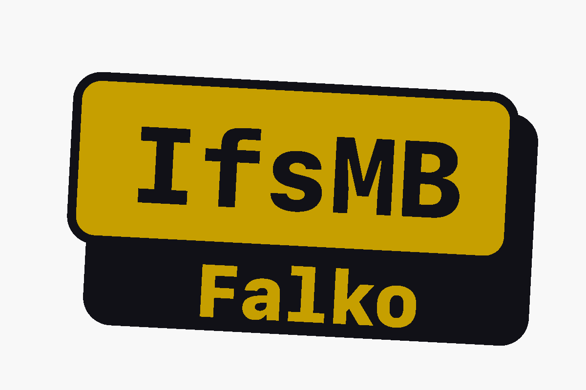

# IfsMB-Badge zum Drucken (gelb + schwarz, ein Farbwechsel)

Das Logo „Logo (Badge) als SVG“ (`../institut/ifsmb-logo-badge.svg`) als flaches Badge, optional mit Namen.

 

Auf der Website: [/presse/#badge](https://ifsmb.de/presse/#badge) (drehbares 3D-Modell, Downloads) und im Teamprofil jeder Person mit Badge.

| Datei | Inhalt |
|---|---|
| `ifsmb-badge.scad` | OpenSCAD-Quelle; Parameter oben in der Datei (auch im Customizer von OpenSCAD) |
| `ifsmb-wordmark.scad` | Schriftzug „IfsMB“ als Polygon, erzeugt aus dem Logo-SVG – nicht von Hand bearbeiten |
| `wordmark_from_svg.py` | erzeugt `ifsmb-wordmark.scad` neu, falls sich das Logo-SVG ändert |
| `export_colored.py` | erzeugt alle Dateien eines Badges in `assets/badge/` (`python3 export_colored.py ["Name"]`) |

Erzeugte Dateien in **`assets/badge/`** (von der Website ausgeliefert), je Badge:

| Datei | Inhalt |
|---|---|
| `<name>.3mf` | zwei Objekte „gelb“ und „schwarz“, bereits eingefärbt (AMS/MMU) |
| `<name>.obj` + `.mtl` | dasselbe als OBJ; lädt auch der 3D-Viewer `assets/js/badge3d.js` |
| `<name>.stl` | ein Körper, Farbwechsel per Pause bei 1,4 mm |
| `<name>-oben.png` | Vorschau, zugleich Bild ohne JavaScript/WebGL |

Vorhanden: `ifsmb-badge` (nur Logo, 52,8 × 24 × 2 mm), `-falko`, `-gregor`, `-mr-e`, `-hr-sladek` (mit Namen, 52,8 × 30,7 × 2 mm). Welche Badges auf der Website erscheinen und zu welchem Teamprofil sie gehören, steht in `_data/badges.yml`.

## Aufbau

- **0 – 1,4 mm gelb**: Grundplatte in der Umrissform von Badge und Schatten.
- **1,4 – 2,0 mm schwarz**: Rand, Schriftzug und Schatten stehen 0,6 mm erhaben darauf.
- **Mit Namen**: der Schatten wird unten zu einem schwarzen Band verlängert; die Buchstaben des Namens sind darin ausgespart, dort scheint das Gelb durch.

Es gibt also genau **einen Farbwechsel, bei Z = 1,4 mm**. Ein normaler Drucker ohne Mehrfarb-System reicht.

## Drucken

1. STL laden, flach auf der Rückseite liegen lassen, 0,2 mm Schichthöhe.
2. Mit gelbem Filament starten.
3. Im Slicer auf der Ebene **1,4 mm** (bzw. der ersten Schicht darüber) einen Filamentwechsel / eine Pause einfügen
   (Bambu/Orca: Rechtsklick auf den Schicht-Schieber → „Pause/Filamentwechsel“, PrusaSlicer: „+“ am Schieber → „Farbwechsel (M600)“).
4. Nach dem Wechsel schwarz zu Ende drucken.

Auf der Rückseite ist eine Aussparung (26 × 4,2 × 0,6 mm) für eine Anstecknadel zum Einkleben (`pin_slot = [0,0,0]` schaltet sie ab).

**Mit AMS/MMU** einfach die `.3mf` öffnen: sie enthält zwei Objekte „gelb“ und „schwarz“ an der richtigen Position; jedem Objekt das passende Filament zuweisen. Fragt der Slicer, ob die Objekte zu einem Objekt mit mehreren Teilen zusammengefasst werden sollen: ja. Kein Farbwechsel per Pause nötig.

## Eigener Name

```bash
openscad -D 'name="Falko"' -o ifsmb-badge-falko.stl ifsmb-badge.scad
```

- Schrift ist SF Mono Heavy wie im Logo (wird aus dem Terminal-Programm von macOS geladen, liegt nicht im Repo). Auf anderen Systemen `name_font` umstellen, z. B. `-D 'name_font="DejaVu Sans Mono:style=Bold"'`.
- `name_size` (6 mm) ist die Wunschhöhe; lange Namen werden automatisch kleiner, damit sie ins Band passen. Bis 8 Zeichen bleibt es bei 6 mm, bis etwa 13 Zeichen über 4 mm.
- `name_band` (9 mm) ist die sichtbare Höhe des schwarzen Bandes.

## Neues Badge

```bash
cd _logo/badge
python3 export_colored.py "Vorname"      # -> assets/badge/ifsmb-badge-vorname.*
```

Dann in `_data/badges.yml` eintragen (`aufschrift`, `datei`, optional `team` = Team-Kürzel → erscheint im Teamprofil).
