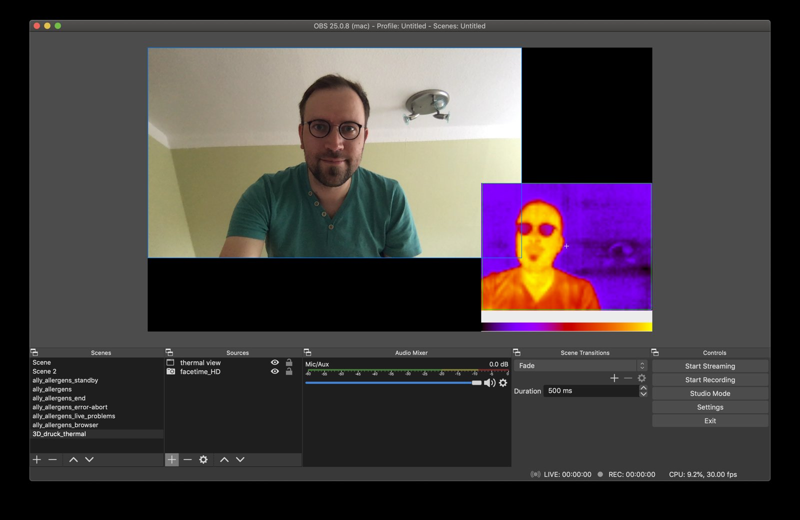
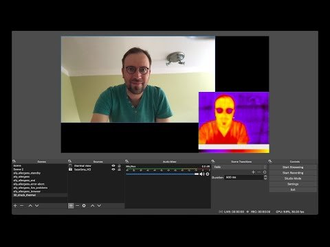
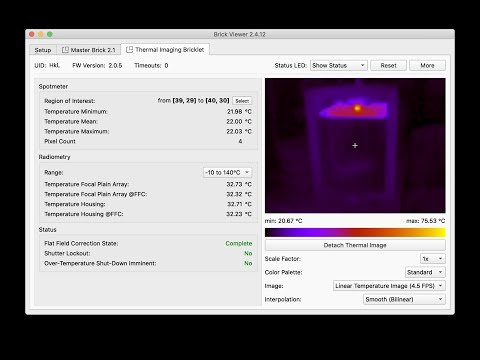

{: .gallery}

Am Donnerstag den 21.05.2020 (Himmelfahrt) um 10:00 gibt es einen Stream zum Thema „3D Druck für Kita Kinder“ von Falko und seinem Papa und vielleicht macht Hanne auch mit.

## Programm:

- 09:45: Stream Start – Es gibt Kaffee und Kakao und wir warten auf euch
- 10:00: Was ist ein 3D Drucker? Wie funktioniert er? Was hat das alles mit einer Heißklebepistole zu tun und warum eine Wärmebildkamera sehr praktisch ist.
- ab 10:30: Wir drucken ein Objekt. **Wünsche für das Druckobjekt bitte hier unten in die Kommentare**. Gerne als Link von [thingiverse.com](https://www.thingiverse.com/)!
- wir hoffen dass der Druck bis 11:30 fertig ist. Ab 10:30 wird es aber nicht sehr spannend, ihr dürft gerne später schauen ob es was geworden ist. Wer einem Drucker eine Stunde lang zuschauen will kann auch gerne die ganze Zeit zuschauen.

## Wann? – 21.05.2020 10:00

→ [Termin im Kalender]({{ '/kalender/2020-05-21-chaos-macht-kita-stream/' | relative_url }})

## WO? – HIER:

Unter [https://www.youtube.com/watch?v=UYhys3mDXUc](https://www.youtube.com/watch?v=UYhys3mDXUc) oder direkt:

<a class="video-link" href="https://www.youtube.com/watch?v=UYhys3mDXUc" target="_blank" rel="noopener">
  
  ▶ Video auf YouTube ansehen
</a>

## Fragen? – Kommentieren auf den Kanälen⬇⬇⬇

- Twitter: [twitter.com/volkersfreunde/status/1259884760991764483](https://twitter.com/volkersfreunde/status/1259884760991764483){: .link-tot}
- Instagram: [instagram.com/p/CADfV_UIS6O](https://www.instagram.com/p/CADfV_UIS6O/)

## [Update: Testvideo mit Wärmebildkamera]

<a class="video-link" href="https://www.youtube.com/watch?v=UDVKEjSYFek" target="_blank" rel="noopener">
  
  ▶ Video auf YouTube ansehen
</a>
