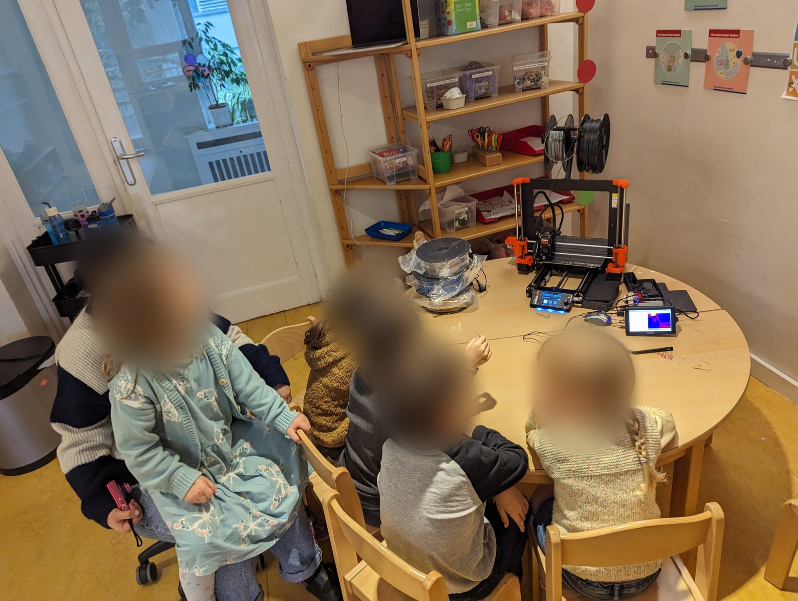
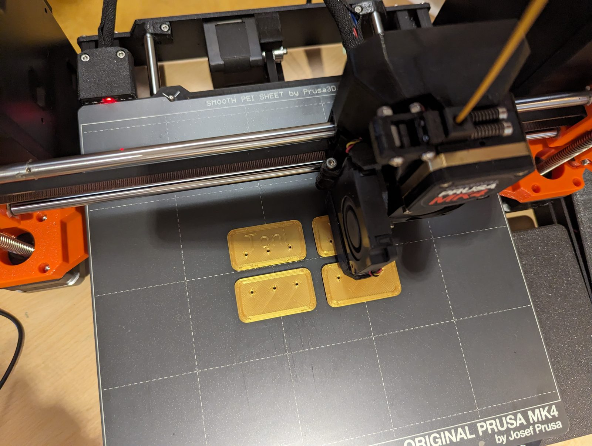
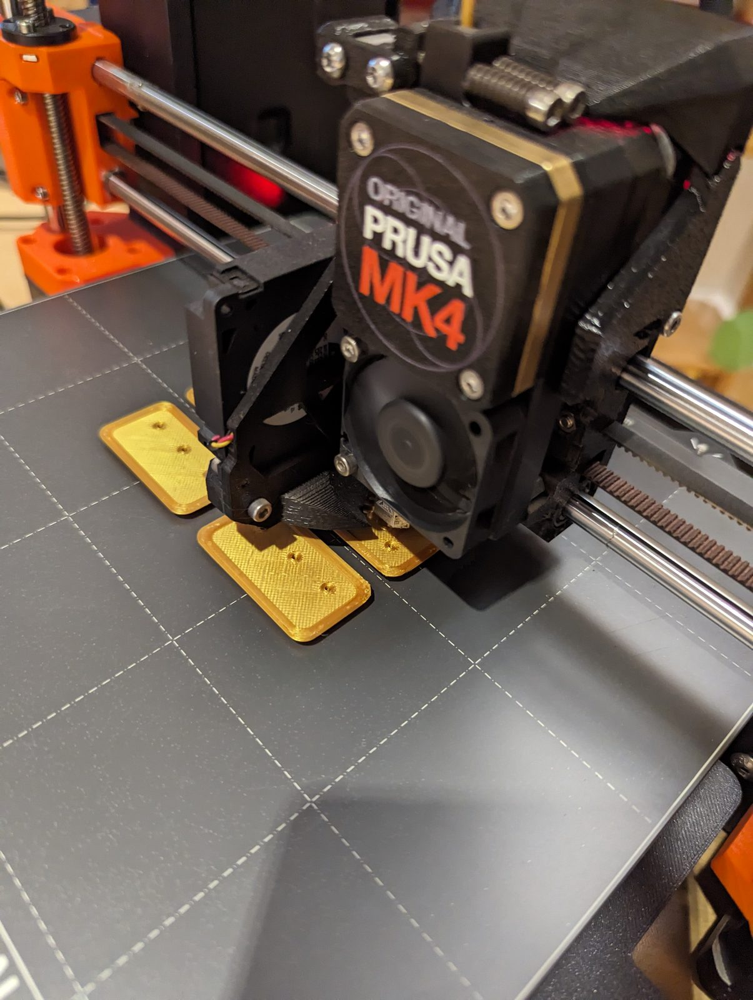
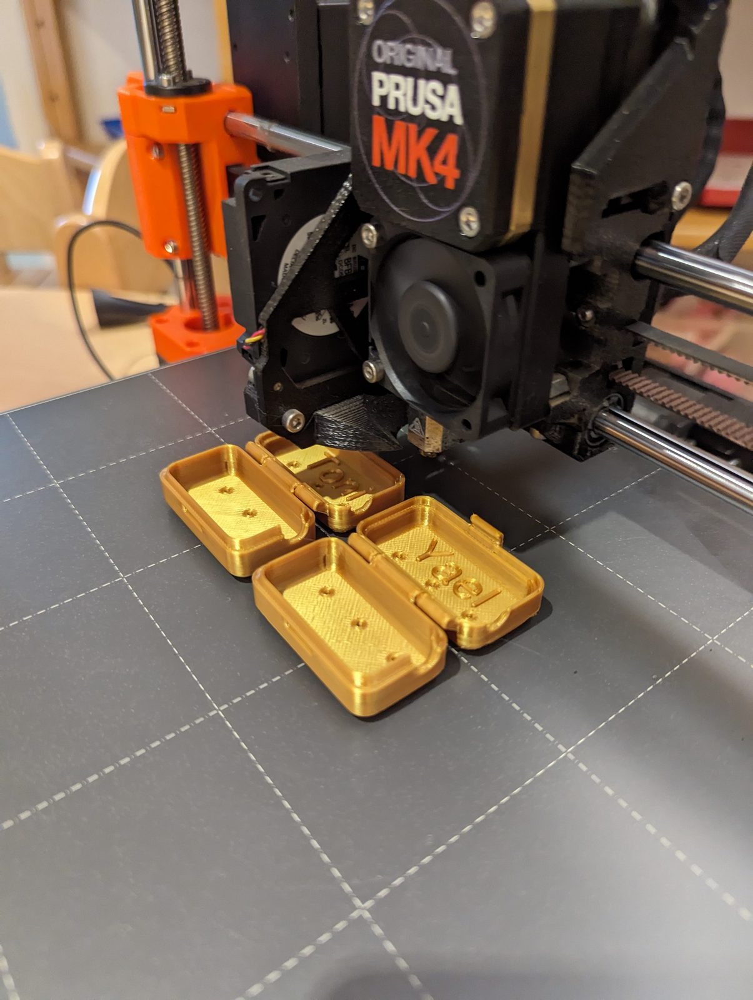
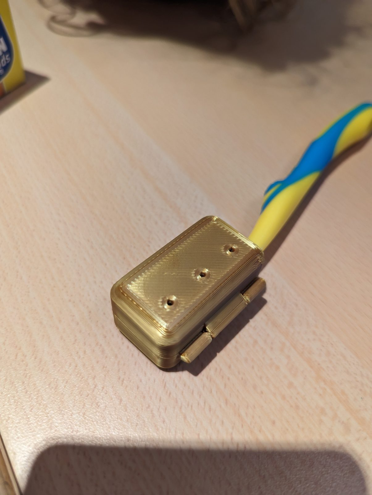
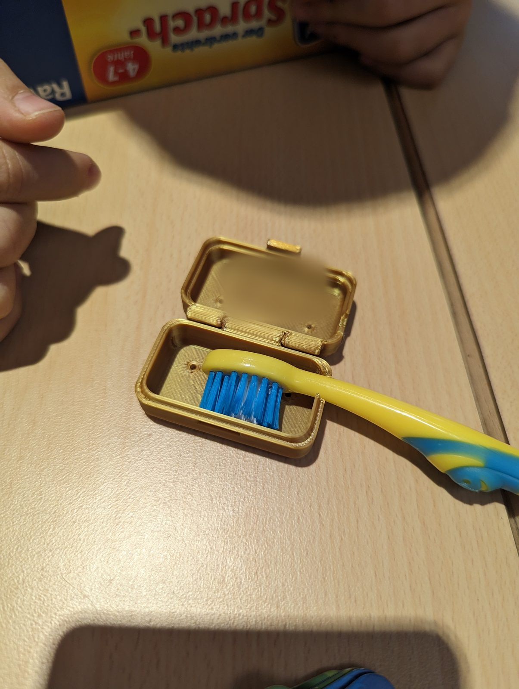
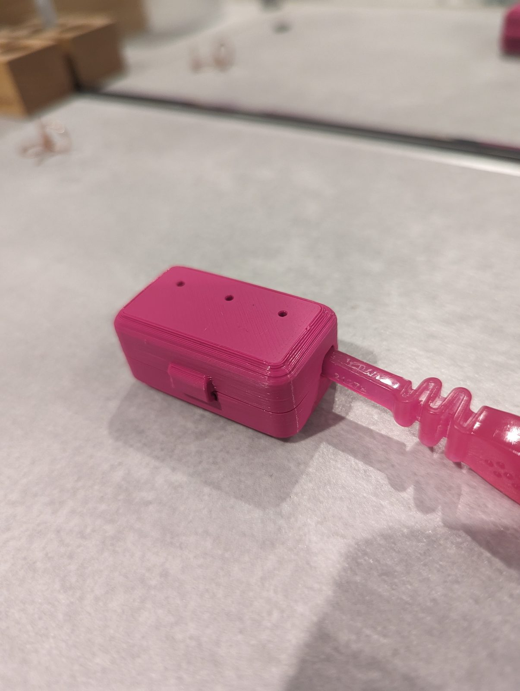
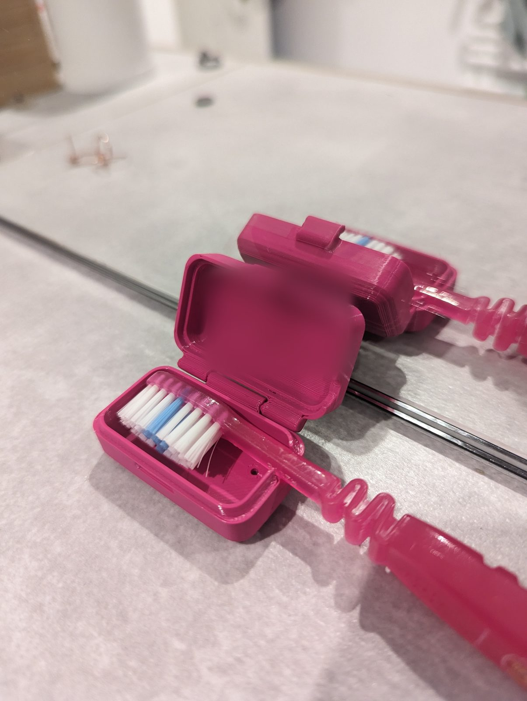

[Falko]({{ '/team/falko-richter/' | relative_url }}) hat in der INA Habersaathstraße eine kleine 3D-Druck-Einführung gegeben. Gedruckt wurden Zahnbürstenetuis mit den Namen der Kinder auf dem Deckel.

Die Einführung ist offen dokumentiert – als Open Educational Resource: [chaos-macht-kita auf GitHub](https://github.com/falkorichter/chaos-macht-kita). Wie alles angefangen hat, steht im Beitrag über [Falkos Vortrag auf dem Chaos Communication Camp 2023]({{ '/news/2023/08/16/3d-druck-fuer-kinder-auf-dem-cccamp23/' | relative_url }}).

{: .gallery}
