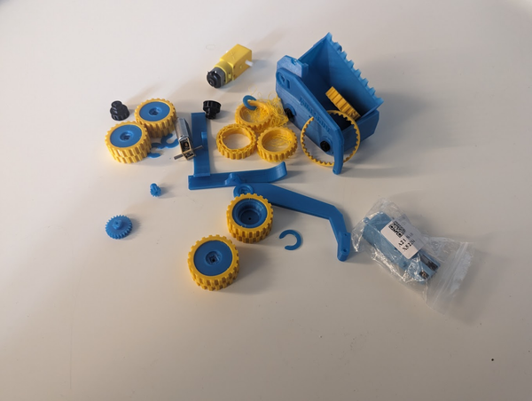
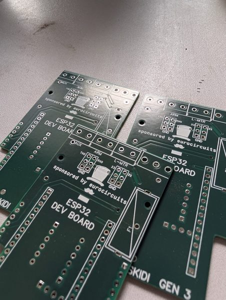
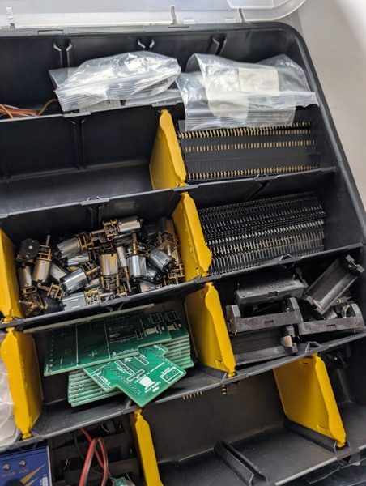
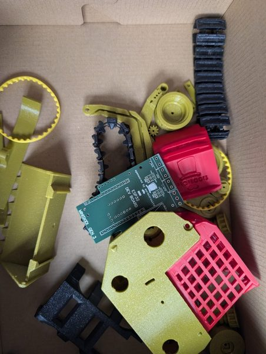
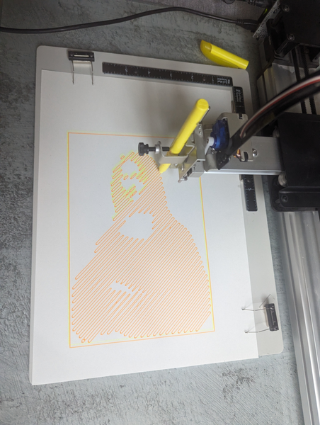
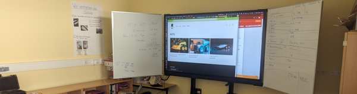
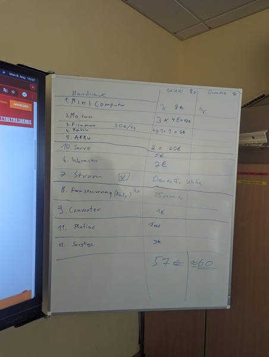
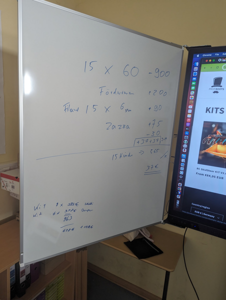
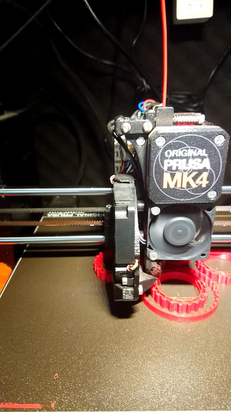

Am 8. April um 15:00Uhr startet eine AG an der Kurt-Tucholsky-Grundschule und wir lernen 3D Druck, Löten und Basteln einen fertgesteuerten Bagger oder Kipplaster. Dies ist ein Projekt von [Falko]({{ '/team/falko-richter/' | relative_url }}) (und [Jan]({{ '/team/jan/' | relative_url }}) von 35services).

  

## Vielen Dank an unsere Sponsoren:

- **[Zazza](https://www.pajas-kaffee.de/about-3)** in der Lehrter Straße – Danke an Jan un Paul für leckeren Kaffee und die Unterstützung
- **[KTG-Förderverein](https://kurt-tucholsky-grundschule.de/das-sind-wir/foerderverein/)** – Vielen Dank an Andreas Pachten für die Zusage
- [**eurocircuits**](https://www.eurocircuits.de/) – Vielen Dank für die Zusage, die Platinen zu sponsoren
- **[Das Paradise](https://www.thisisparadise.de/)** – das wohl stylischste Frühstückslokal Berlins in der Kirchstraße – Vielen Dank für die Unterstützung
- [**Brille und Glas**](https://www.brilleundglas-augenoptik.de/) – der tolle kleine Optiker in der Lehrter Straße – Doppelt Dank für den Spind: die Kollegen in der Werktatt freuen sich und die Einnahmen gehen direkt in diese AG
- **Eltern** – Danke an alle Eltern, die schon Geld mitgegeben haben

  
  
  

Wir sind knapp [700 Schüler](https://www.bildung.berlin.de/schulverzeichnis/schuelerschaft.aspx) an der Schule und werden auf den Schulfesten/Schulflohmärkten immer unsere Sponsoren ausstellen und großzügig erwähnen 🫶🫶🫶

**Wann:** Montags 15:00 – 16:00 in der KTG

**Treffpunkt 8. April:** 14:50Uhr vor dem Sekretariat

**Der Plan:**

- Einführung 3D Druck (wie schon 2x in Kitas erprobt: [https://github.com/falkorichter/chaos-macht-kita](https://github.com/falkorichter/chaos-macht-kita))
- Drucken des Modell: [https://www.printables.com/model/544937-v20-3d-printed-rc-skidsteer](https://www.printables.com/model/544937-v20-3d-printed-rc-skidsteer) oder [https://www.printables.com/model/649741-v20-3d-printed-rc-dumptruck](https://www.printables.com/model/649741-v20-3d-printed-rc-dumptruck)
- Einführung in die Elektronik
- Vorbereitung der Elektronik:

Platine bestellen [https://github.com/ProfBoots/V2.0-3D-Printed-RC-SkidSteer](https://github.com/ProfBoots/V2.0-3D-Printed-RC-SkidSteer)
- weitere Elektronik bestellen

- Platine bestellen [https://github.com/ProfBoots/V2.0-3D-Printed-RC-SkidSteer](https://github.com/ProfBoots/V2.0-3D-Printed-RC-SkidSteer)
- weitere Elektronik bestellen

- Besuch bei 3dBoutiqueBerlin (kleine 3D Druck und Manufaktur in der Stephanstraße)
- Führung in der Niederlassung Moabit von Vitesco Technologies (Sickingenstraße 42-46)
- Führung im HappyLab/MotionLab/Xhain Fablab-Hackerspace

Zum Anmelden bitte bei Frau Schroth im Sekretariat melden und eine eMail an falko[ät]35services[punkt]de schicken.

*Stand: wird ständig aktualisiert*

## Inhalte – was passiert?!

#### 1 Kennenlernen und Überblick

- Was ist ein Roboter?
- Ein Kind wird ein Roboter und wir „programmieren“ es.
- Was ist ein 2D Drucker?
- Wir schauen uns den 2D Druck Roboter an und versuchen zu verstehen warum ein Roboter eigentlich nicht viel kann.
- Wir reden über das Projekt.
- Wir besprechen mögliche Sponsoren
- Es gibt Hausaufgaben 🙂

#### 2 Auf dem Weg zum 3D Druck

  

- Was ist ein 3D Druck Stift? Warum ist er gefährlich (heiß)
- Wir malen mit dem 3D Druck Stift
- Wir schauen uns einen 3D Drucker an, im Grunde ist ein 2D Drucker mit Druck Stift
- Wir besprechen [https://www.eurocircuits.com/](https://www.eurocircuits.com/) als möglichen [Sponsor](https://www.eurocircuits.de/impressum/) – Falko telefoniert mit Uwe Dörr 

Logo auf die Platine
- Rechnung zurück an eurocircuits
- Account von 35services als e.V.
- uwe.doerr[at]eurocircuits[punkt]com eMail schreiben und Details anfragen 👍

- Logo auf die Platine
- Rechnung zurück an eurocircuits
- Account von 35services als e.V.
- uwe.doerr[at]eurocircuits[punkt]com eMail schreiben und Details anfragen 👍

#### 3 3D Drucker

- Wir bestimmen einen Kassenmeister und machen eine Übersicht, wie teuer es wird
- Wir begutachten den 3D Drucker
- Wir drucken etwas
- Wir reden über den Ausflug

#### 4 Ausflug in die 3dBoutiqueBerlin in der Stephanstr.

[Formular](https://docs.google.com/document/d/14EfDfSdWN3HooCYi65vl9DSG6d19kfZvcAg7ukmf29M/edit) nicht vergessen!!! Ohne Unterschriebenes Formular der Eltern darfst du nicht mit!

- [https://www.instagram.com/3dboutiqueberlin/](https://www.instagram.com/3dboutiqueberlin/)
- [https://www.etsy.com/de/shop/3dBoutiqueBerlin](https://www.etsy.com/de/shop/3dBoutiqueBerlin)

3dboutiqueberlin ist eine kleine Firma die 3D gedruckte Objekte designed, druckt und verkauft. Betrieben wird sie von Max, seine Kinder sind auch KTG Schüler (gewesen).

#### 5 Wir rechnen

  

  
  

#### 6 – Räder und Riemen aus Gummi drucken

  

- wir haben WLAN und richten den Drucker in der Schule ein
- Wir reden über Sponsoren und sammeln Bargeld von den Eltern ein. Ein Kind wird Kassenwart 🎉
- Wir drucken mit [https://www.prusa3d.com/de/produkt/colorfabb-varioshore-tpu-natural-filament-700g/](https://www.prusa3d.com/de/produkt/colorfabb-varioshore-tpu-natural-filament-700g/) und schäumen ausversehen – dann wechseln wir auf 195 Grad und es werden Räder und Riemen gedruckt.

Leider hat die Kamera nicht durchgehalten, wir haben nur dieses Foto hier ->
- Druck hat gut an der strukturierten Platte gehalten

- Leider hat die Kamera nicht durchgehalten, wir haben nur dieses Foto hier ->
- Druck hat gut an der strukturierten Platte gehalten

#### next: Fahrzeuge drucken

- Welche Farbe will jeder haben? Wir schreiben es auf. Wir dokumentieren unsere Sponsoren und ob sie auf dem Fahrzeug erscheinen sollen.
- Wir drucken mit den Kindern jeweils, Treffen 7:30 im Projektraum, Druck entfernen, neuen Druck starten
- Elektronik bestellen
- PCB bestellen

## **8. April: Hausaufgabe 1:**

- **2 Videos angucken** (gerne mit Mama oder Papa, man muss den Text nicht verstehen):

[https://www.youtube.com/watch?v=3jgQ9fDi1nY](https://www.youtube.com/watch?v=3jgQ9fDi1nY)
- [https://www.youtube.com/watch?v=DEg1vcA16jw](https://www.youtube.com/watch?v=DEg1vcA16jw&t=506s)

- [https://www.youtube.com/watch?v=3jgQ9fDi1nY](https://www.youtube.com/watch?v=3jgQ9fDi1nY)
- [https://www.youtube.com/watch?v=DEg1vcA16jw](https://www.youtube.com/watch?v=DEg1vcA16jw&t=506s)

- Welches Fahrzeug willst du dir bauen?
- Hast du eine Idee für einen Sponsor von deinem Fahrzeug? Sprich mit deine Eltern und frag auch gerne mal im Kiez ob jemand 30€ (gerne auch mehr oder weniger) für dein Fahrzeug sponsorn würde

## **15. April: Hausaufgabe 2:**

- Denke an deine Freunde im Hort wenn du zur AG kommst und nimm sie mit (kommt gerne zusammen hoch)
- Sei pünktlich 15:45 im Raum (Mathe Labor gegenüber vom Sekretariat)
- Schulranzen 🎒 und Jacke 🧥 mitbringen damit du direkt danach los kannst oder direkt von der AG abgeholt werden kannst
- Vergiss die Hausaufgaben der 1. Woche nicht 😉

Sponsoring
