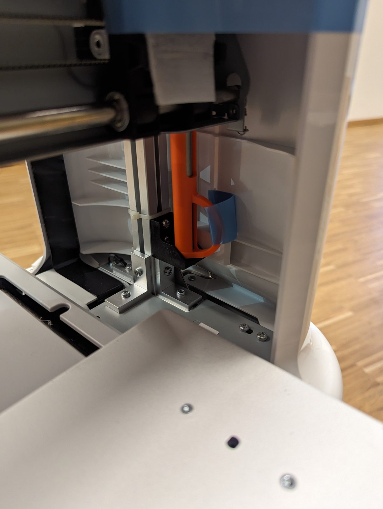
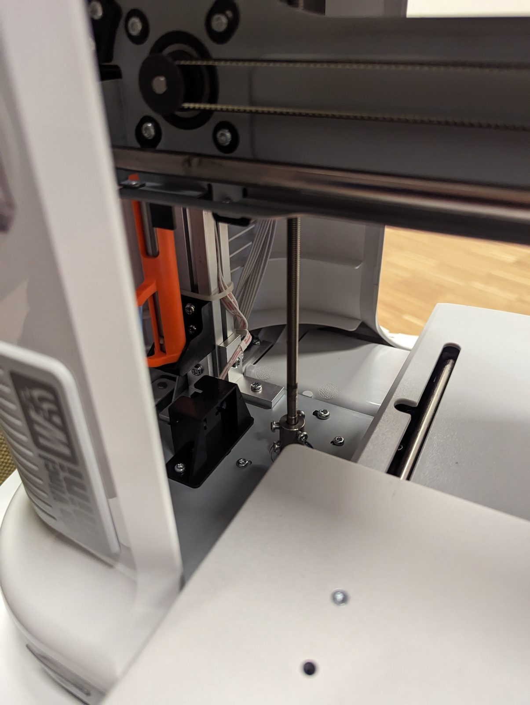
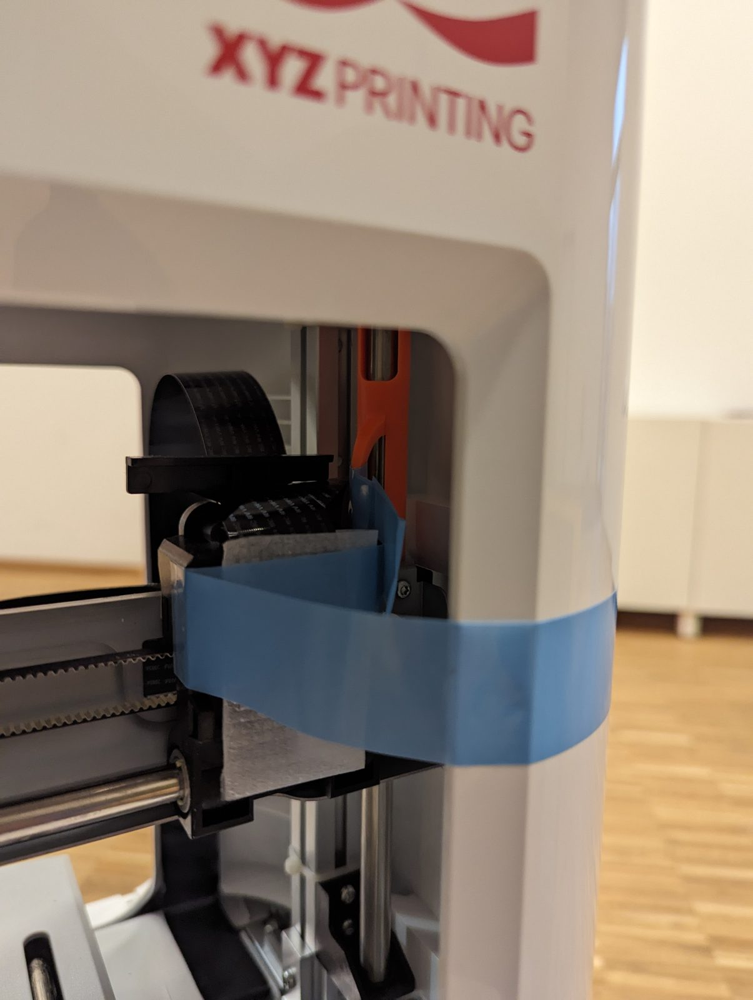
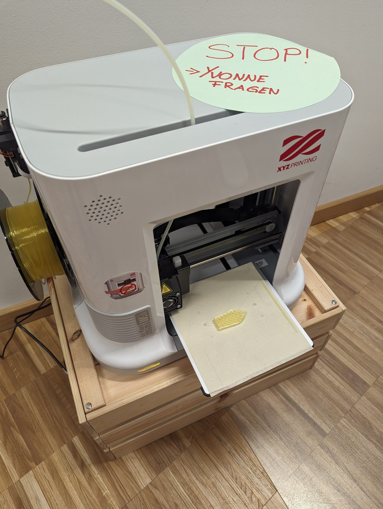
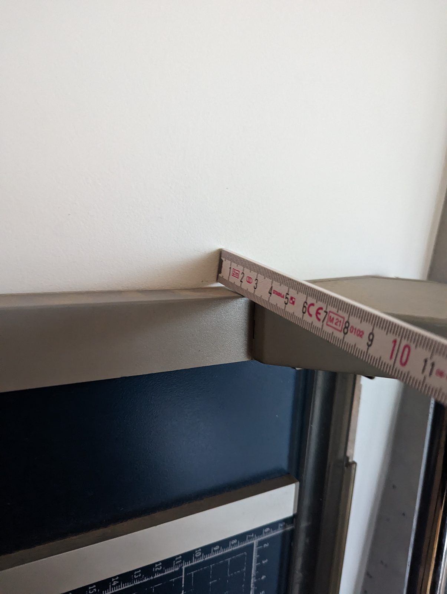
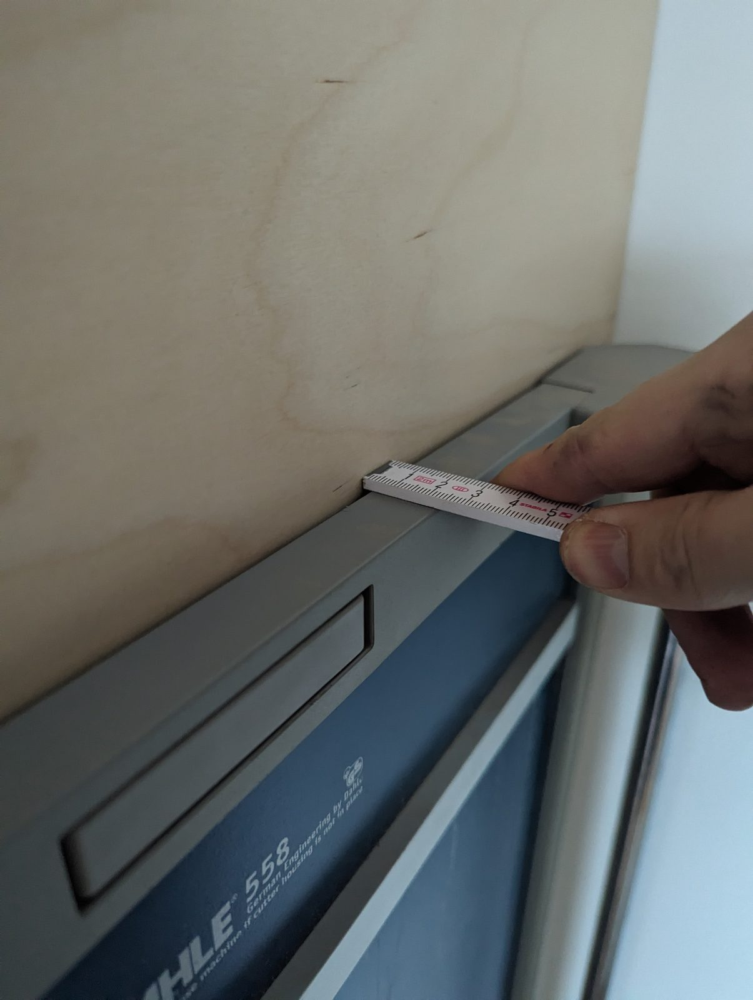

Am 12. Januar 2024 haben wir im Fröbel-Kindergarten in der Lisa-Fittko-Straße einen 3D-Drucker eingeweiht: einen da Vinci mini von XYZprinting. Morgens wurde ausgepackt und aufgebaut, am Nachmittag liefen die ersten Drucke.

Damit niemand einfach so losdruckt, steht ein Schild auf dem Drucker: „STOP! → Yvonne fragen“.

Die Einführung ist offen dokumentiert – als Open Educational Resource: [chaos-macht-kita auf GitHub](https://github.com/falkorichter/chaos-macht-kita). Wie alles angefangen hat, steht im Beitrag über [Falkos Vortrag auf dem Chaos Communication Camp 2023]({{ '/news/2023/08/16/3d-druck-fuer-kinder-auf-dem-cccamp23/' | relative_url }}).

{: .gallery}

## Die ersten Drucke

<video class="post-video" controls preload="none" playsinline poster="/assets/video/news/3d-drucker-im-froebel-kindergarten-eingeweiht/01.jpg" src="/assets/video/news/3d-drucker-im-froebel-kindergarten-eingeweiht/01.mp4"></video>

<video class="post-video" controls preload="none" playsinline poster="/assets/video/news/3d-drucker-im-froebel-kindergarten-eingeweiht/02.jpg" src="/assets/video/news/3d-drucker-im-froebel-kindergarten-eingeweiht/02.mp4"></video>

<video class="post-video" controls preload="none" playsinline poster="/assets/video/news/3d-drucker-im-froebel-kindergarten-eingeweiht/03.jpg" src="/assets/video/news/3d-drucker-im-froebel-kindergarten-eingeweiht/03.mp4"></video>
