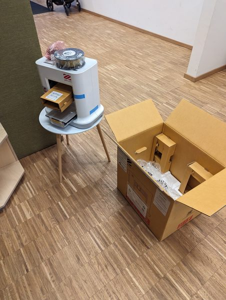
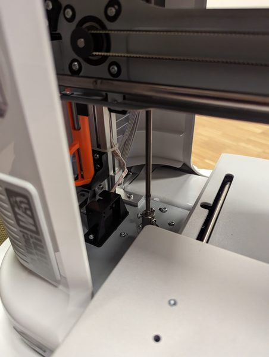
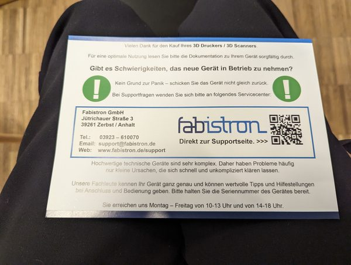
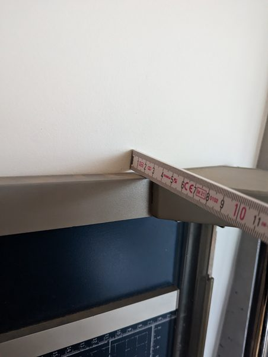
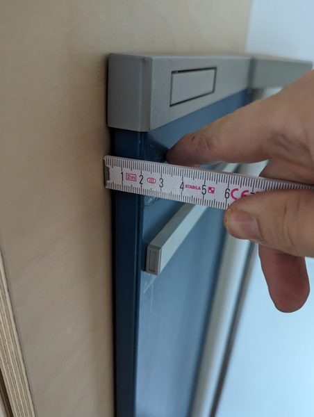
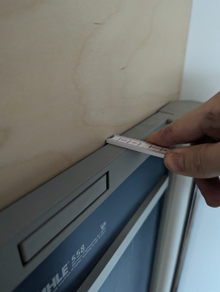
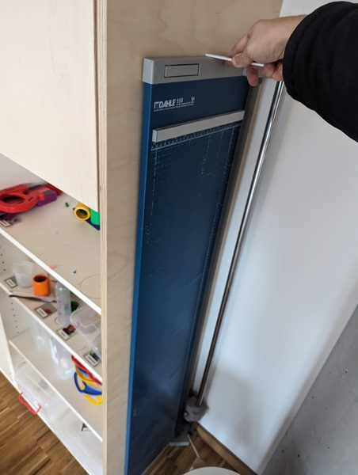

Am 12. Januar 2024 haben wir im Fröbel-Kindergarten einen 3D-Drucker eingeweiht: einen da Vinci mini von XYZprinting. Morgens wurde ausgepackt und aufgebaut, am Nachmittag liefen die ersten Drucke.

Damit niemand einfach so losdruckt, steht ein Schild auf dem Drucker: „STOP! → Yvonne fragen“.

  
  
  
  
  
  
  
  
  
  

## Die ersten Drucke

<video class="post-video" controls preload="none" playsinline poster="/assets/video/news/3d-drucker-im-froebel-kindergarten-eingeweiht/01.jpg" src="/assets/video/news/3d-drucker-im-froebel-kindergarten-eingeweiht/01.mp4"></video>

<video class="post-video" controls preload="none" playsinline poster="/assets/video/news/3d-drucker-im-froebel-kindergarten-eingeweiht/02.jpg" src="/assets/video/news/3d-drucker-im-froebel-kindergarten-eingeweiht/02.mp4"></video>

<video class="post-video" controls preload="none" playsinline poster="/assets/video/news/3d-drucker-im-froebel-kindergarten-eingeweiht/03.jpg" src="/assets/video/news/3d-drucker-im-froebel-kindergarten-eingeweiht/03.mp4"></video>
