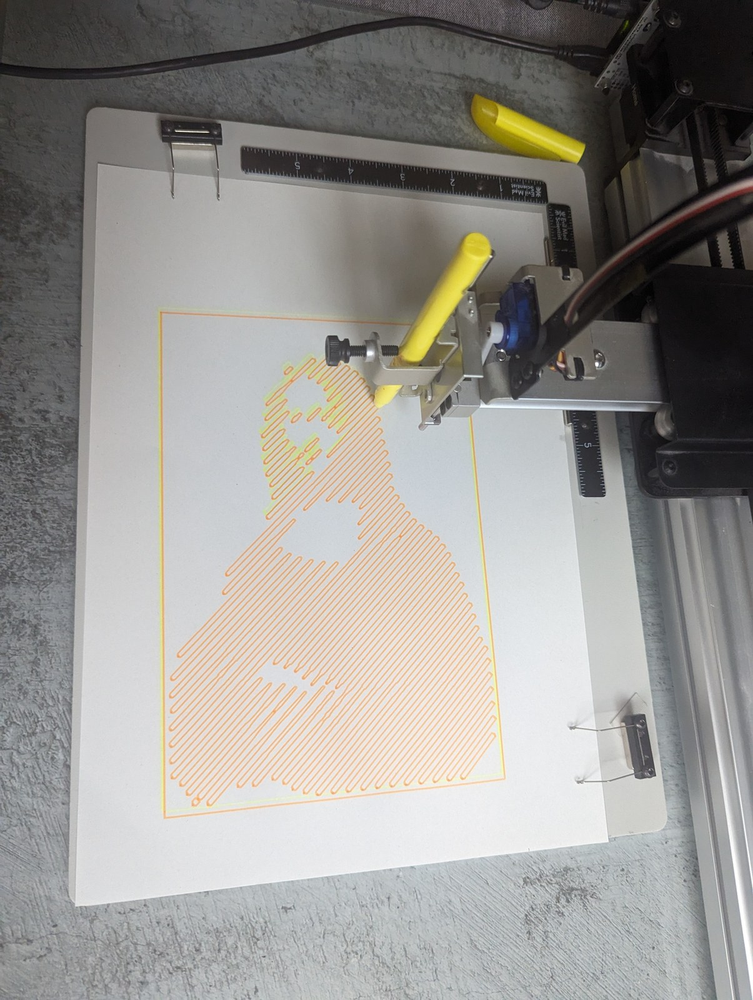
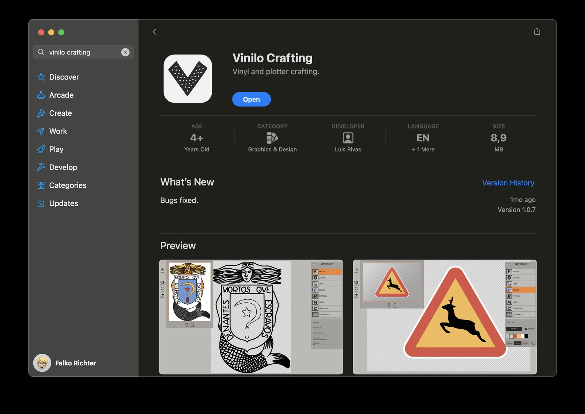
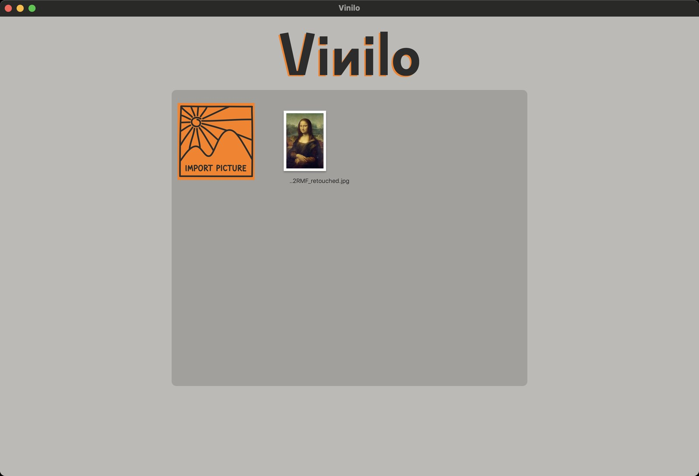

In den ersten Stunden der [3D-Druck- und Elektronik-AG an der KTG]({{ '/projekte/ktg-ag-jahr-1/' | relative_url }}) haben wir uns angeschaut, wie unser Stiftplotter [AxiDraw V3]({{ '/ausstattung/axidraw-v3/' | relative_url }}) funktioniert – denn ein 3D-Drucker ist im Grunde auch nichts anderes als ein 2D-Drucker, der Schicht für Schicht mit einem heißen Stift übereinander malt.

Dabei kam eine Herausforderung aus der Runde: **Ein Kind aus der AG hat gewettet, dass der AxiDraw keine Mona Lisa malen kann.**

Die Wette galt! Falko hat das [Foto der Mona Lisa aus Wikimedia Commons](https://commons.wikimedia.org/wiki/File:Mona_Lisa,_by_Leonardo_da_Vinci,_from_C2RMF_retouched.jpg) genommen und mit **Vinilo** in eine einzige durchgehende Zickzack-Linie umgewandelt – dort, wo das Gemälde dunkel ist, liegen die Schlaufen enger beieinander, an den hellen Stellen weiter auseinander.

{: .gallery}

Anschließend hat der AxiDraw das Porträt mit gelbem und orangefarbenem Stift auf Papier gezeichnet. Alle SVG-Dateien und Zwischenschritte liegen offen in unserem Plotter-Repository **[35services/2d]({{ '/projekte/35services-2d/' | relative_url }})** im Ordner [`mona-lisa/`](https://github.com/35services/2d/tree/main/mona-lisa).

{: .gallery}
