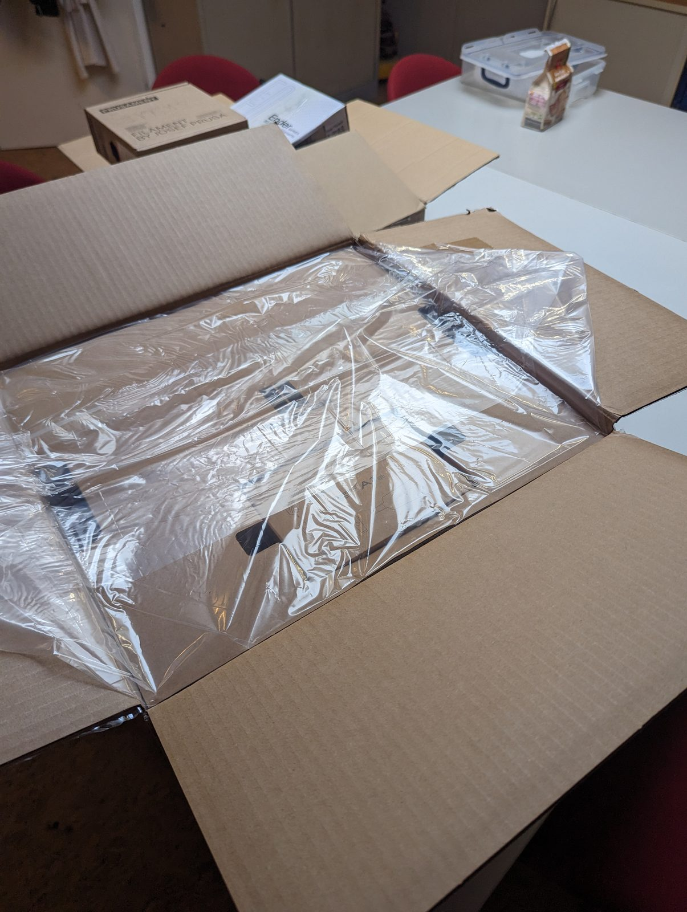
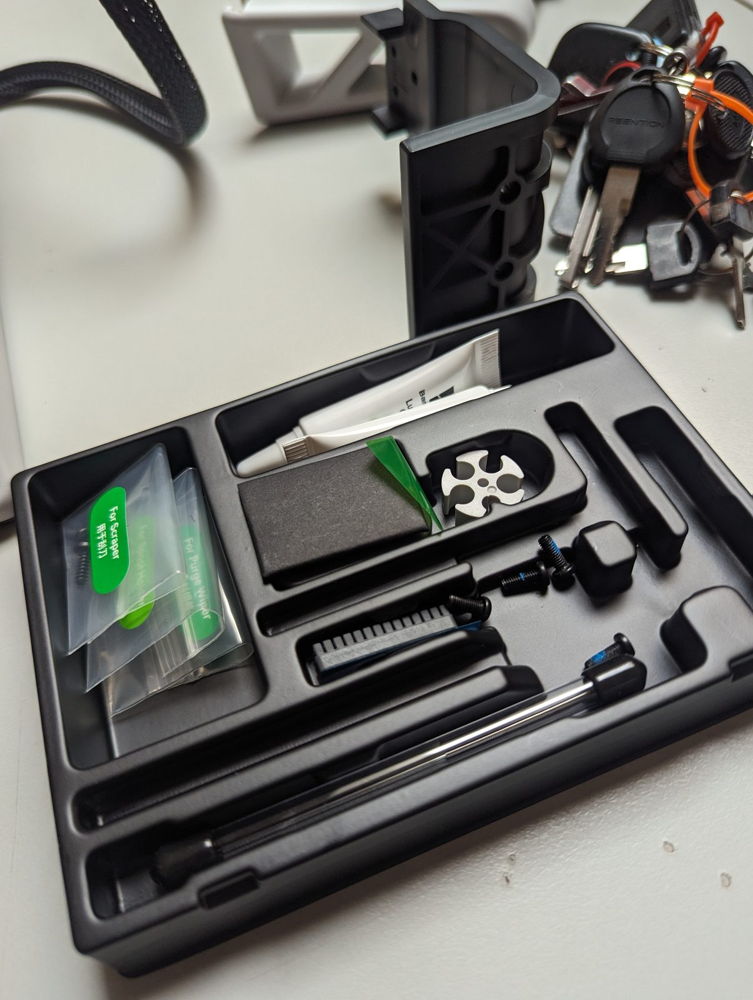
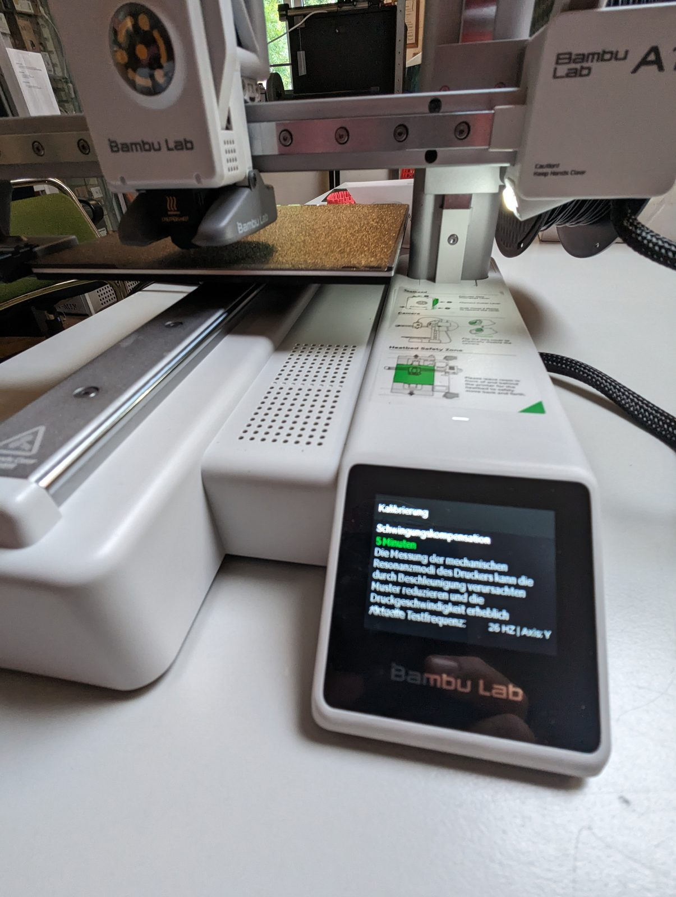
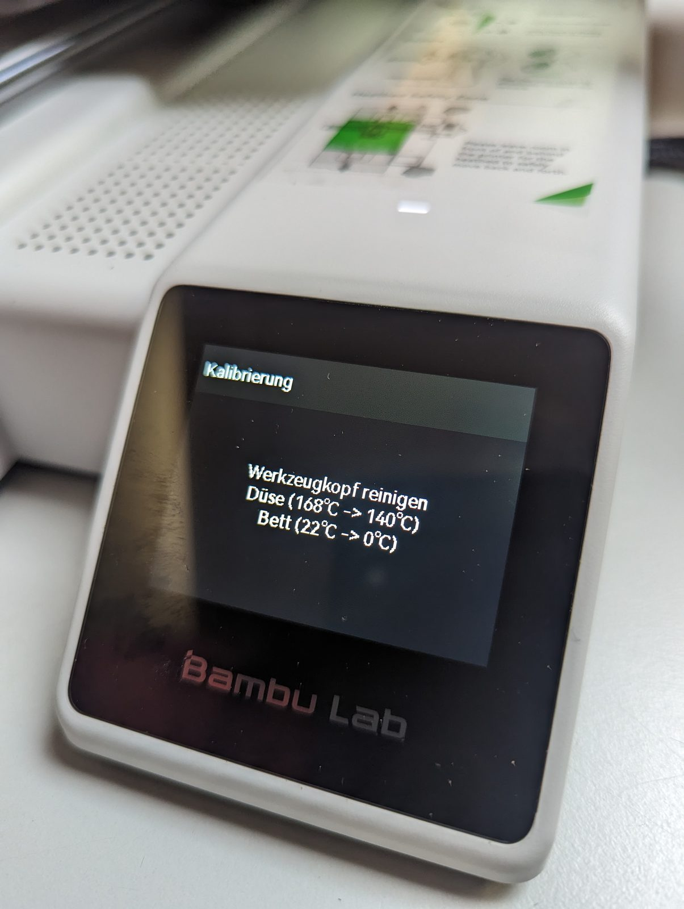
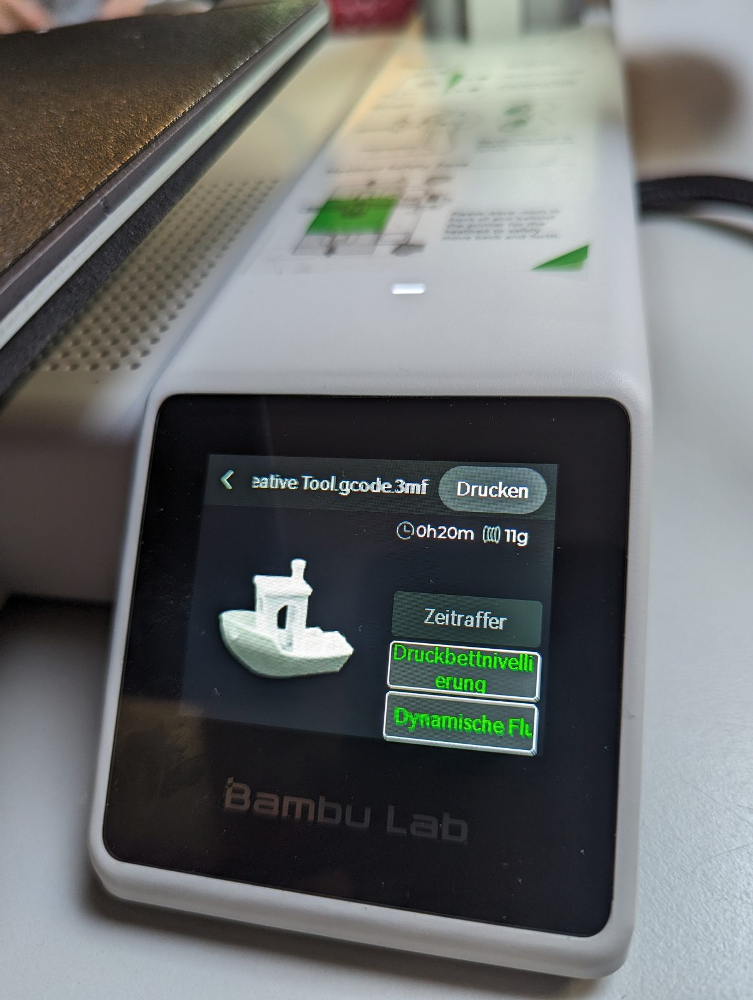
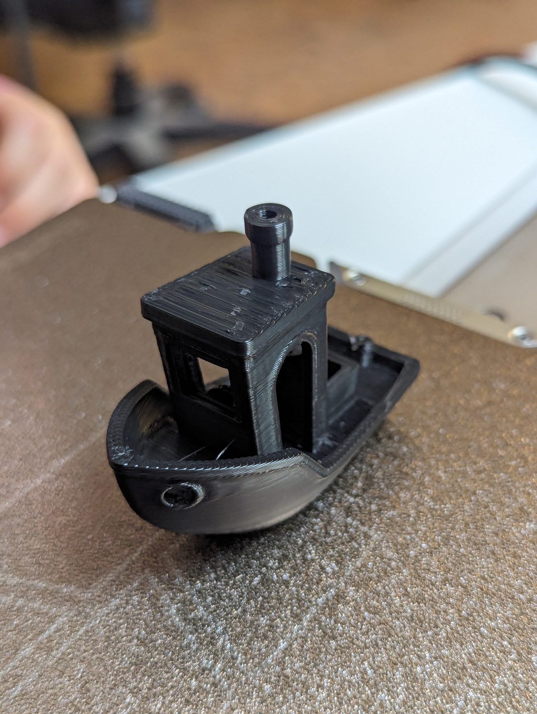

Am 12. Juni 2024 kam der erste Drucker von 35services: ein Bambu Lab A1. Falko hat ihn auf eigenes Risiko gekauft – finanziert werden soll er nach und nach über Spenden unter [35services.de/ag](https://35services.de/ag/).

Abgeholt mit dem Lastenrad, ausgepackt, aufgebaut, kalibriert – und als erster Druck lief, wie es sich gehört, das Benchy-Boot.

{: .gallery}

## Videos

<video class="post-video" controls preload="none" playsinline poster="/assets/video/news/unboxing-des-ersten-35services-druckers/01.jpg" src="/assets/video/news/unboxing-des-ersten-35services-druckers/01.mp4"></video>

<video class="post-video" controls preload="none" playsinline poster="/assets/video/news/unboxing-des-ersten-35services-druckers/02.jpg" src="/assets/video/news/unboxing-des-ersten-35services-druckers/02.mp4"></video>

<video class="post-video" controls preload="none" playsinline poster="/assets/video/news/unboxing-des-ersten-35services-druckers/03.jpg" src="/assets/video/news/unboxing-des-ersten-35services-druckers/03.mp4"></video>

<video class="post-video" controls preload="none" playsinline poster="/assets/video/news/unboxing-des-ersten-35services-druckers/04.jpg" src="/assets/video/news/unboxing-des-ersten-35services-druckers/04.mp4"></video>

<video class="post-video" controls preload="none" playsinline poster="/assets/video/news/unboxing-des-ersten-35services-druckers/05.jpg" src="/assets/video/news/unboxing-des-ersten-35services-druckers/05.mp4"></video>

