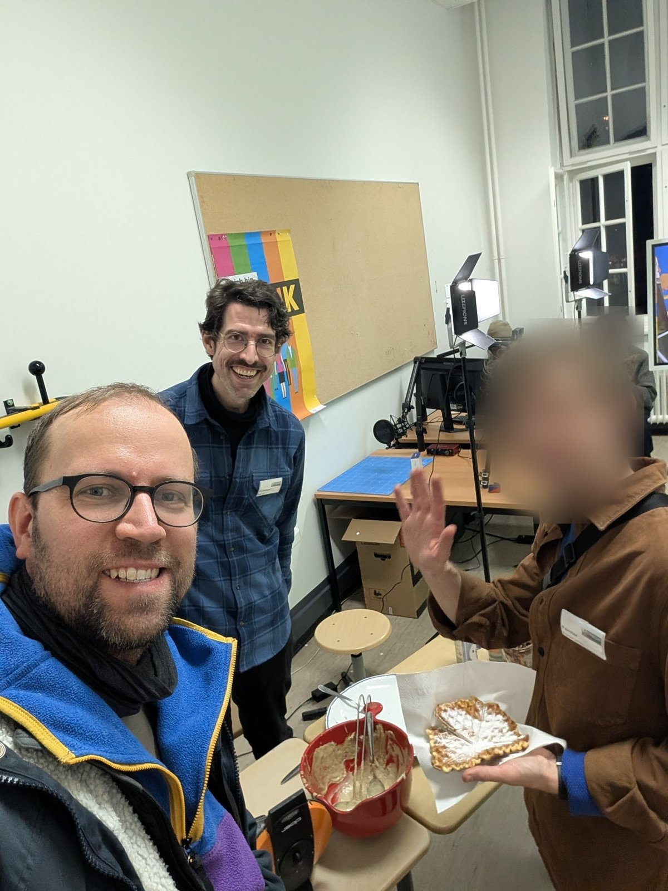
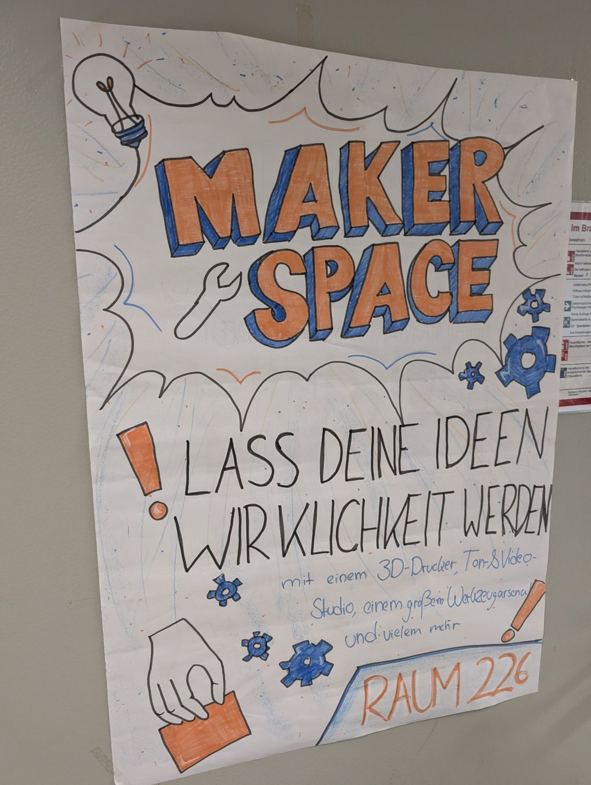
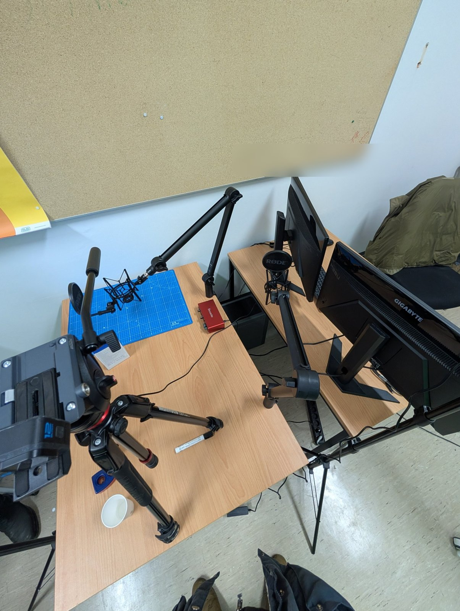
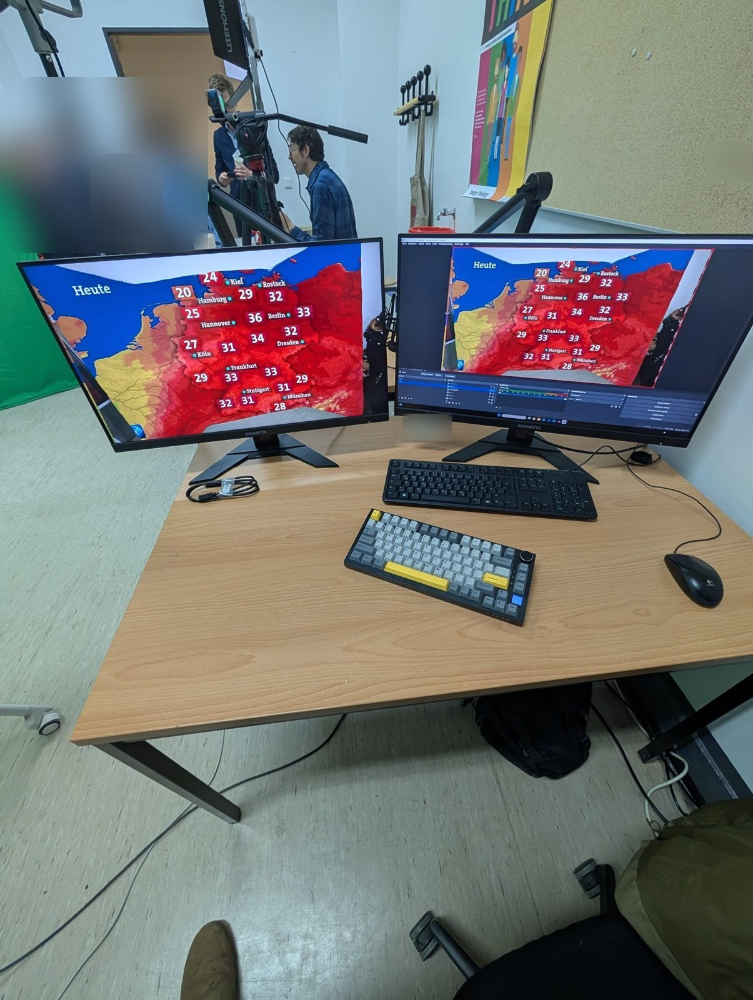
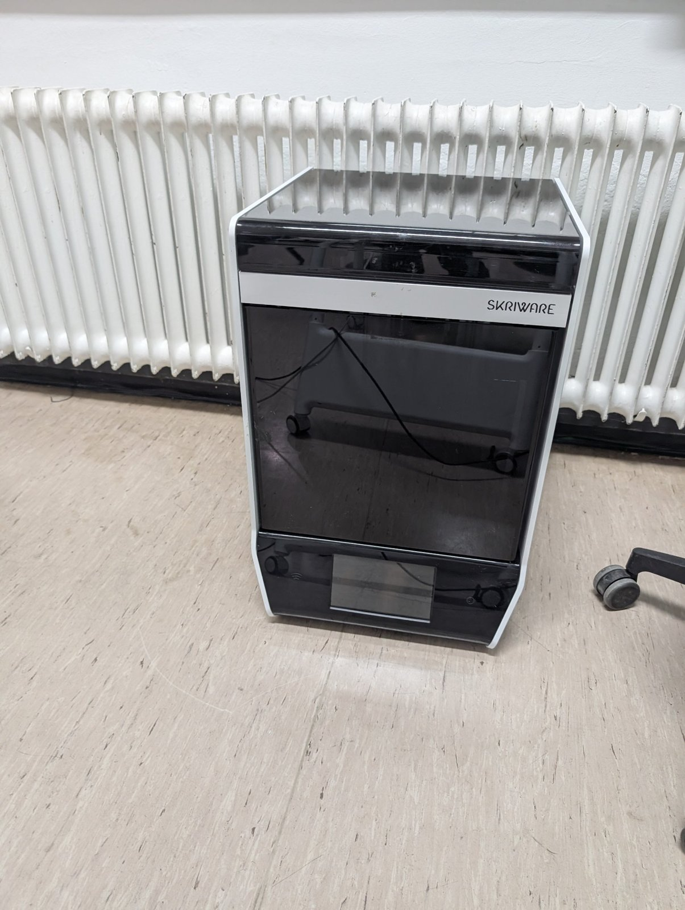
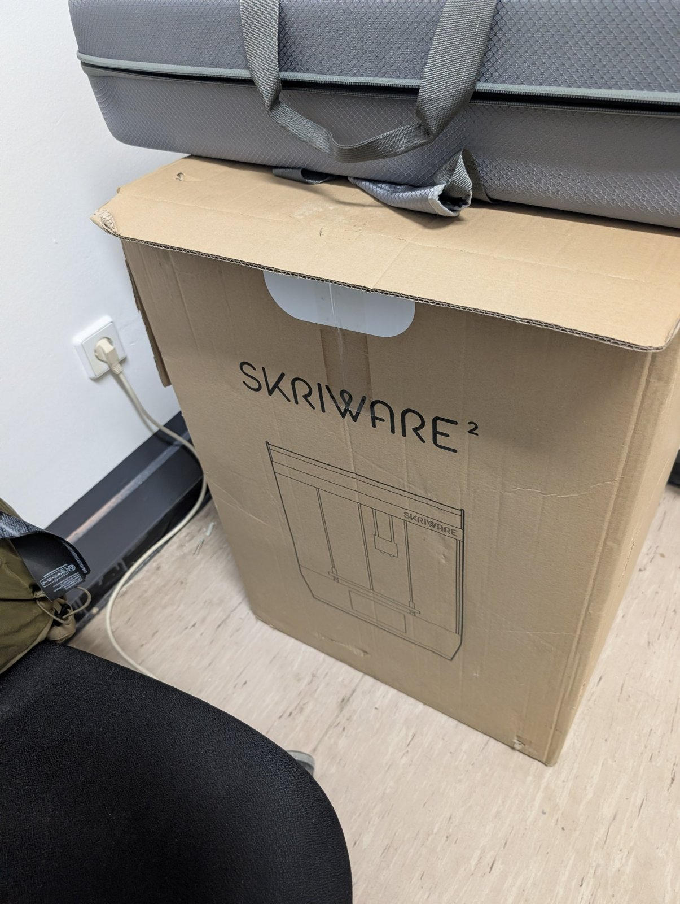
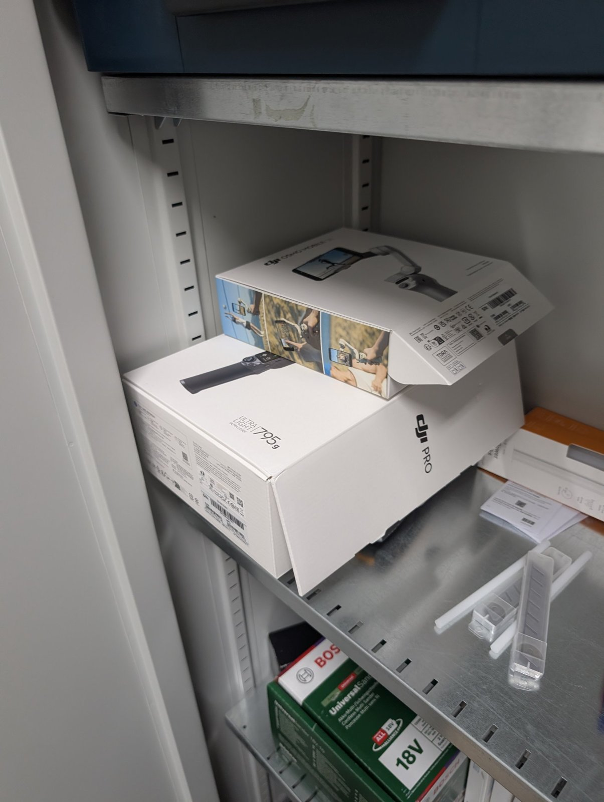
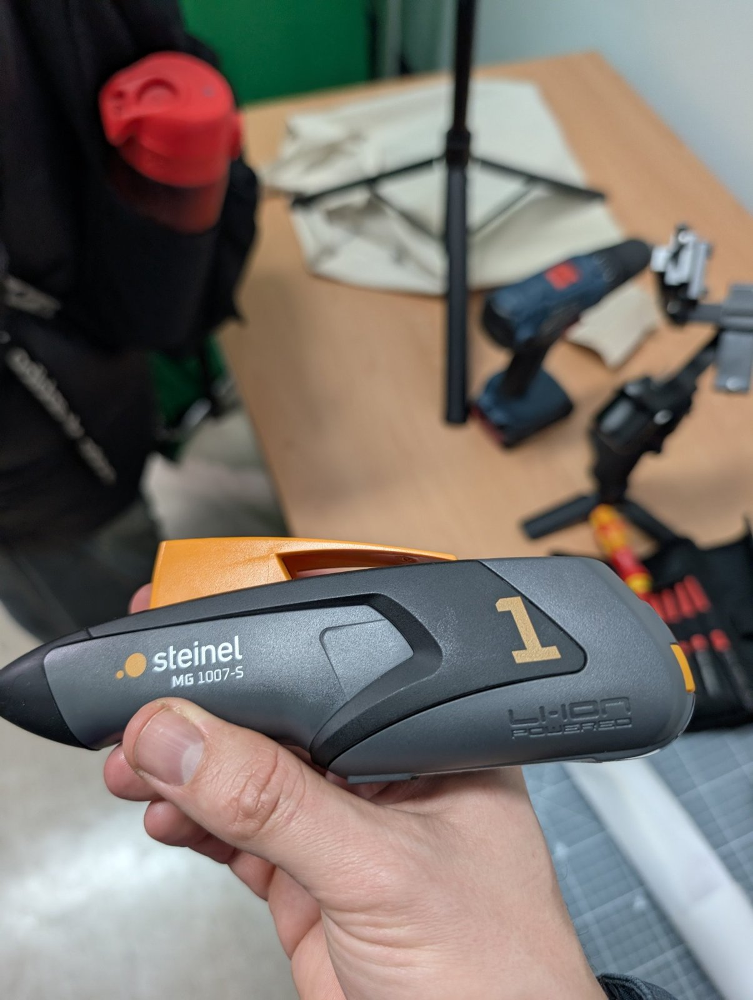

Beim Tag der offenen Tür 2025 war Falko im [Makespace Tiergarten]({{ '/projekte/makespace-tiergarten/' | relative_url }}) von [Frieder]({{ '/team/frieder-euteneuer/' | relative_url }}) in Raum 226 zu Besuch. Es gab Waffeln, und im Studio lief vor dem Greenscreen ein Wetterbericht.

{: .gallery}

Fotos: Falko Richter

