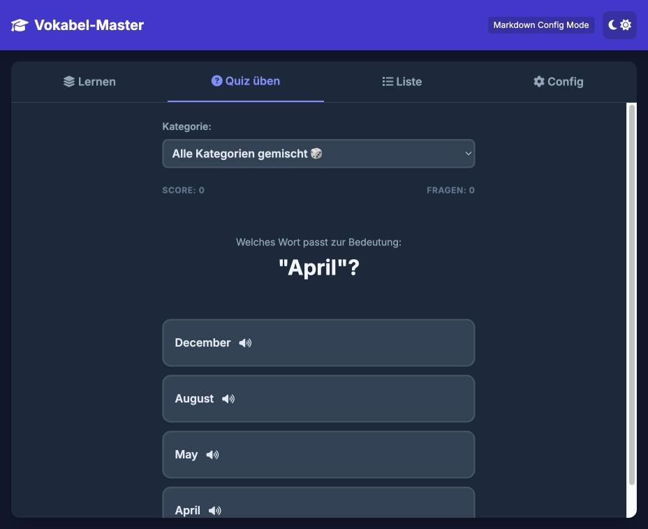

Falko hat zum Vokabellernen einen kleinen **Vokabeltrainer im Browser** gebaut, fast komplett mit KI: Jeder Wunsch kam als kurzes GitHub-Issue („swipe“, „Dark Mode für alle html seiten“, „Quiz within category“), daraus hat der **GitHub Copilot Coding Agent** einen Pull Request gemacht, und Falko hat geprüft und gemergt. Angefangen hat es am 17. Dezember 2025, seitdem sind in knapp vier Wochen 18 Pull Requests zusammengekommen.

{: .gallery}

Was der Trainer kann:

- **Lernen** mit Karteikarten zum Umdrehen und Wischen, nach Kategorie oder gemischt
- **Quiz** mit vier Antworten – die falschen kommen aus derselben Kategorie, damit es nicht zu leicht wird
- **Vorlesen** auf Englisch, Französisch und Spanisch, direkt im Browser ohne Anmeldung
- **Eigene Listen** als einfaches Markdown (`- Wort : Bedeutung`), mit Fehlerprüfung, und **per Link teilen**
- Eine fertige Liste mit 142 englischen Wörtern in 12 Kategorien: Körper, Essen, Getränke, Zuhause, Wochentage, Monate …

Alles läuft als einfache Seite auf GitHub Pages, die Vokabeln bleiben im eigenen Browser. Ohne Cookies. Ohne Tracking. Komplett Datenschutzneutral. Man kann Daten nur per Link verschicken, das Tool kann keine Daten speichern.

- Ausprobieren: [Vokabeltrainer](https://falkorichter.github.io/learning-with-ai/english/with-config.html)
- Quellcode (Apache 2.0): [github.com/falkorichter/learning-with-ai](https://github.com/falkorichter/learning-with-ai)
