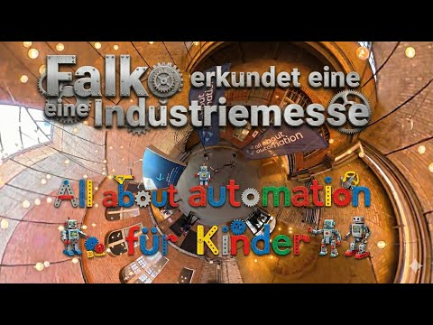

<a class="video-link" href="https://www.youtube.com/watch?v=eHz2jel4Lr8" target="_blank" rel="noopener">
  
  ▶ Video auf YouTube ansehen
</a>

Kurzer Messerundgang von Falko von 35services, ich besuche Aussteller die auch für unsere „3D-Druck und CAD AG“ an der KTG in Moabit interessant sein könnten. Natürlich auch spannend für alle anderen 🙂

❤️ Lasst uns den Nachwuchs für die Industrie inspirieren! ❤️ 
💶 Spenden unter [https://35services.de/ag/](https://35services.de/ag/) 💶 
✉️ falko[ät]35services[punkt]de ✉️

🏭 Firmenliste: 🏭

- <https://www.druckerfachmann.de/>
- <https://de.dobot-robots.com/>
- <https://www.conrad.de/>
- <https://ero-botics.com/>
- <https://www.adolf-neuendorf.eu/>
- <https://www.kollmorgen.com/>
- <https://www.herzberg-rollen.de/>
- <https://endless.industries/>

Linkedin Post mit Kontakt zu den tollen Interview Partnern [https://www.linkedin.com/feed/update/urn:li:activity:7422911264303247363/](https://www.linkedin.com/feed/update/urn:li:activity:7422911264303247363/)

🎥🤳🏾 Technik: 🎥🤳🏾 Osmo 360, Osmo Pocket 4, DJI Mini Mini / DJI mic 3, Osmo 1,6 m Stativ Selfie-Stick

🧠 Zusammenfassung: 🧠 Falko beleuchtet die All About Automation-Messe, die sich auf Robotik und Automatisierung in der Industrie fokussiert. Es werden innovative Technologien vorgestellt, beginnend mit einem selektiven Lasersinter (SLS) Drucksystem, das funktionale Teile mit glatten Oberflächen herstellt. Ein Resin-Drucker wird präsentiert, der Kunstharz durch Licht härtet und hohe Detailgenauigkeit bietet. Außerdem wird ein Unternehmen vorgestellt, das benutzerfreundliche Roboter programmiert, inklusive einer visuellen Plattform für Jugendliche. Educational Robotertechnik bei Conrad mit Fischer-Kits und ein autonomes Transportsystem werden ebenfalls thematisiert. Die Wichtigkeit von 3D-Druck und der innovative Prusa-Drucker, der widerstandsfähige Drucke aus Kohlenstofffasern erzeugt, runden das Gespräch ab. Die Messe wird als ein Ort für den Austausch über neue Entwicklungen hervorgehoben, insbesondere im Hinblick auf die Zugänglichkeit von Technologie für die jüngere Generation.

🚨 Disclaimer: 🚨 Titelbild ist mit Gemini illustriert, Zusammenfassung und Untertitel sind mit Auphonic Whisper ASR generiert
