wir haben uns getroffen und mal ein bisschen experimentiert mit unseren 3-D Druckern

<video class="post-video" controls preload="none" playsinline poster="/assets/video/news/3d-druck-experimente/01.jpg" src="/assets/video/news/3d-druck-experimente/01.mp4"></video>

- Nicht-planarer Druck – wir haben eine STL Datei gefunden, bei der die Schichten nicht immer auf der gleichen Z Ebene sind. Das hat sehr gut funktioniert, bis dann die Differenz in Z zu groß wurde und der Kopf das Objekt weggeschoben hat.
- TPU – wir haben verschiedene TPU Filament getestet, unter anderem ein sich aufschäumendes Filament. TPU ist ein gummiartiges, weiches Filament.
- Falko hat einen Drucker, der eine 0,4 mm große Düse hat, vorgegaukelt er hätte eine Zwanzig Millimeter große Düse und müsse mit 6 mm Schichtdicke drucken. Das war sehr lustig und hat erstaunlicherweise sogar funktioniert. Die Lüftung muss dafür abgeschaltet sein. Dann sprudelt lustig Filament aus der kleinen Düse und wirst zu einer lustigen Wurst, die dann sogar den Plan entsprechend eine Form ergibt.

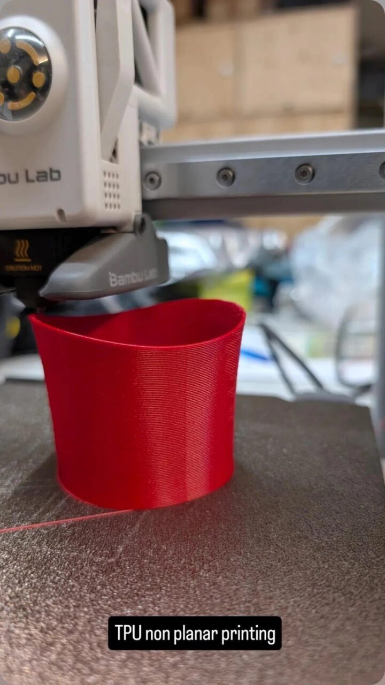
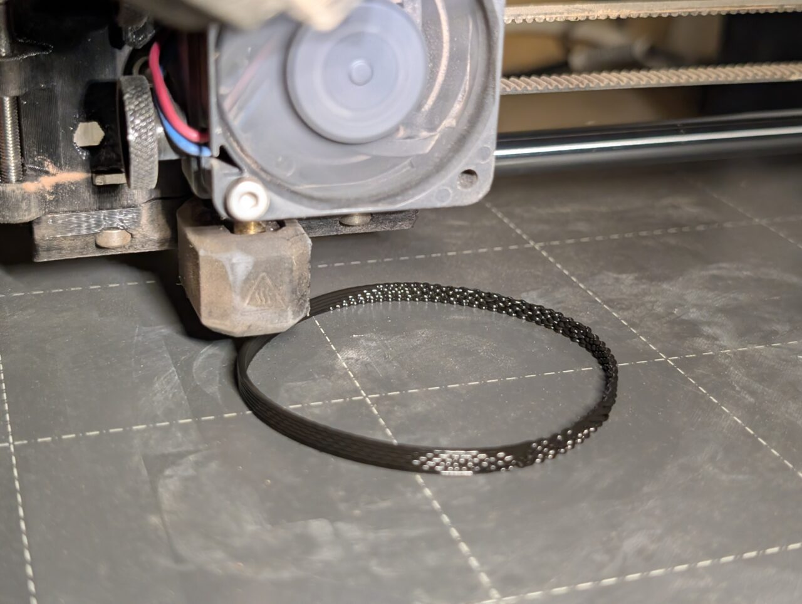
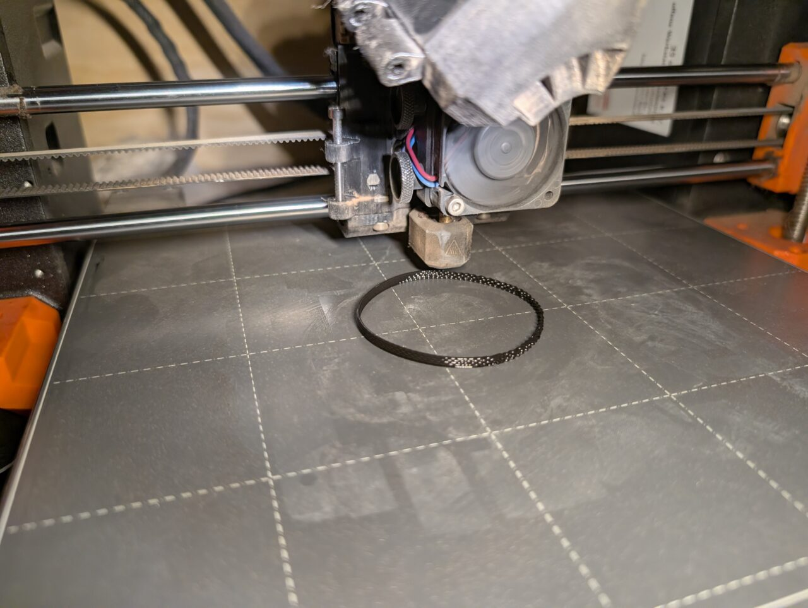
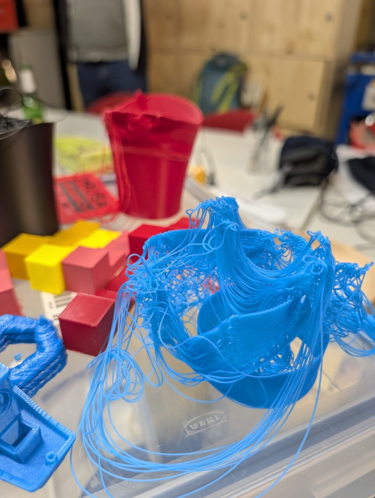
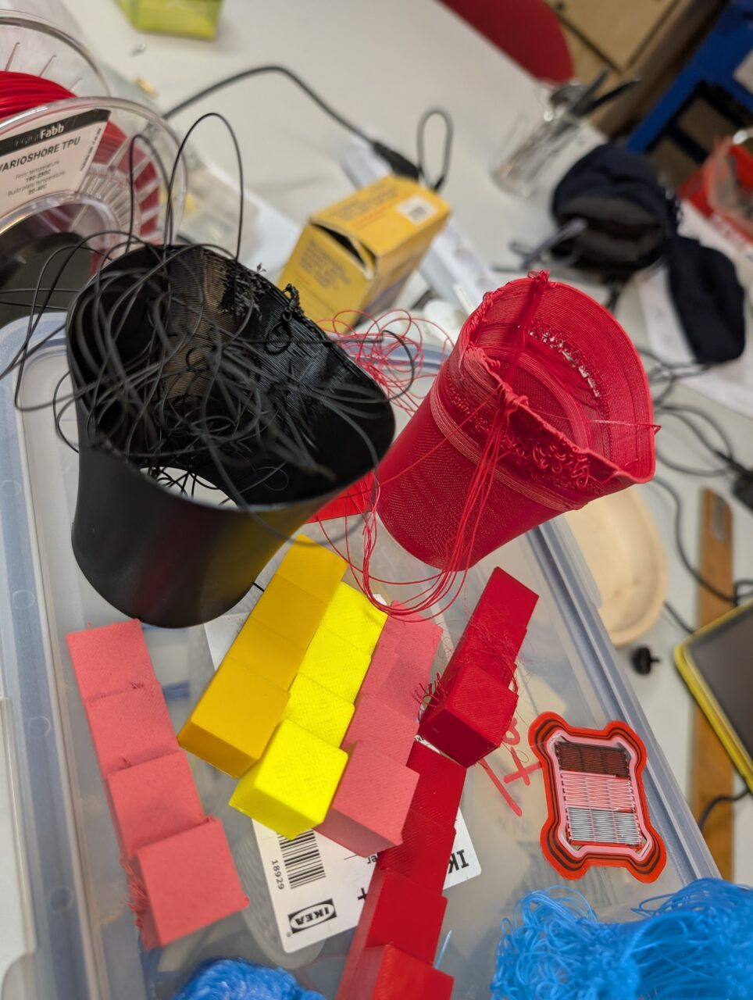
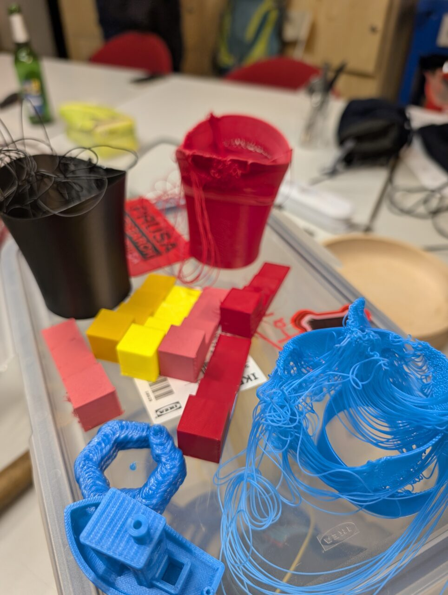
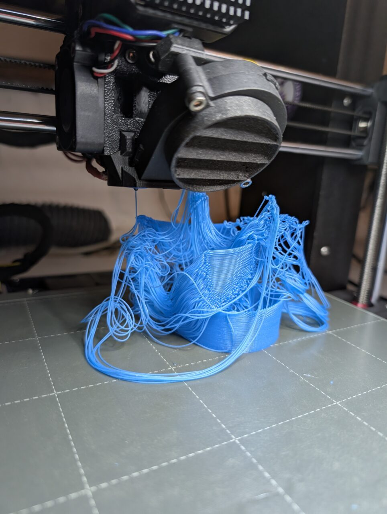
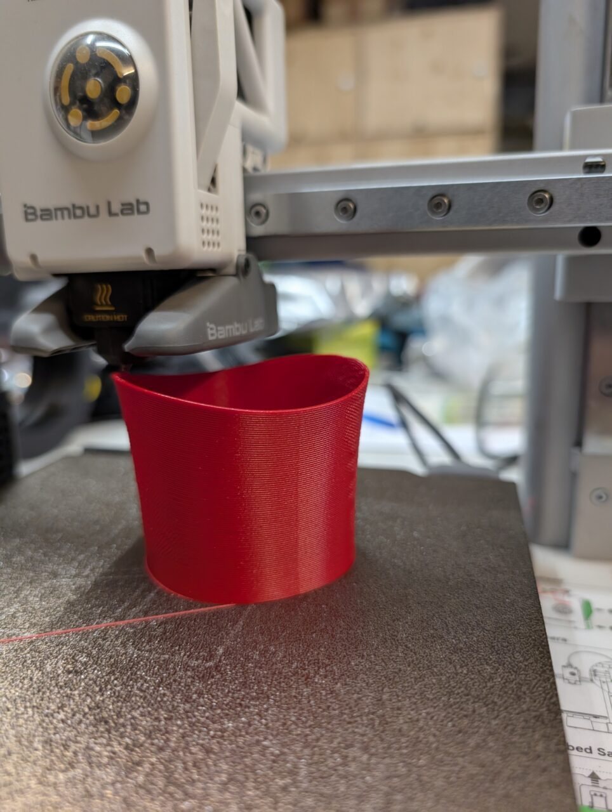
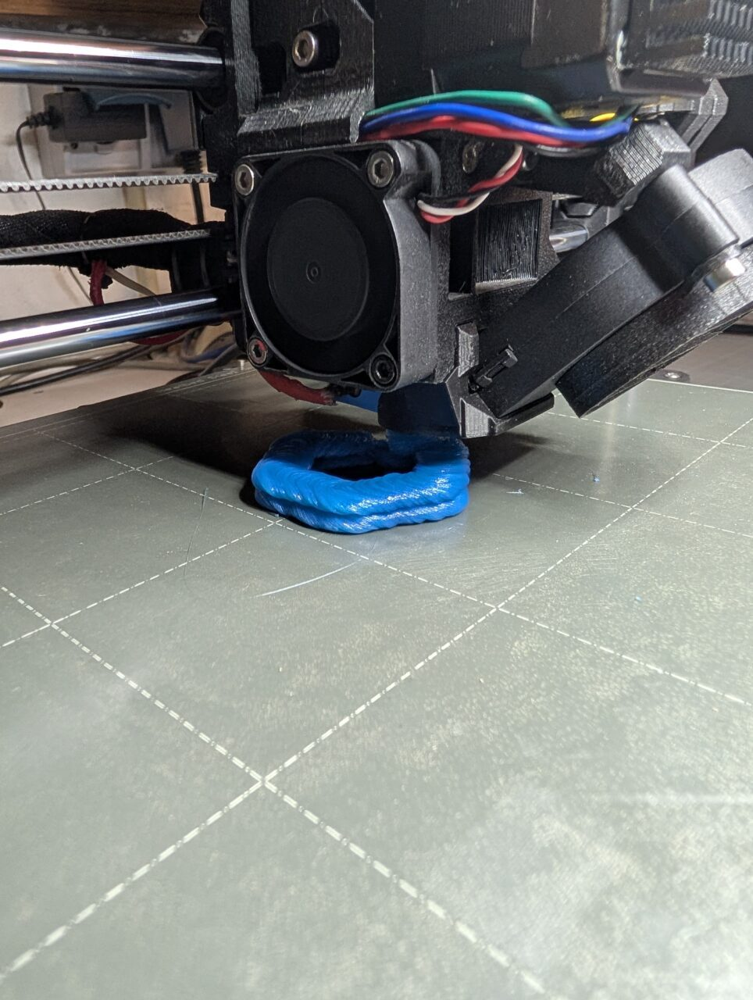
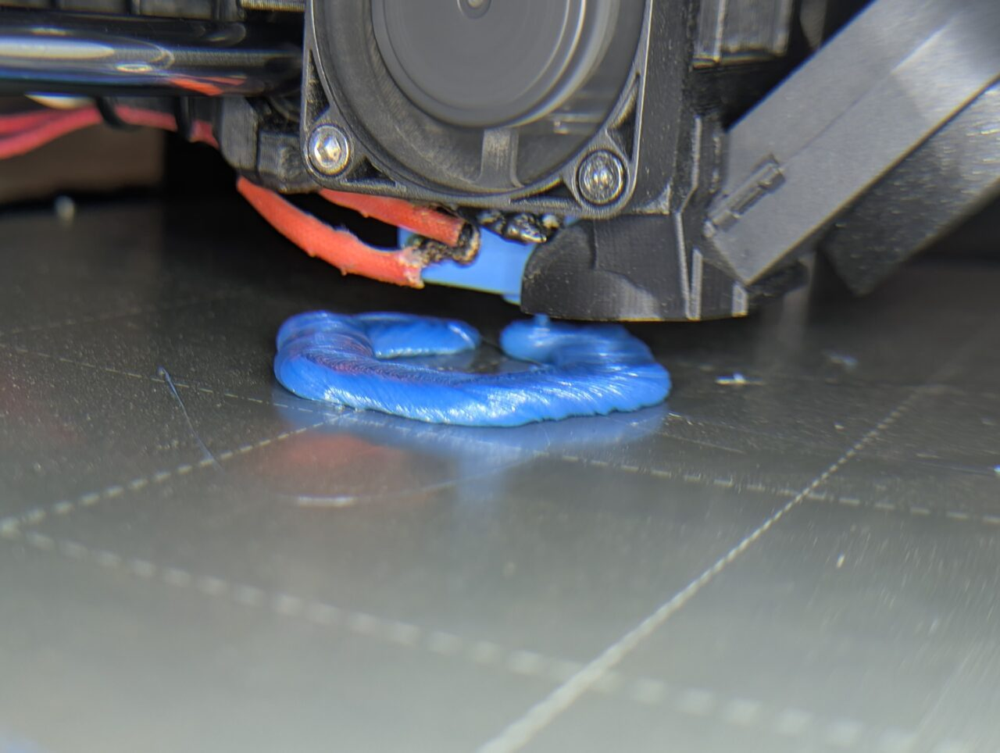
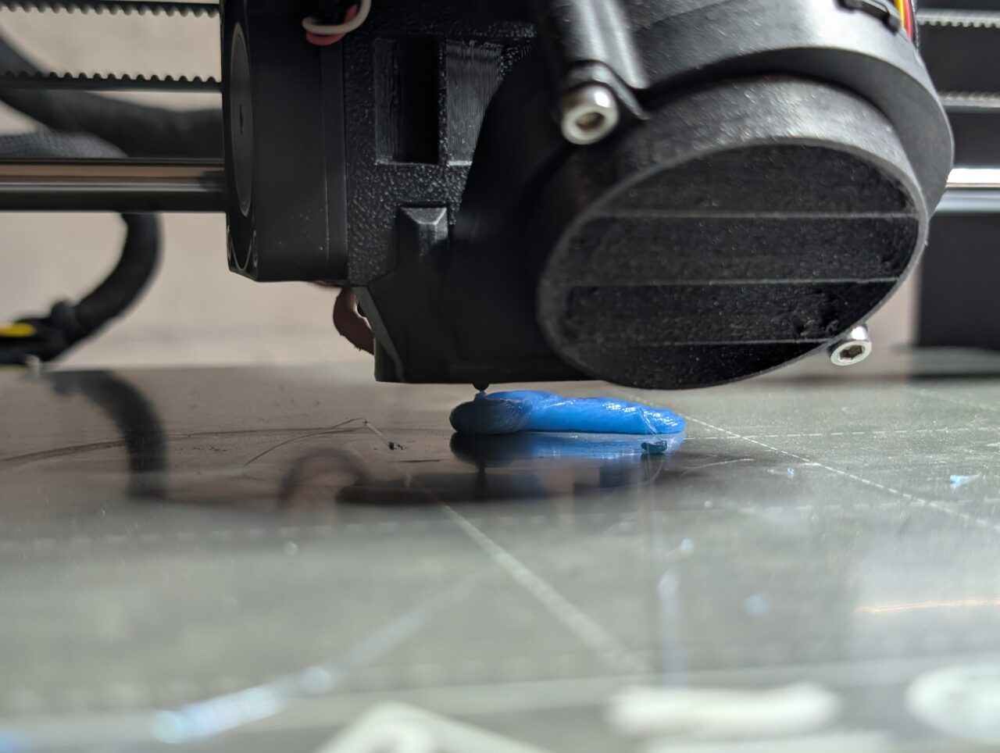
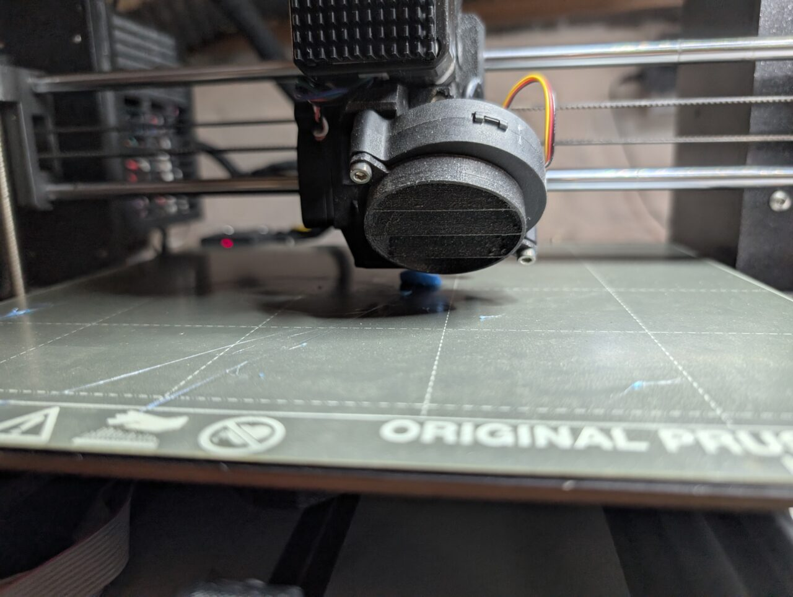
{: .gallery}

<video class="post-video" controls preload="none" playsinline poster="/assets/video/news/3d-druck-experimente/02.jpg" src="/assets/video/news/3d-druck-experimente/02.mp4"></video>

<video class="post-video" controls preload="none" playsinline poster="/assets/video/news/3d-druck-experimente/03.jpg" src="/assets/video/news/3d-druck-experimente/03.mp4"></video>

<video class="post-video" controls preload="none" playsinline poster="/assets/video/news/3d-druck-experimente/04.jpg" src="/assets/video/news/3d-druck-experimente/04.mp4"></video>

<video class="post-video" controls preload="none" playsinline poster="/assets/video/news/3d-druck-experimente/05.jpg" src="/assets/video/news/3d-druck-experimente/05.mp4"></video>
