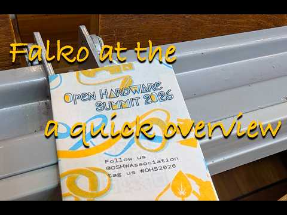

Wir haben die Ankündigung für dieses Event vorbeifliegen sehen. Falko und Anton waren dort und haben erst so richtig vor Ort gemerkt wie prominent das Event ist. Letztes Jahr noch in Edinburgh, vorher Toronto. Der Open Hardware Summit ist jedes Jahr in einem anderen Land und war jetzt direkt nebenan im Mathegebäude der TU Berlin.

<a class="video-link" href="https://www.youtube.com/watch?v=9H0Zhv0ZLKw" target="_blank" rel="noopener">
  
  ▶ Video auf YouTube ansehen
</a>

danke an [OSHWA](https://oshwa.org/) für die Organisation !
