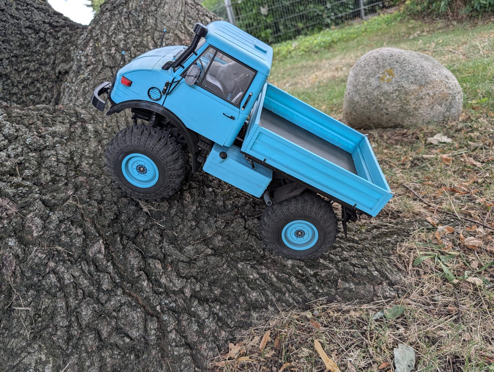
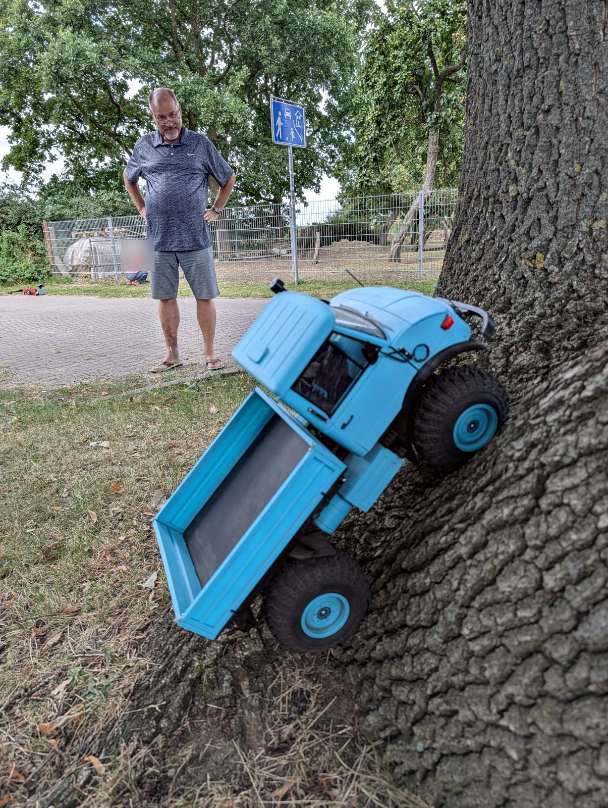
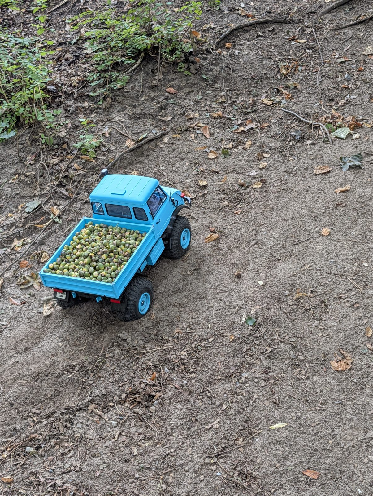
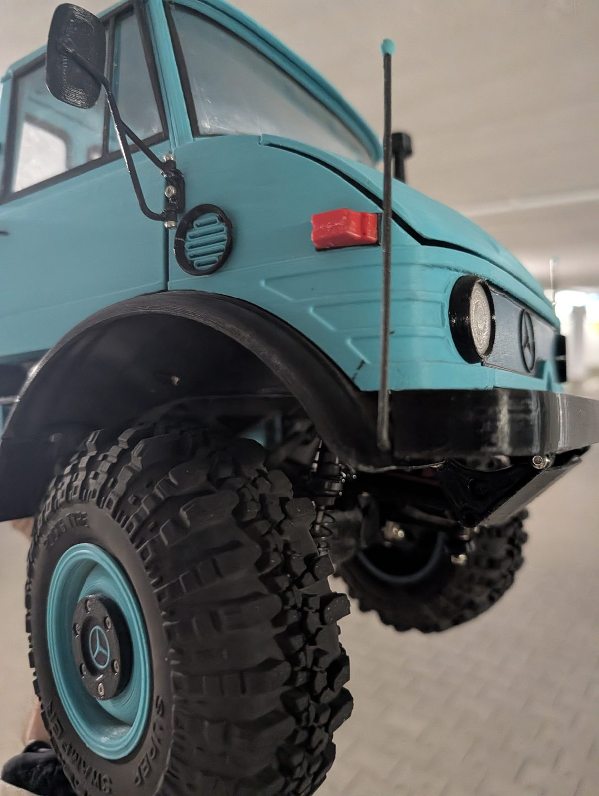
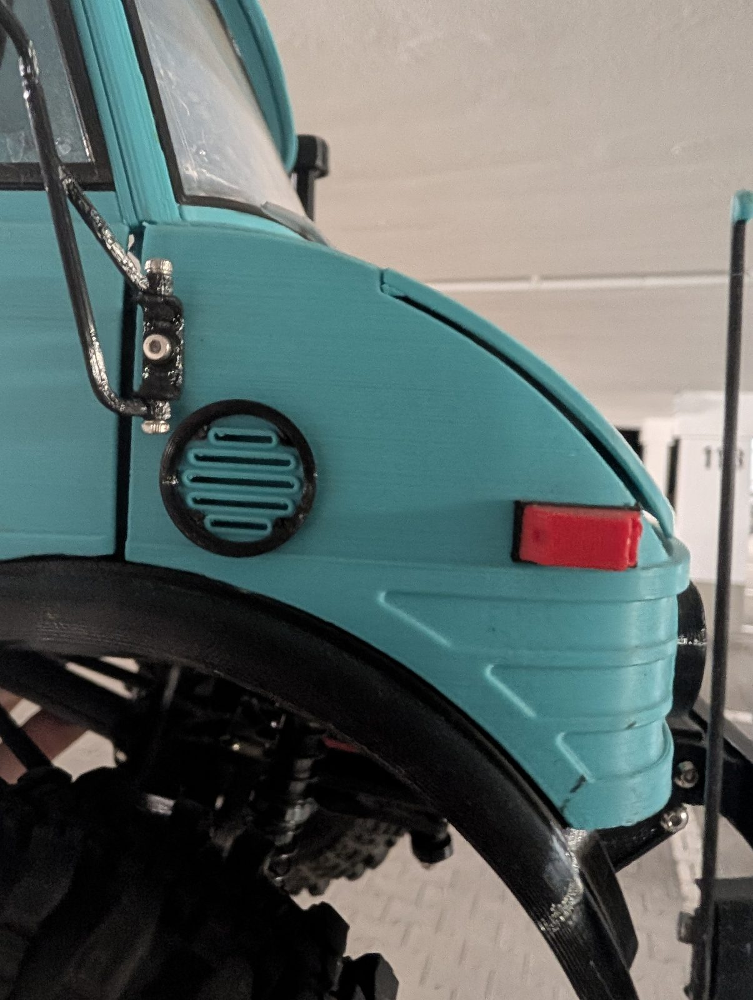
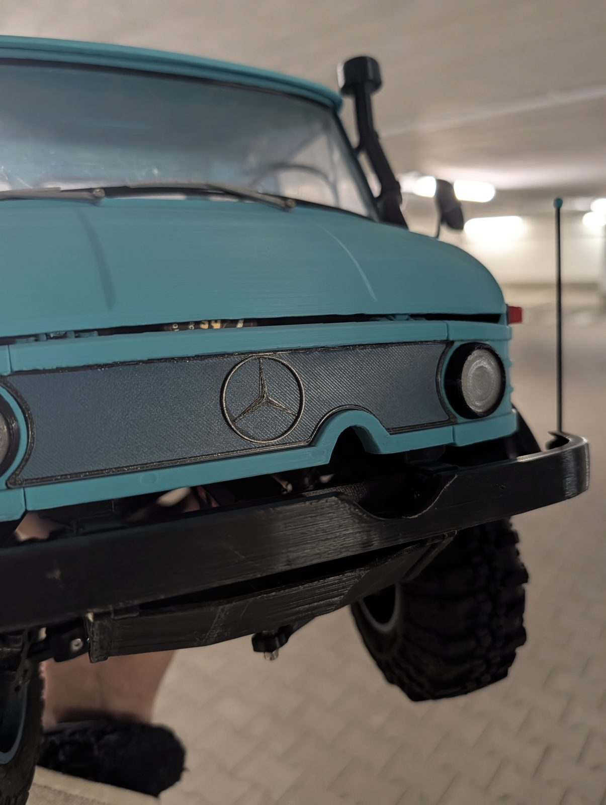

Fertig gebaut und in den Sommerferien 2026 ausgiebig gefahren: Papas Mogster in Hellblau klettert über Baumwurzeln, fährt Sandhügel hoch und transportiert sogar eine ganze Ladung Nüsse.

{: .gallery}

<video class="post-video" controls preload="none" playsinline poster="/assets/video/news/papas-mogster-rollt/01.jpg" src="/assets/video/news/papas-mogster-rollt/01.mp4"></video>
