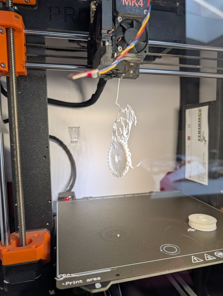
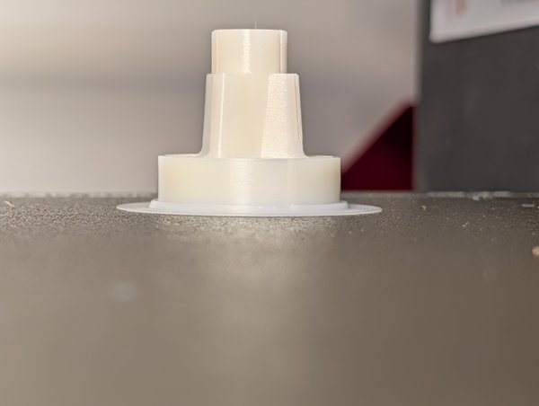
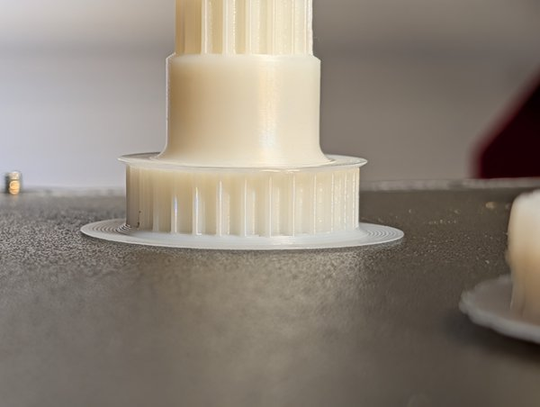

Erste Drucke für das Teilprojekt [PC-Blend drucken]({{ '/projekte/mogster-pc-blend-drucken/' | relative_url }}) am Mogster. Nicht jeder Versuch hat geklappt – aber die Zahnräder sehen gut aus. Eine Erklärung folgt.

  
  
  
  
  

