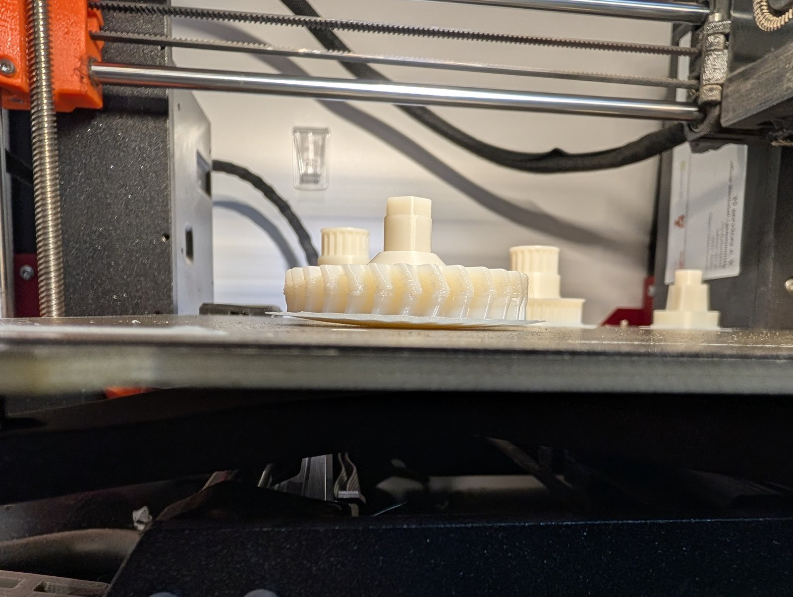
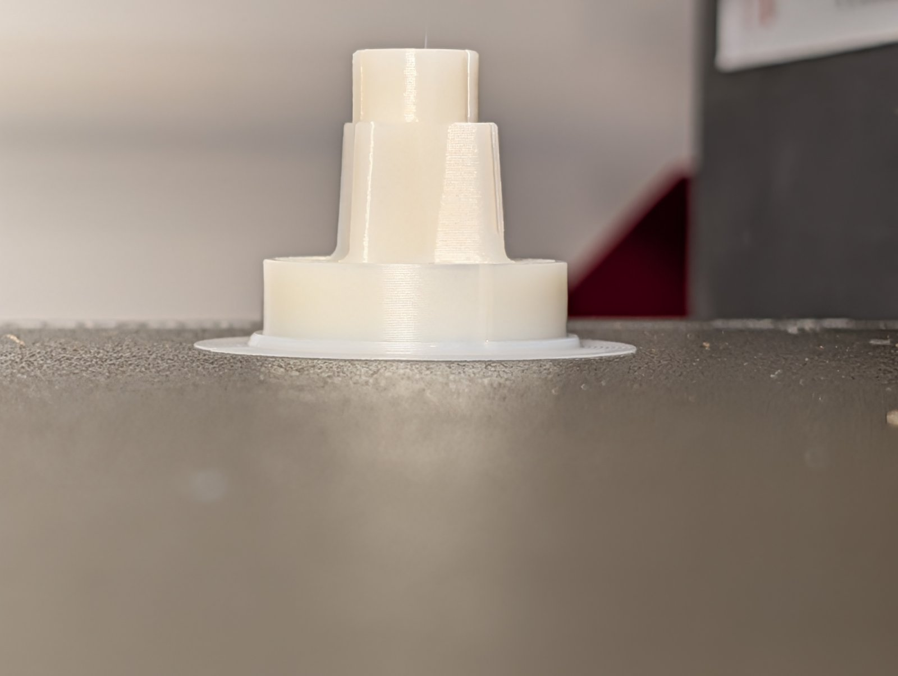
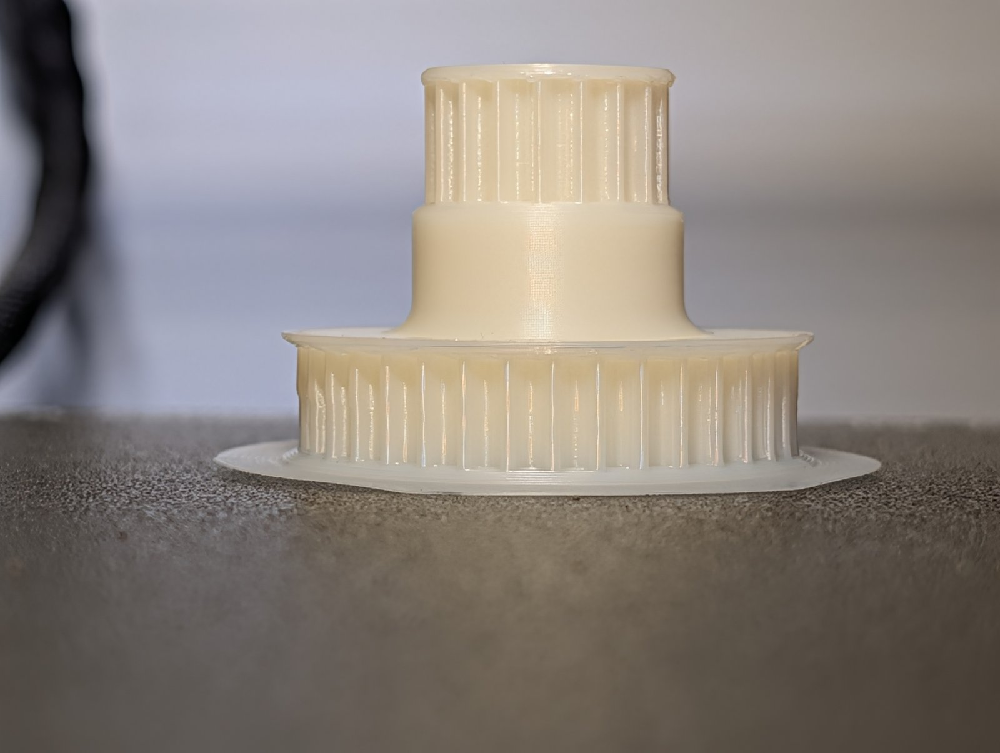
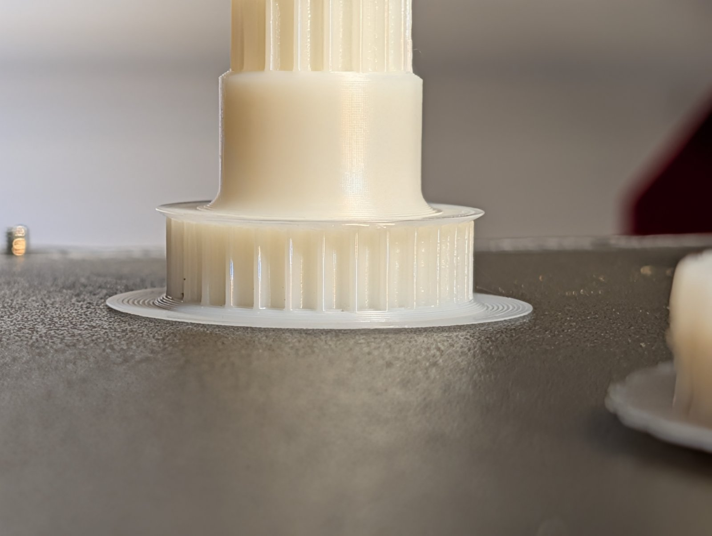

Erste Drucke für das Teilprojekt [PC-Blend drucken]({{ '/projekte/mogster-pc-blend-drucken/' | relative_url }}) am Mogster. Nicht jeder Versuch hat geklappt – aber die Zahnräder sehen gut aus.

PC-Blend ist schwierig zu drucken. Vielleicht ist das Filament schon sehr alt – getrocknet haben wir es aber. Der Druckraum in der IKEA-Kiste war eigentlich ganz gut aufgeheizt. Als Nächstes testen wir ein **Satin-Druckbett**, das Falko gekauft hat.

{: .gallery}
