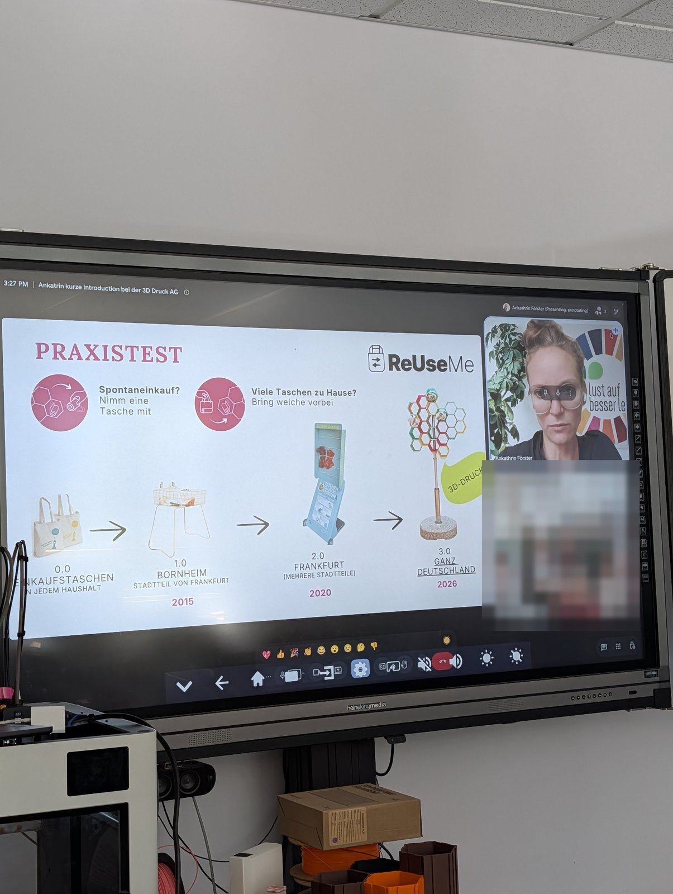
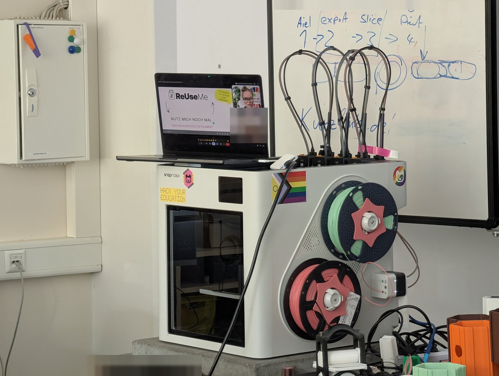

In der [3D-Druck AG an der KTG]({{ '/projekte/3d-druck-ag-ktg/' | relative_url }}) gab es Besuch per Videocall: **ReUseMe** hat den Kindern die [Taschen-Tausch-Station]({{ '/partner/taschenstation/' | relative_url }}) vorgestellt. Die Idee: Wer zu viele Einkaufstaschen hat, bringt welche vorbei – wer spontan eine braucht, nimmt sich eine mit. Angefangen hat das Projekt 2015 in Frankfurt-Bornheim, 2020 kamen mehrere Frankfurter Stadtteile dazu, und 2026 soll es mit Stationen aus dem 3D-Drucker in ganz Deutschland weitergehen.

Die Station ist Open Source – wir wollen mit den AGs weitere Taschenstationen in Berlin verteilen.

{: .gallery}
