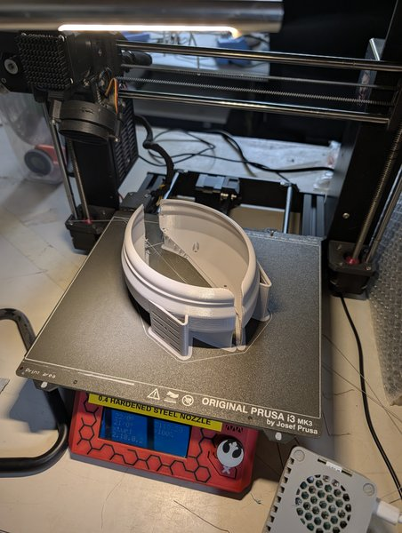
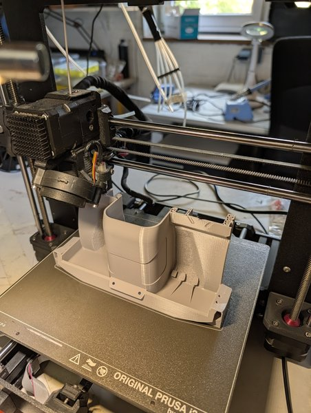

Für den [Mogster]({{ '/projekte/3dsets-mogster-bauen/' | relative_url }}) laufen die Drucker: Auf dem [Prusa MK3S (xHain)]({{ '/ausstattung/prusa-mk3s-xhain/' | relative_url }}) mit gehärteter 0,4-mm-Stahldüse entstehen die großen Teile.

  
  

