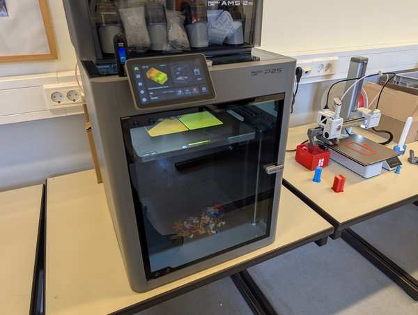
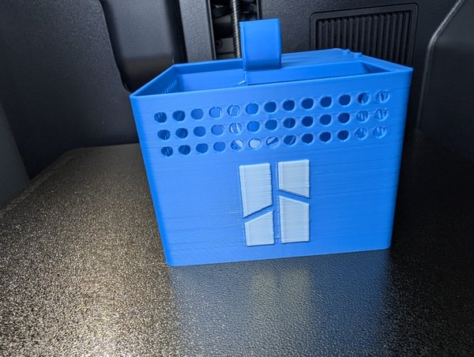
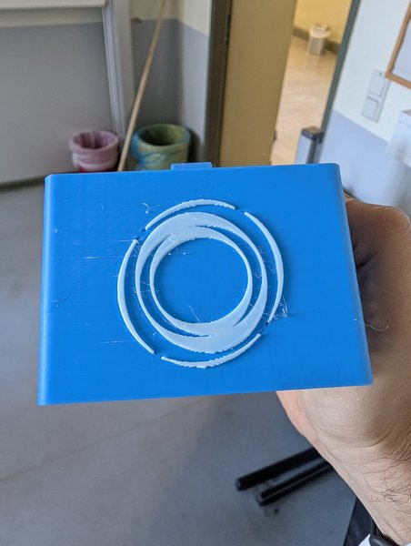

Ein erster Blick in den neuen Makespace am [Rosalind-Franklin-Gymnasium]({{ '/projekte/3d-druck-ag-rosalind-franklin-gymnasium/' | relative_url }}): zwei Bambu Lab P2S mit AMS-Filamentwechsler und vier Bambu Lab A1 mini an langen Tischreihen ([alle sechs Drucker]({{ '/ausstattung/drucker-rosalind-franklin-gymnasium/' | relative_url }})) – und die ersten Drucke sind auch schon fertig.

  
  
  

<video class="post-video" controls preload="none" playsinline poster="/assets/video/news/makespace-rosalind-franklin-gymnasium/01.jpg" src="/assets/video/news/makespace-rosalind-franklin-gymnasium/01.mp4"></video>
