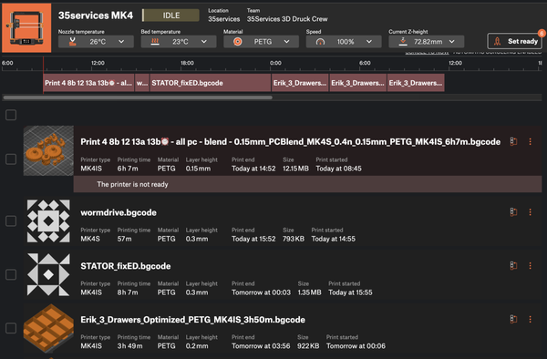
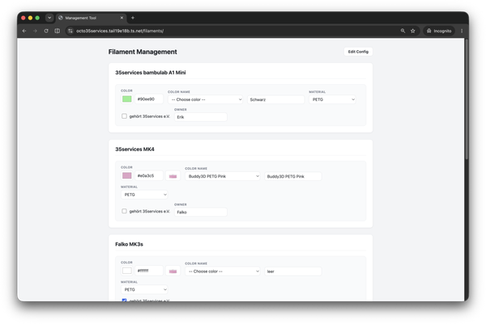
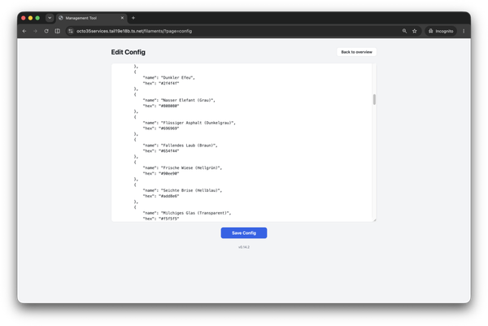
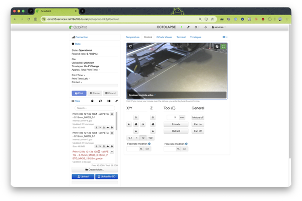
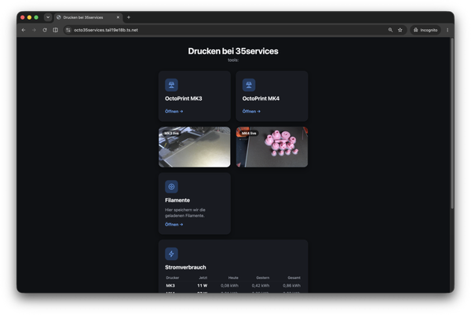

Wir haben seit einigen Jahren einen Prusa Mk4 Drucker und auch einen Bambulab A1 Mini. Neben der [AG an der KTG](https://35services.de/2024/diy-eine-3d-druck-und-elektronik-ag-an-der-ktg/) bieten auch unter *3ddruck [at] 35services [punkt] de* Beratung für eure 3D-Druck Projekte an. Bei Bedarf drucken wir auch mit dem SnapMaker U1 in der KTG, der Drucker hat 4 Druckköpfe und ist extrem gut im Mehrfarbdruck.

Die Infrastruktur um den Prusa Drucker gemeinsam zu nutzen ist schon sehr gut von Prusa gelöst, der Drucker ist in einem Team und Mitglieder können so Fernzugriff auf den Drucker bekommen. Mit der MMU (Multi-Material-Unit) können wir 5 Filamente bereit halten und so verschiedene Druckaufträge mit Materialen der Mitglieder oder mit Material aus dem Verein flexibel verwalten und die Warteschlage füllen. Wir wollen aber mehr.

  

**1. Ein einfaches tool um die Filamente zu verwalten, unabhähngig vom Drucker:**

Das gibt es open source: [https://github.com/35services/3d-printing-simple-filament-tool](https://github.com/35services/3d-printing-simple-filament-tool) und funktioniert ganz gut. Die Filamente kann man direkt pflegen und nach dem Einkauf hinzufügen. Einige Prusa Filamente mit Vorschaubild sind schon hinterlegt.

  
  

**2. Live Stream und Flexibilität** – octoprint

Mit einem Raspberry Pi haben wir 2 Drucker und 2 webcams (es gehen auch mehr, USB-Hub) im Lokalen Netzwerk erreichbar gemacht. Das Setup ist unter [github.com/35services/3d-printing-octoprint](https://github.com/35services/3d-printing-octoprint) dokumentiert. *falko [at] 35services [punkt] de* hilft euch gerne, wenn ihr auch so etwas bauen wollt.

  

**3. Erreichbarkeit und Dashboard**

Unter [https://github.com/35services/3d-printing-proxy](https://github.com/35services/3d-printing-proxy) sehr ihr unser Setup für ein einfaches Dashboard und damit das System was alles zusammenbringt. Bisher lief alles lokal in der Werkstatt und war nur im lokalen WLAN einzeln erreichbar.

Mit [Tailscale](https://tailscale.com/) als kostenloses, open source basiertes, peer-to-peer VPN kann man jetzt alle Dienste auch außerhalb der Werkstatt erreichen.

Als Bonus haben wir unsere [Tasmota Nous](https://nous.technology/product/a1t/de.html) Steckdosen auch sichtbar gemacht und können so sehen, was die Drucker und Filament Trockner so an Strom verbrauchen. Das soll zum Spenden motivieren.

  

Falko hat versucht das ganze so aufzusetzen, dass man es modular ist auch in anderen Werkstätten aufsetzen kann. Meldet euch gerne bei *falko [at] 35services [punkt] de* oder via Matrix: [https://offene-werkstaetten.org/users/profile/5532](https://offene-werkstaetten.org/users/profile/5532) bei Falko.
