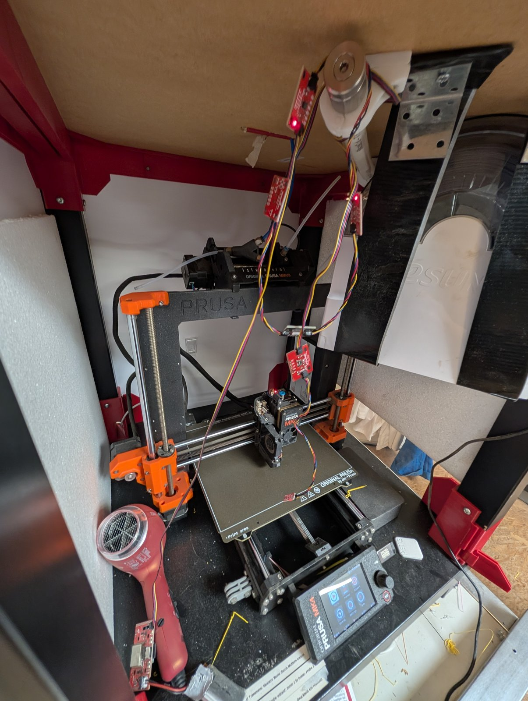
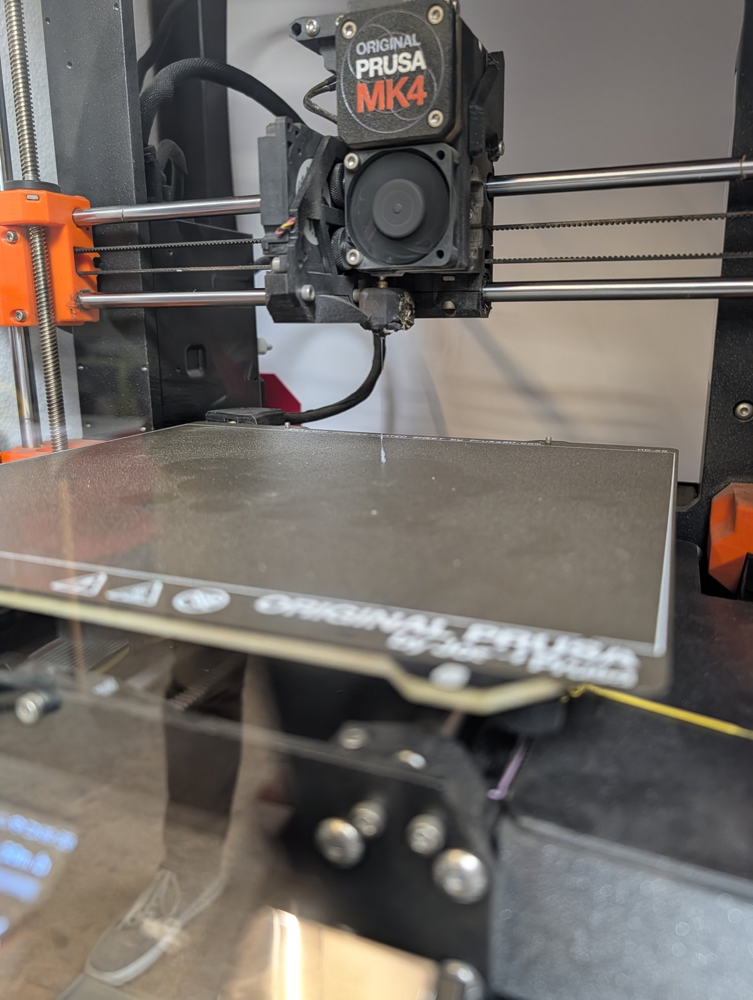
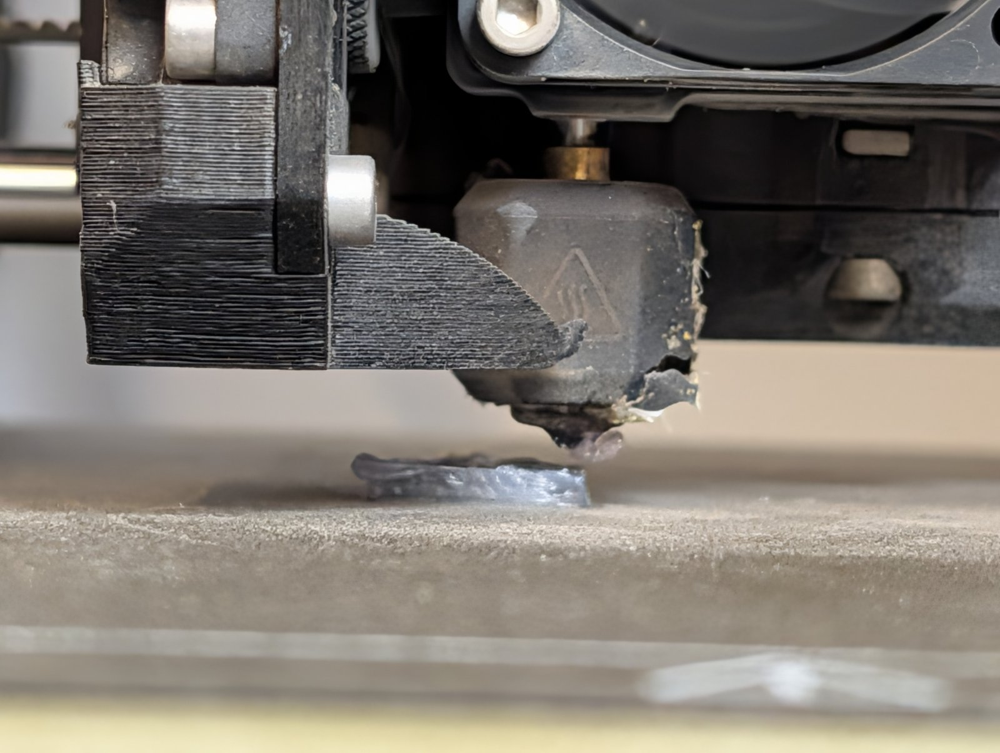
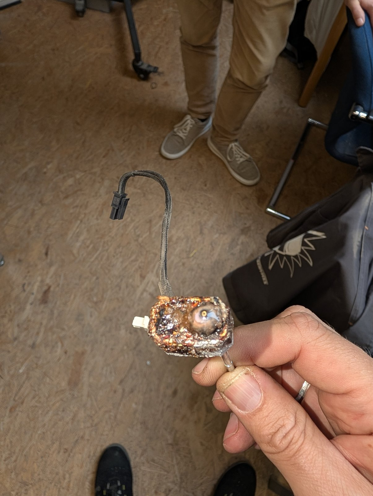

Die ersten Versuche für das Projekt [Moldlay drucken]({{ '/projekte/moldlay-drucken/' | relative_url }}) von Falko und Philipp auf einem Prusa MK4. Die Fotos zeigen auch einen ausgebauten Heizblock voller verbranntem Filament – und wie er nach dem Reinigen aussah.

Moldlay ist **extrem brüchig**. Mit einem Föhn haben wir versucht, das Filament geschmeidiger zu bekommen – geholfen hat es nur wenig. Nächste Schritte: einen anderen Drucker oder **2,85-mm-Filament** ausprobieren.

{: .gallery}
