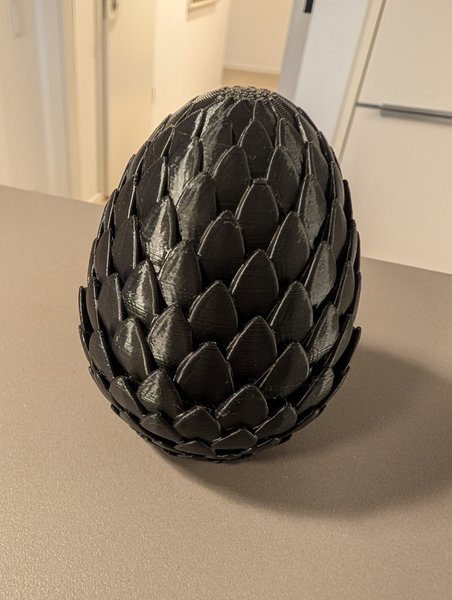
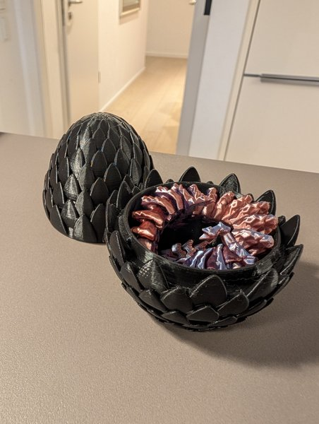

Für die [3D-Druck AG an der KTG]({{ '/projekte/3d-druck-ag-ktg/' | relative_url }}) haben wir **Drachen und Eier** gedruckt: Ein schwarzes Ei mit Schuppen lässt sich öffnen – und darin liegt zusammengerollt ein beweglicher Drache aus schimmerndem Filament.

  
  

<video class="post-video" controls preload="none" playsinline poster="/assets/video/news/dracheneier-drucken/01.jpg" src="/assets/video/news/dracheneier-drucken/01.mp4"></video>
