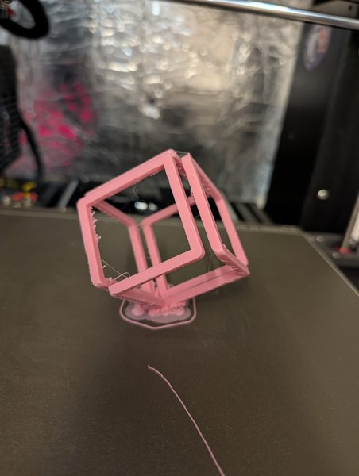

Aus der [3D-Druck AG an der Platanus Schule]({{ '/projekte/3d-druck-ag-platanus-schule/' | relative_url }}): ein rosa [Infinite Cube](https://makerworld.com/en/models/909738-infinite-cube) von MakerWorld, auf eine Ecke gestellt gedruckt. Daran lernen wir, wie man **Stützstrukturen** baut – und wie gut der Drucker Überhänge schafft.

Das Gleiche machen wir gerade auch am [Rosalind-Franklin-Gymnasium]({{ '/news/2026/10/06/wuerfel-mit-baumstuetzen-am-rosalind-franklin-gymnasium/' | relative_url }}) – zwei Schulen, ein Würfel :)

Falko hat inzwischen eine [Referenz gedruckt]({{ '/news/2026/11/03/ein-infinite-cube-als-referenz/' | relative_url }}), mit der die AGs ihre Würfel vergleichen können.

  

