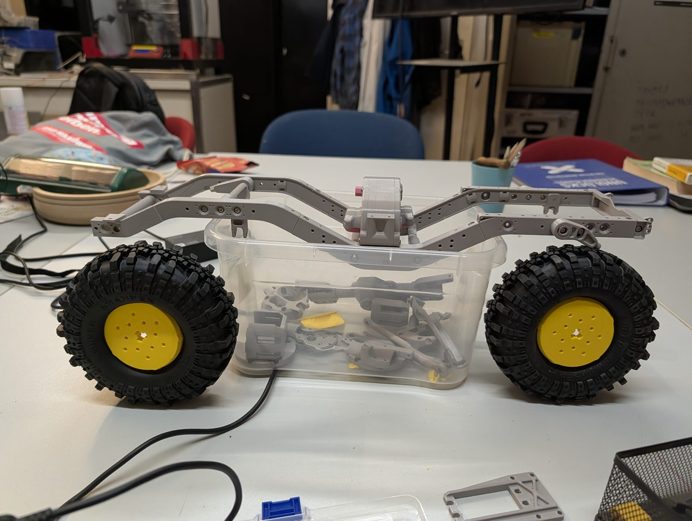
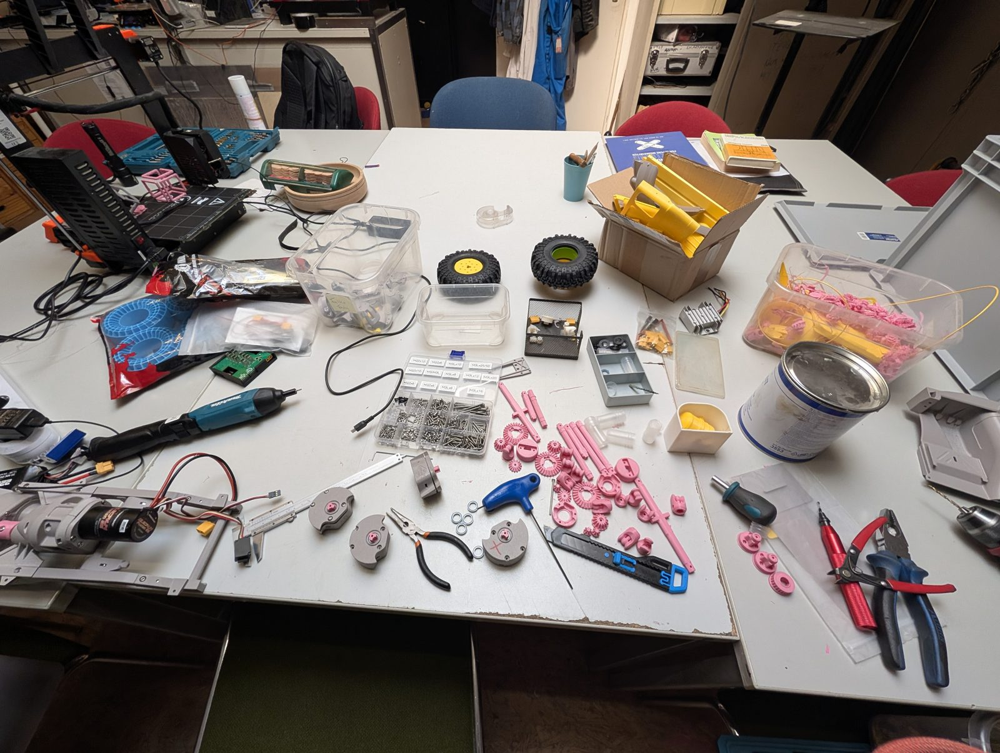
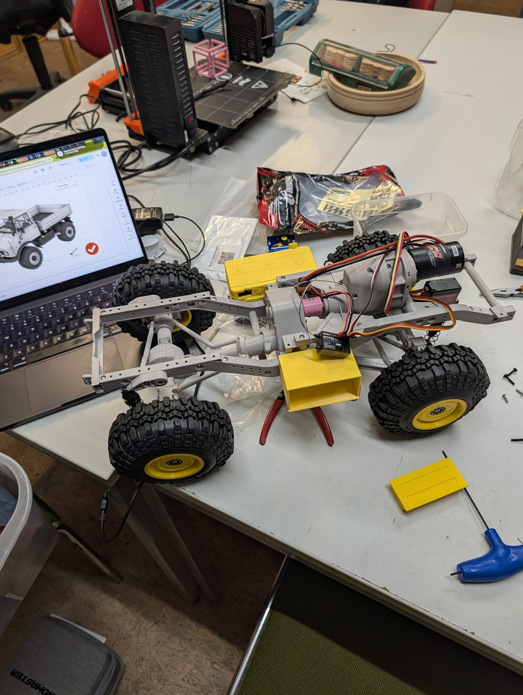
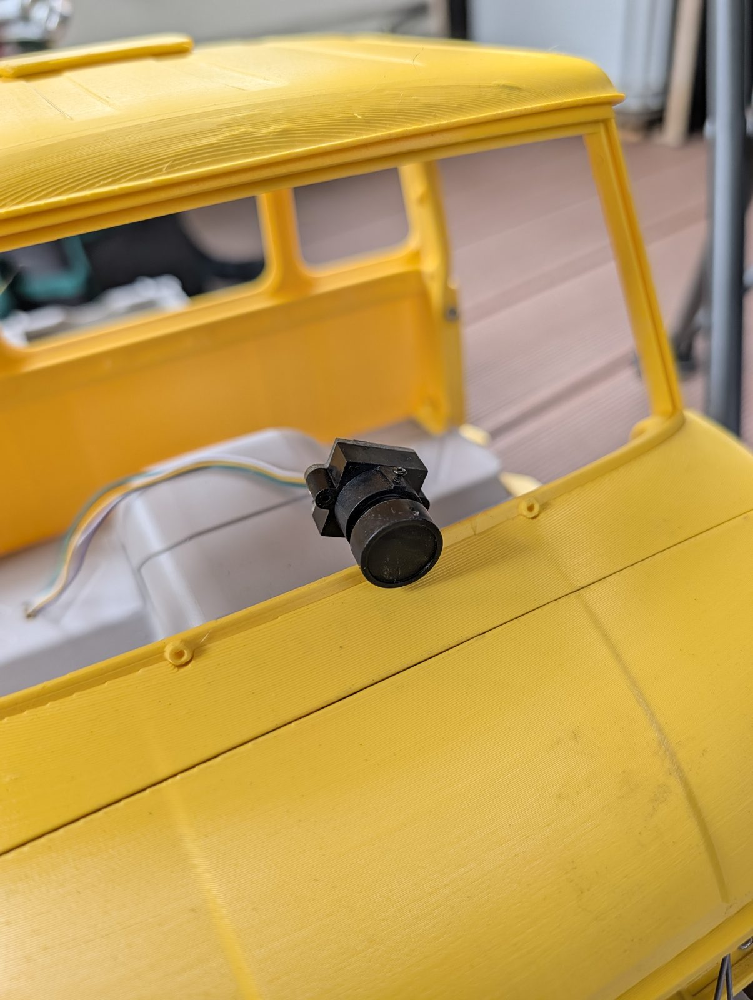
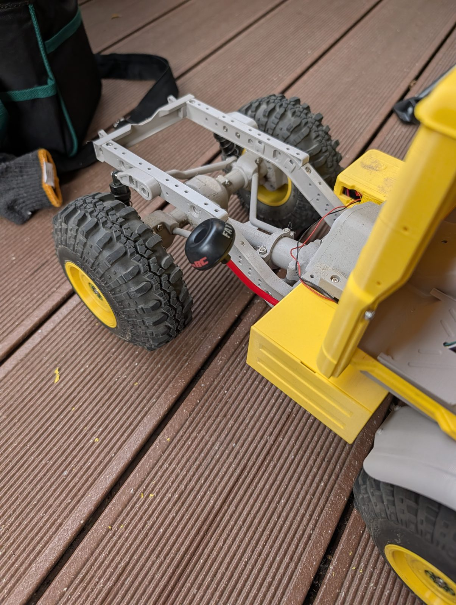
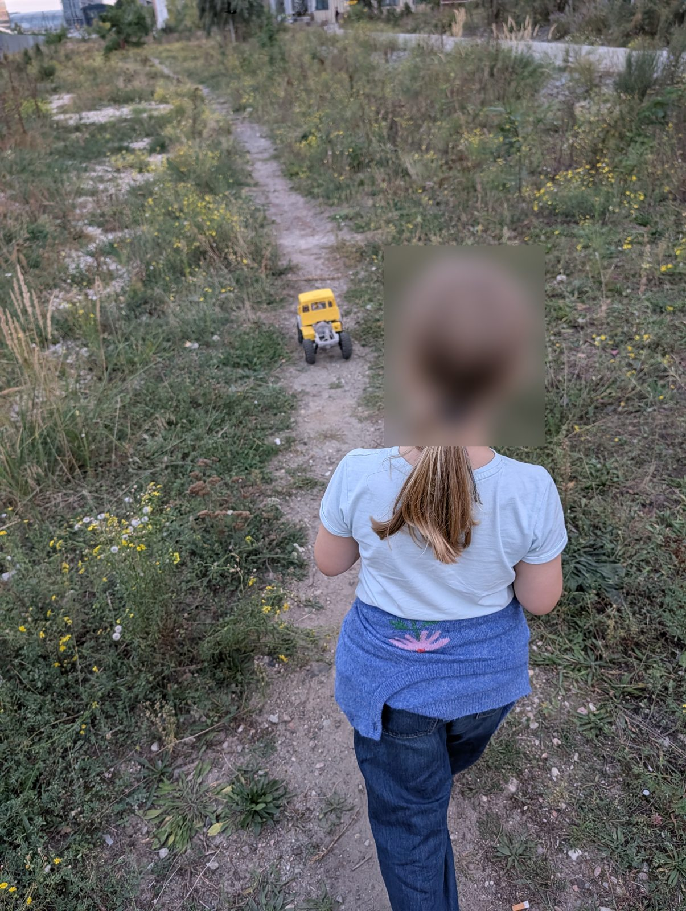

Nach Papas Mogster wollte Falko auch einen: Am **30. September und 1. Oktober 2026** hat er seinen gelben Mogster an zwei Abenden in der Werkstatt zusammengebaut. Als Extra sitzt im Führerhaus eine **kleine Kamera auf einem Servo**, die sich hin und her drehen kann. Kurz darauf ging es zur ersten Ausfahrt ins Gelände.

{: .gallery}

<video class="post-video" controls preload="none" playsinline poster="/assets/video/news/falko-baut-seinen-mogster-an-zwei-abenden/01.jpg" src="/assets/video/news/falko-baut-seinen-mogster-an-zwei-abenden/01.mp4"></video>
