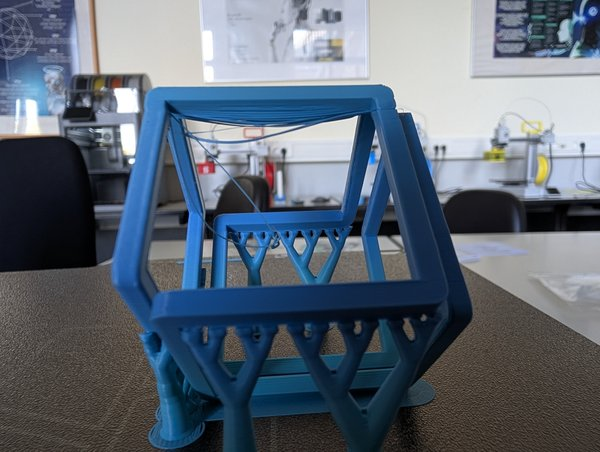

Aus der [3D-Druck AG am Rosalind-Franklin-Gymnasium]({{ '/projekte/3d-druck-ag-rosalind-franklin-gymnasium/' | relative_url }}): ein [Infinite Cube](https://makerworld.com/en/models/909738-infinite-cube) von MakerWorld, auf die Kante gestellt und mit **Baumstützen** gedruckt – die verzweigten Stützen tragen die schrägen Kanten. Daran lernen wir, wie man Stützstrukturen baut.

Das Gleiche machen wir gerade auch an der [Platanus Schule]({{ '/news/2026/09/30/wuerfel-auf-der-ecke-an-der-platanus-schule/' | relative_url }}) – zwei Schulen, ein Würfel :)

Falko hat inzwischen eine [Referenz gedruckt]({{ '/news/2026/11/03/ein-infinite-cube-als-referenz/' | relative_url }}), mit der die AGs ihre Würfel vergleichen können.

  

