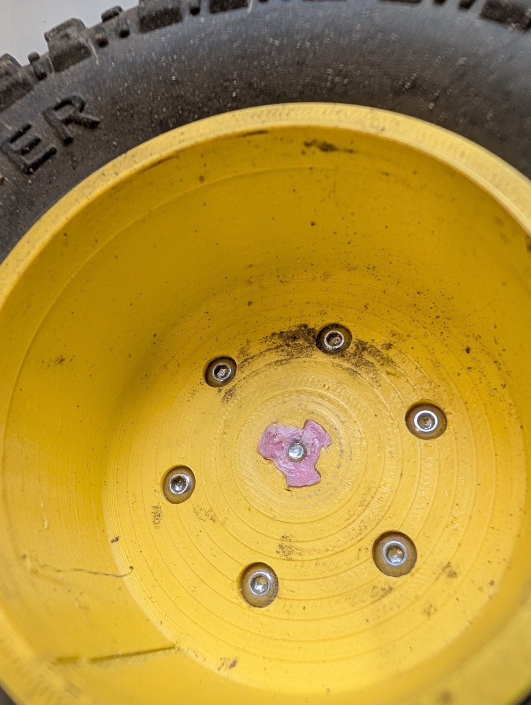
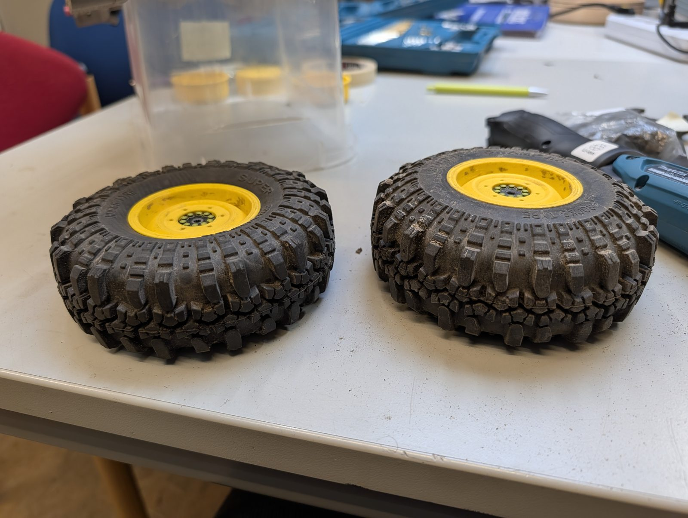
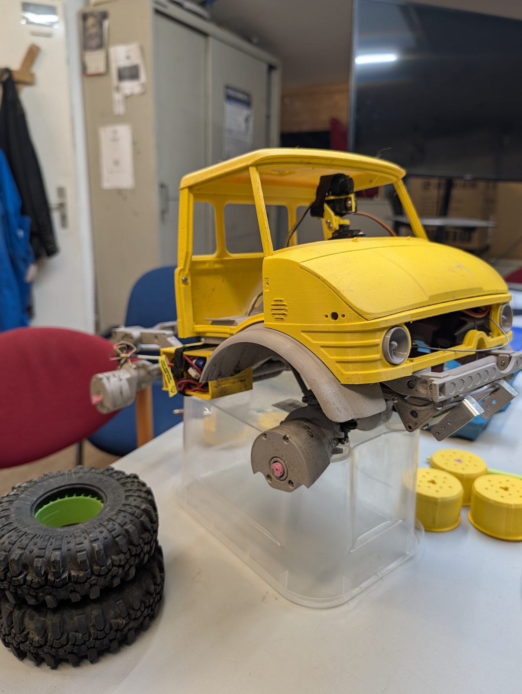
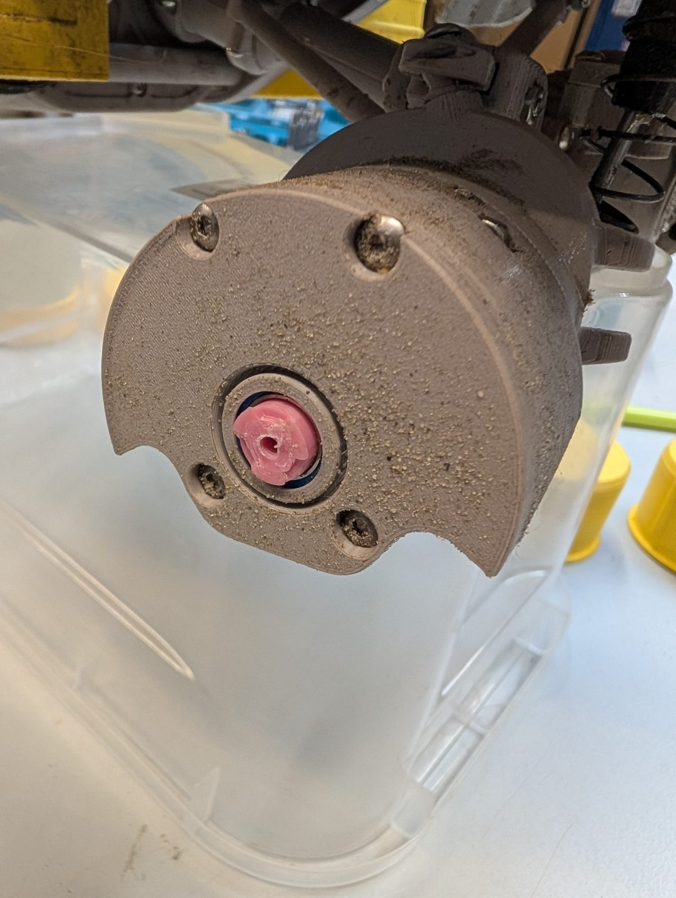
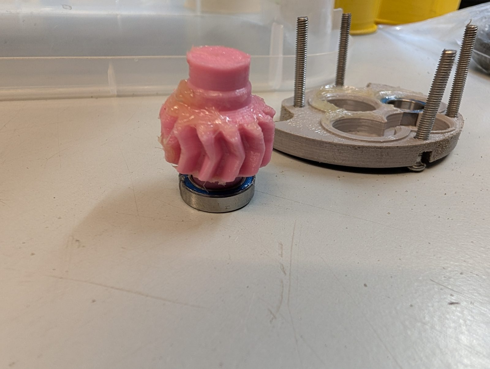
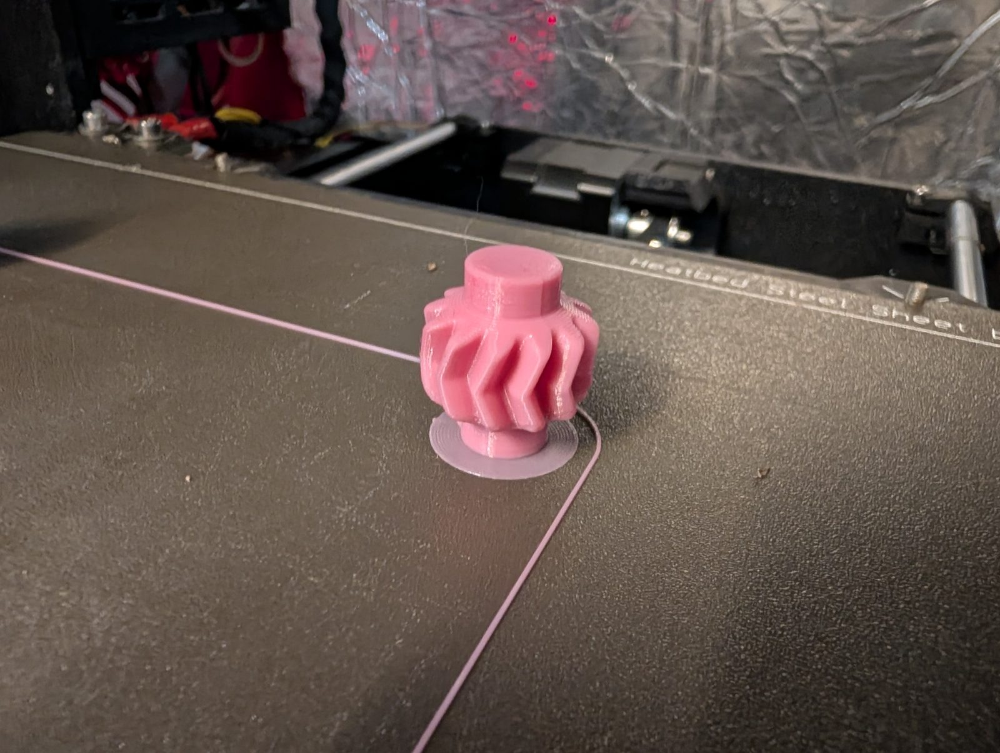
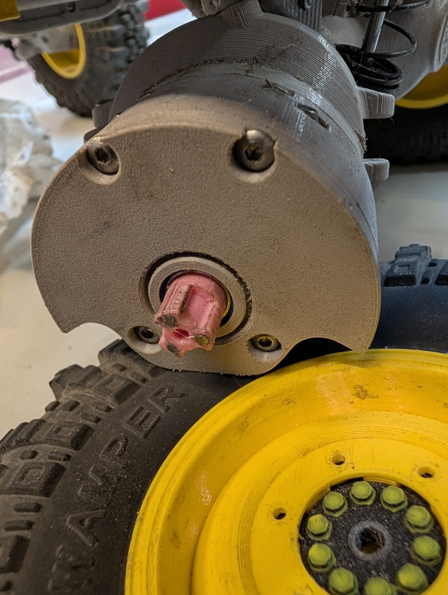

Falkos eigener Mogster ist gelb – und hat im Oktober 2026 die erste Reparatur gebraucht. Die **Portalachse hat eine Schwachstelle**: Das gedruckte Zahnrad im Portalgetriebe hält die hohe Kraft nicht immer aus und bricht. Also: Rad ab, Portalgehäuse auf, neues Zahnrad drucken und einbauen.

Für die Zukunft gibt es eine verstärkte Version des Zahnrads, die noch eingebaut werden muss: **[3D Sets Mogster Portal Gear Reinforced](https://www.printables.com/model/1861933-3d-sets-mogster-portal-gear-reinforced)** auf Printables.

{: .gallery}
