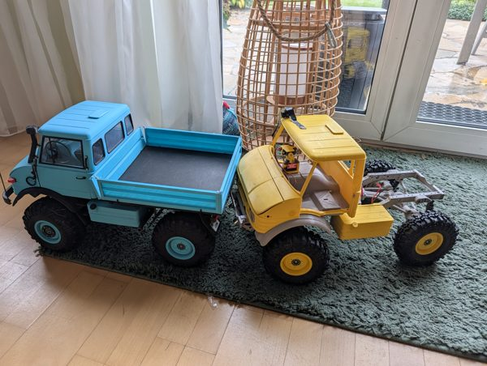
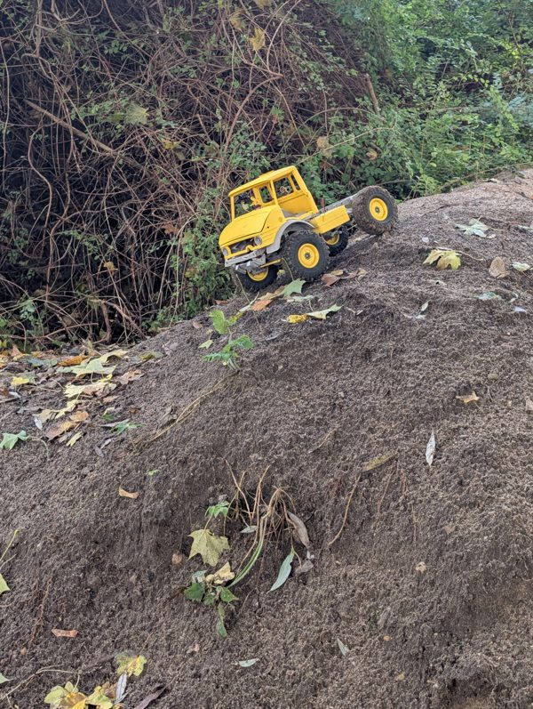

Am 19. Oktober 2026 standen die beiden Mogster zum ersten Mal nebeneinander: Papas hellblauer Mogster – fertig, mit Pritsche – und Falkos gelber, bei dem hinten noch der nackte Leiterrahmen zu sehen ist.

Danach ging es für Falkos Mogster zum **ersten Praxistest** nach draußen: einen Sandhügel hinauf und durch Erde und Laub. Und an der Front sitzt ein kleiner, mit einem Servo bewegter **Kran**, der eine Holzlatte an einem Nagel einhakt und anhebt.

  
  

<video class="post-video" controls preload="none" playsinline poster="/assets/video/news/die-mogster-treffen-aufeinander/01.jpg" src="/assets/video/news/die-mogster-treffen-aufeinander/01.mp4"></video>

<video class="post-video" controls preload="none" playsinline poster="/assets/video/news/die-mogster-treffen-aufeinander/02.jpg" src="/assets/video/news/die-mogster-treffen-aufeinander/02.mp4"></video>
