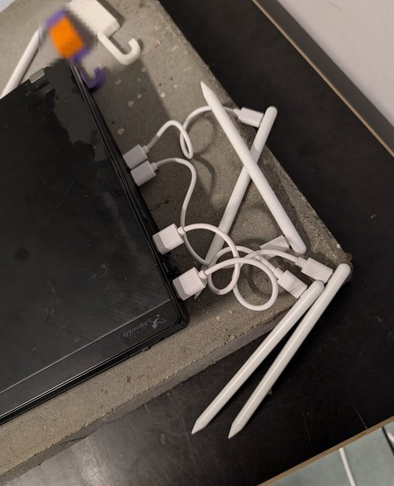
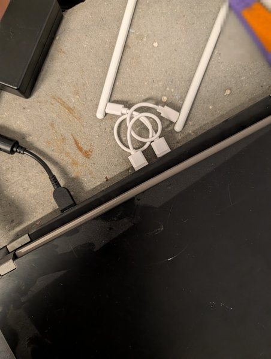
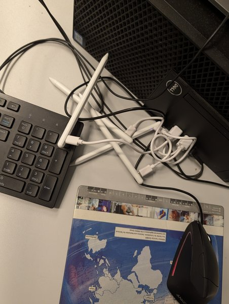
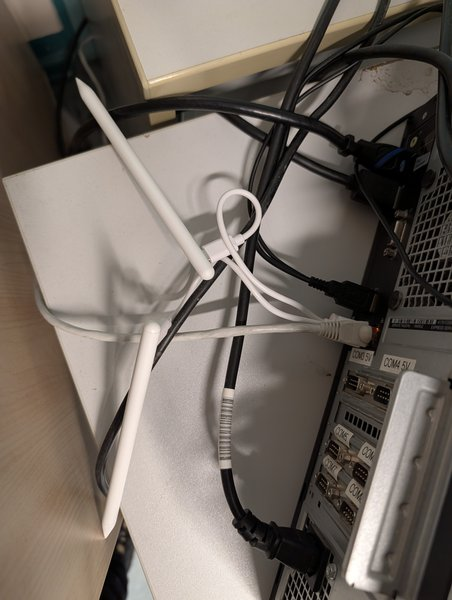

Fortschritt beim Projekt [iPad-Stifte wiederbeleben]({{ '/projekte/ipad-stifte-wiederbeleben/' | relative_url }}): Wir haben **alle Stifte der KTG zum Laden aufgehängt** – an USB-Hubs, Notebooks und Computern im Raum. Wer sie sieht: **bitte nicht entfernen!** Sobald sie voll sind, testen wir jeden einzelnen durch und sortieren die mit totem Akku aus.

  
  
  
  

