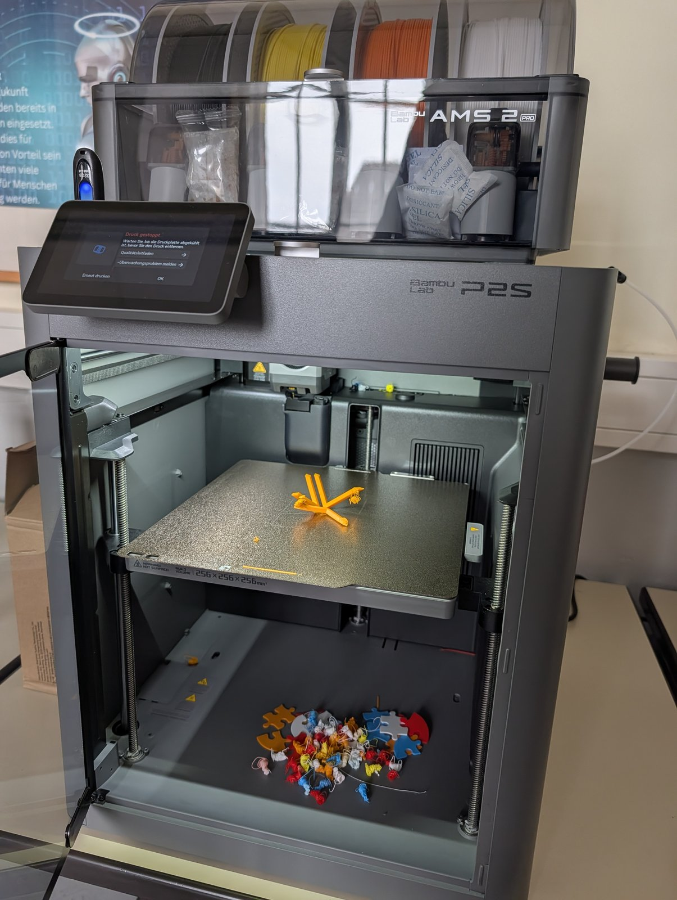
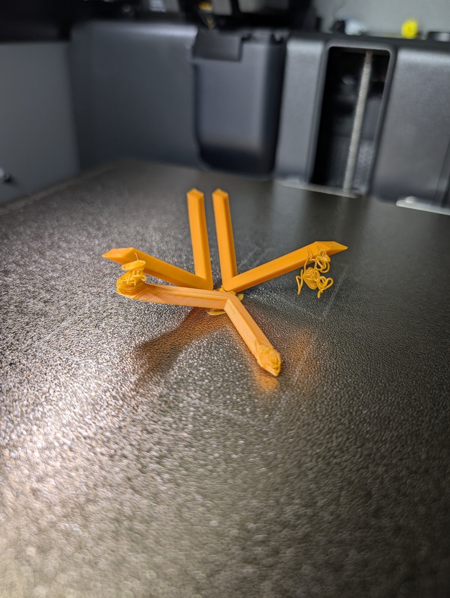
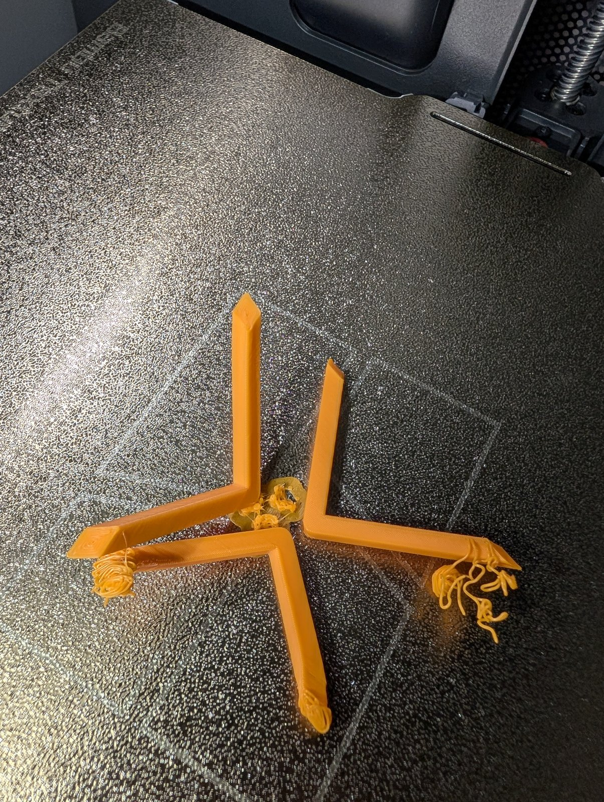
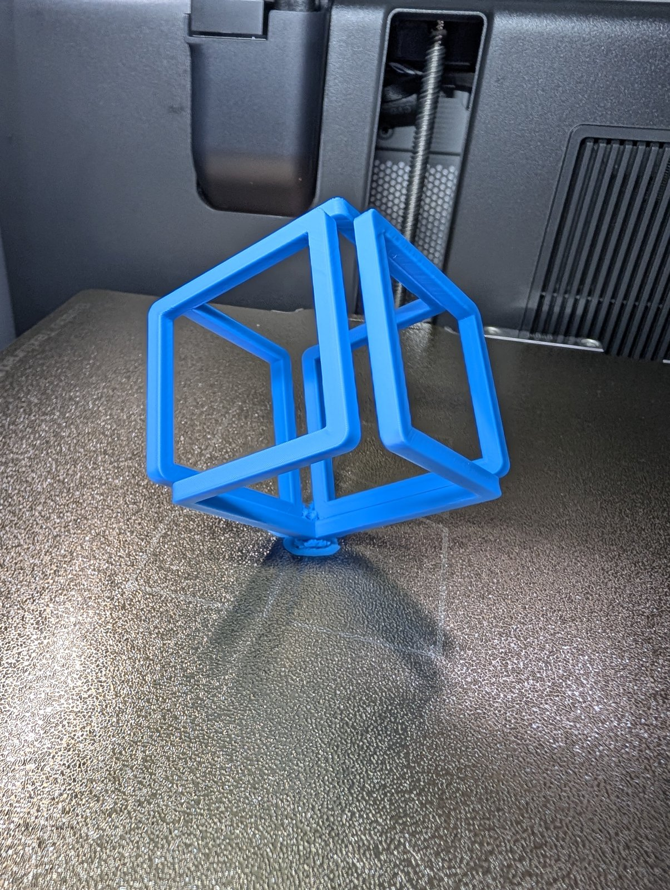

Den [Infinite Cube](https://makerworld.com/en/models/909738-infinite-cube) drucken wir gerade an zwei Schulen – an der [Platanus Schule]({{ '/news/2026/09/30/wuerfel-auf-der-ecke-an-der-platanus-schule/' | relative_url }}) und am [Rosalind-Franklin-Gymnasium]({{ '/news/2026/10/06/wuerfel-mit-baumstuetzen-am-rosalind-franklin-gymnasium/' | relative_url }}). Damit die AGs vergleichen können, wie ein gut gedruckter Würfel aussieht, hat Falko eine **Referenz** gedruckt – auf einem der [P2S am Rosalind-Franklin-Gymnasium]({{ '/ausstattung/drucker-rosalind-franklin-gymnasium/' | relative_url }}).

Der erste Versuch in Orange hat nicht geklappt: Nur die unteren Kanten sind stehen geblieben, an den Enden hängen Fadenknäuel. Der zweite Versuch in Blau steht – ein Würfel auf der Ecke, fast ohne sichtbare Stützen.

{: .gallery}
