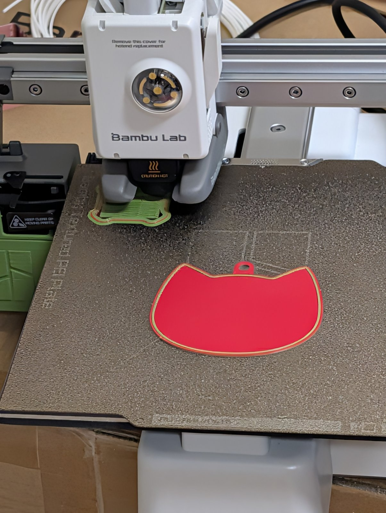
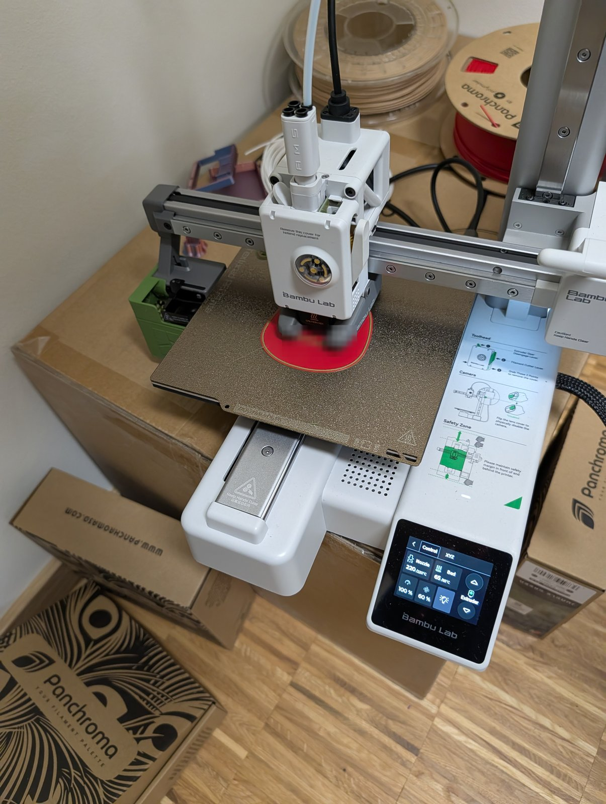

Neues aus der [3D-Druck AG an der Platanus Schule]({{ '/projekte/3d-druck-ag-platanus-schule/' | relative_url }}): Wir drucken **mehrfarbig** – mit dem [Bambu Lab A1 mini]({{ '/ausstattung/bambu-lab-a1-mini-platanus/' | relative_url }}) der Schule und ohne automatischen Filamentwechsler. Der Drucker pausiert an der richtigen Stelle, wir **wechseln das Filament per Hand**, und weiter geht's in der nächsten Farbe. So entstehen zum Beispiel Anhänger mit Rand und Schrift in einer anderen Farbe.

{: .gallery}
