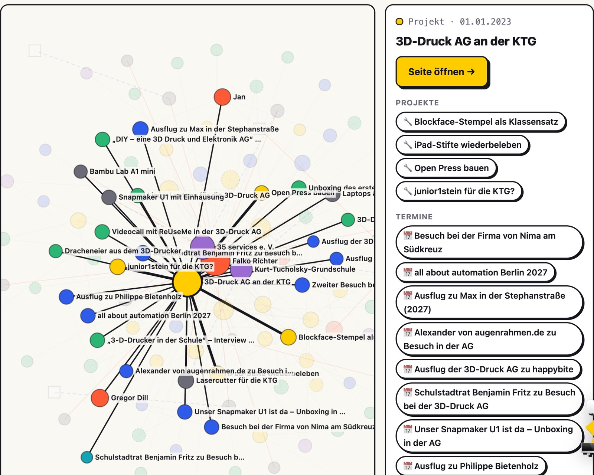

Was als 3D-Druck AG an einer Grundschule angefangen hat, ist inzwischen ein ganzes Geflecht: AGs an mehreren Schulen, Ausflüge, Partner, Geräte, die bei verschiedenen Leuten stehen, und viele Menschen, die mitmachen. Damit man das auch **sehen** kann, gibt es jetzt eine neue Seite: das **[Netzwerk]({{ '/netzwerk/' | relative_url }})** (im Menü unter „Wir“).

{: .gallery}

## Was das Netzwerk zeigt

Jeder Punkt ist eine Seite von ifsmb.de, jede Linie eine Verbindung:

- 🟡 **Projekte** – mit ihren Teilprojekten
- 🔵 **Termine** und 🟢 **Beiträge**
- 🔴 **Menschen** aus dem Team
- 🟣 **Partner**
- ⚫ **Ausstattung** – rote Linien zeigen, wem ein Gerät gehört, blau gestrichelte, wo es steht
- ⬜ **Orte**

Je größer ein Punkt, desto mehr hängt an ihm. Klickt man darauf, leuchten seine Verbindungen auf, und rechts erscheinen sie als Liste – ein Klick darauf, und man wandert zum nächsten Punkt weiter. So kann man zum Beispiel von der [3D-Druck AG an der KTG]({{ '/projekte/3d-druck-ag-ktg/' | relative_url }}) über einen Ausflug zu einem Partner und von dort zu den Geräten springen, die dort stehen. Filter blenden einzelne Bereiche aus, die Suche findet jeden Punkt, und persönliche Projekte und Beiträge aus dem Team lassen sich ein- und ausschalten.

## Was sich dafür auf der Seite geändert hat

Damit das Netzwerk entstehen konnte, haben wir aufgeräumt, wie die Seiten miteinander verbunden sind:

- **Alles kann mit allem verbunden werden.** Projekte, Termine, Beiträge, Menschen, Geräte, Pressemitteilungen und Partnerseiten lassen sich gegenseitig verlinken. Die Verbindungen stehen unten auf jeder Seite – immer gleich gestaltet und immer in beide Richtungen.
- **Teilprojekte.** Große Projekte haben jetzt Teilprojekte. Die KTG-AG zum Beispiel baut gerade eine [Open Press]({{ '/projekte/openpress-bauen/' | relative_url }}), plant einen [Klassensatz Blockface-Stempel]({{ '/projekte/blockface-klassensatz/' | relative_url }}) und belebt [alte iPad-Stifte wieder]({{ '/projekte/ipad-stifte-wiederbeleben/' | relative_url }}). Ein Teilprojekt kann auch zu mehreren Projekten gehören.
- **Termine gehören zu Projekten, Partnern und Menschen.** Ausflüge einer AG stehen erst nach dem Termin im öffentlichen Kalender – vorher sehen sie Kinder und Eltern auf der Projektseite.
- **Geräte können mehreren gehören.** Besitz und Standort sind eigene Verbindungen – im Netzwerk sieht man auf einen Blick, wem ein Gerät gehört und wo es steht. Das Institut selbst besitzt (noch) nichts: Alles, was wir nutzen, gehört Partnern oder Menschen aus dem Team.

## Warum wir das machen

Wir wollen unsere Aktivitäten dokumentieren – nicht nur einzelne Beiträge, sondern wie alles zusammenhängt. Das Netzwerk zeigt, wie viele Menschen, Schulen, Vereine und Partner hier ehrenamtlich zusammenarbeiten, und wie aus einer AG, einem geliehenen Drucker oder einem Ausflug immer wieder Neues entsteht. Je mehr wir eintragen, desto dichter wird es.

Schaut es euch an: **[zum Netzwerk]({{ '/netzwerk/' | relative_url }})**. Und wenn ihr irgendwo dazugehört und noch nicht drin seid – meldet euch!
