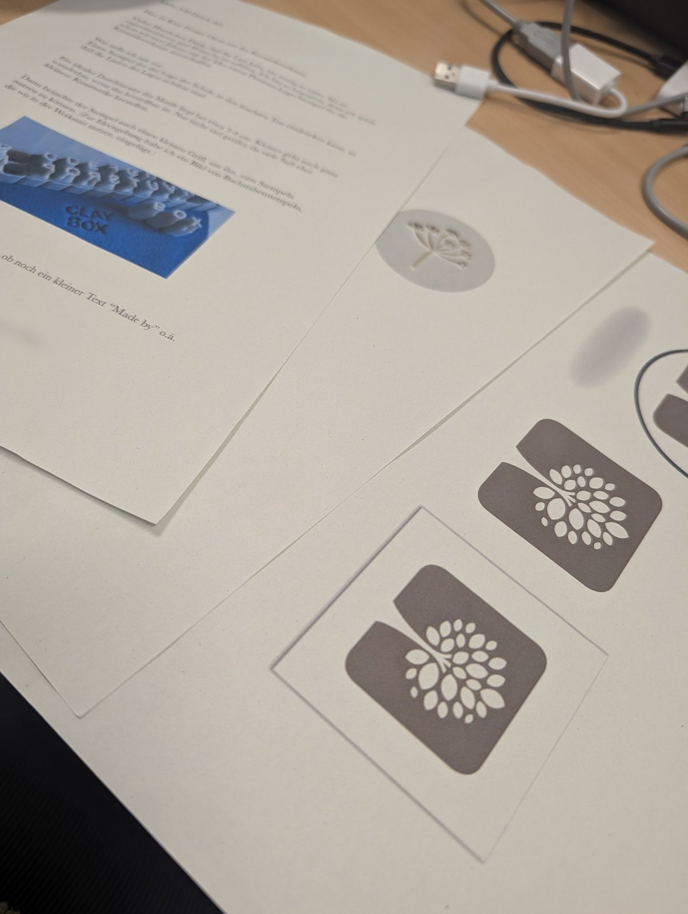
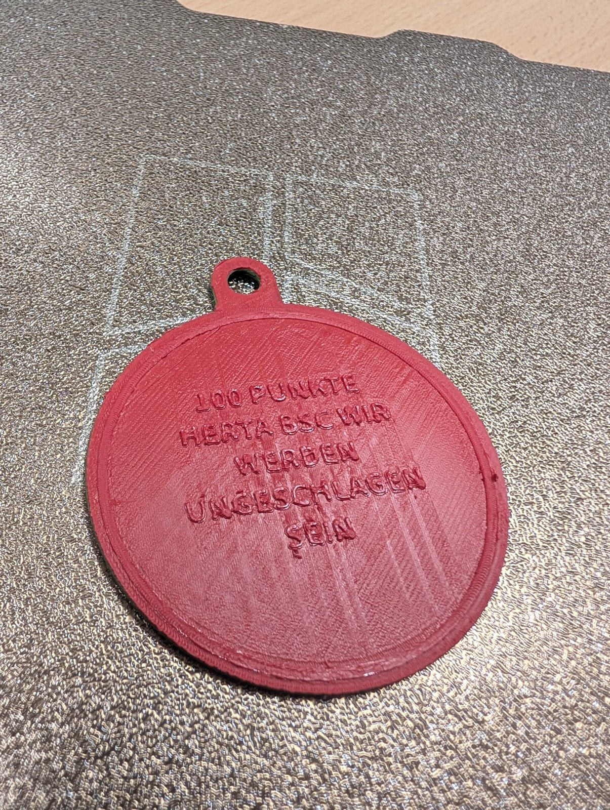

Neues aus der [3D-Druck AG an der Platanus Schule]({{ '/projekte/3d-druck-ag-platanus-schule/' | relative_url }}): Wir haben **Post von der Keramik AG** bekommen! Darin stehen ihre Ideen für einen 3D-gedruckten Stempel, mit dem sie ihre Tonarbeiten kennzeichnen können – samt ausgedruckten Motiven und der Frage, ob noch ein kleiner Text wie „Made by“ mit draufpasst.

{: .gallery}

Außerdem haben wir in der AG unseren **ersten Schlüsselanhänger** gedruckt – mehrfarbig, mit Filamentwechsel per Hand auf dem [Bambu Lab A1 mini]({{ '/ausstattung/bambu-lab-a1-mini-platanus/' | relative_url }}) der Schule.

Leider haben wir die **Pause an der falschen Stelle** gesetzt: Statt nur der Schrift ist fast der ganze Anhänger rot geworden. Viel zu rot – aber es hat trotzdem Spaß gemacht, und beim nächsten Mal sitzt die Pause.

{: .gallery}
