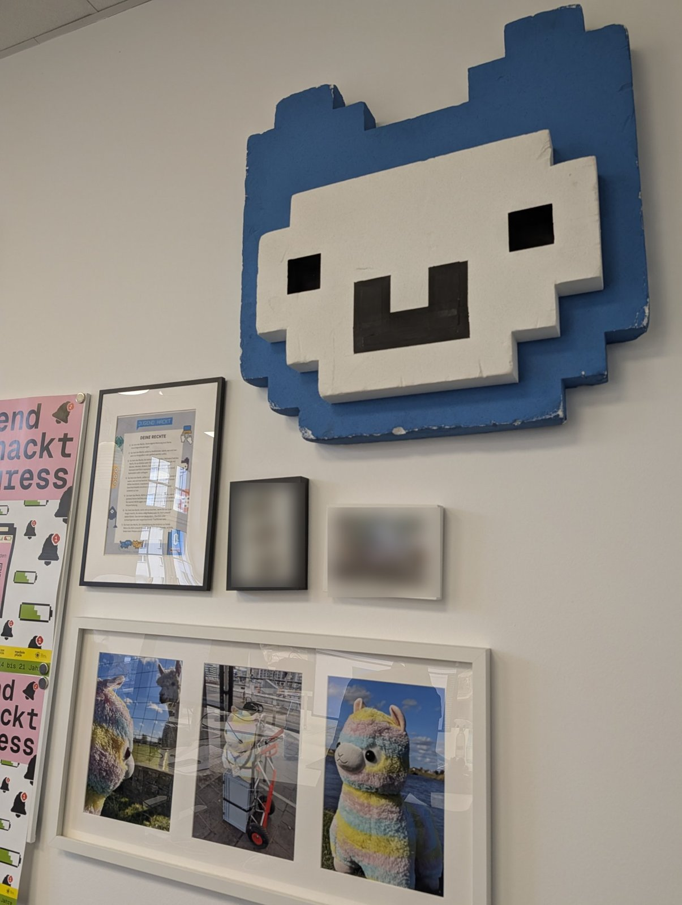

Heute war ich bei der Open Knowledge Foundation (OKF) und habe [Jugend hackt]({{ '/partner/jugend-hackt/' | relative_url }}) besucht – und dabei meine Beamer vom Jugend-hackt-Hackathon abgeholt.

{: .gallery}

Wir haben über **Finanzierung** gesprochen. (*Hint, hint, nudge, nudge:* Jugend hackt sucht Finanzierung, um stabil weiterarbeiten zu können.)

Außerdem ging es um **lokale KI**. Ich werde mal mit Anton quatschen, ob unser [KI-Server]({{ '/projekte/ki-server-anton/' | relative_url }}) doch in Berlin bleibt, damit er hier ein bisschen arbeiten kann – das wäre voll cool.
