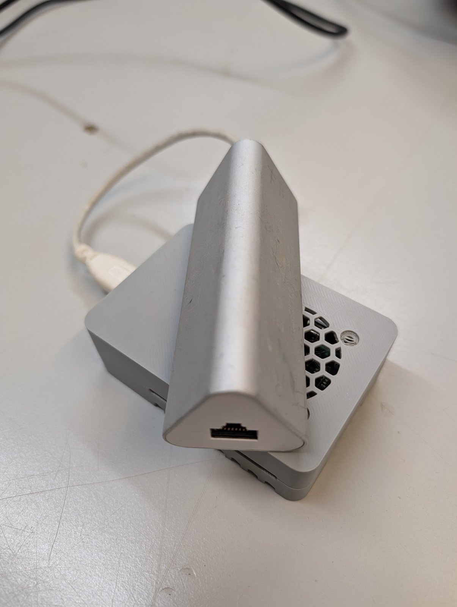

Neues vom [KI-Server]({{ '/projekte/ki-server-anton/' | relative_url }}): Anton bekommt von Falko einen **Raspberry Pi 4** mit einem **USB-3.0-Hub mit Gigabit-Netzwerk**.

{: .gallery}

Damit wollen wir einen **Proxy** bauen: Der KI-Server braucht viel Strom, deshalb soll er schlafen, solange niemand ihn braucht. Der sparsame Pi nimmt die Anfragen an, **weckt den Server auf**, wenn ein Request kommt, und legt ihn danach wieder schlafen.
