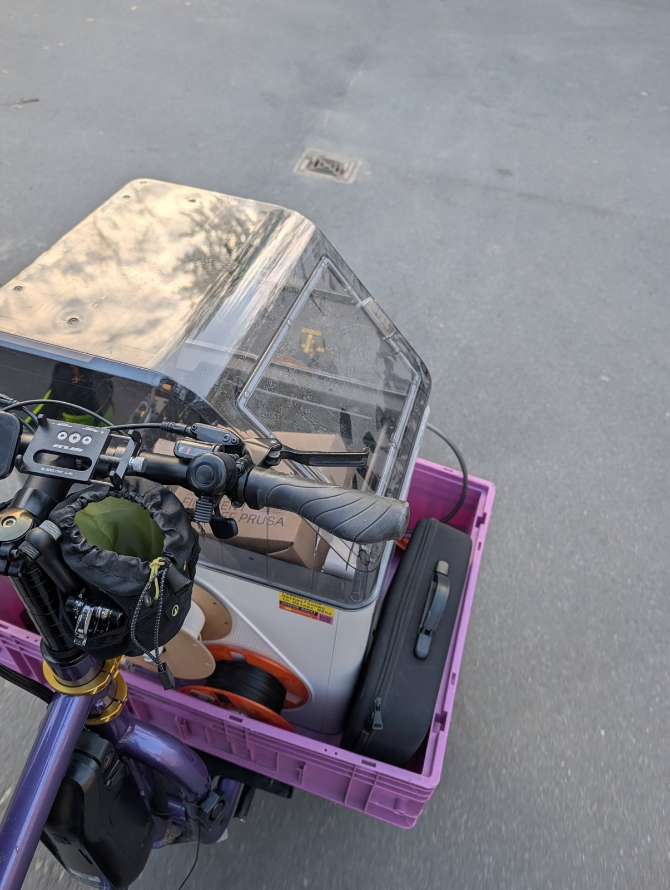
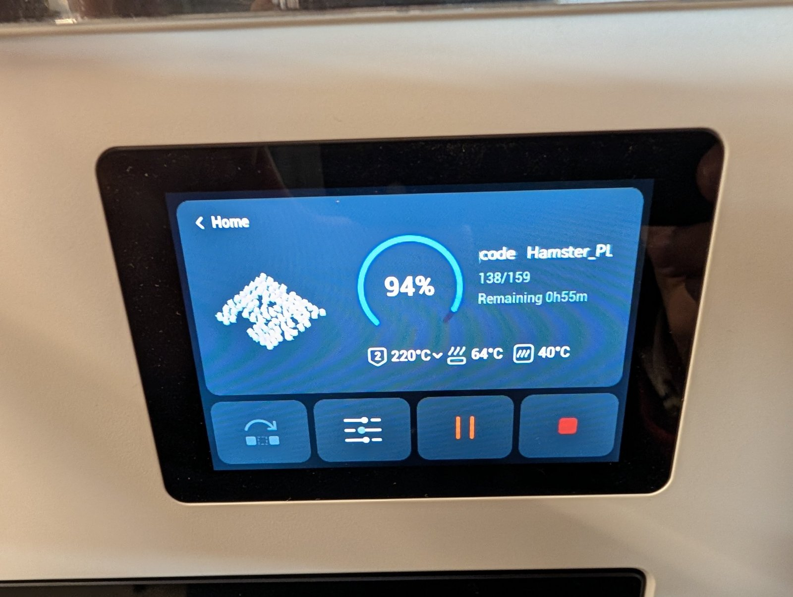
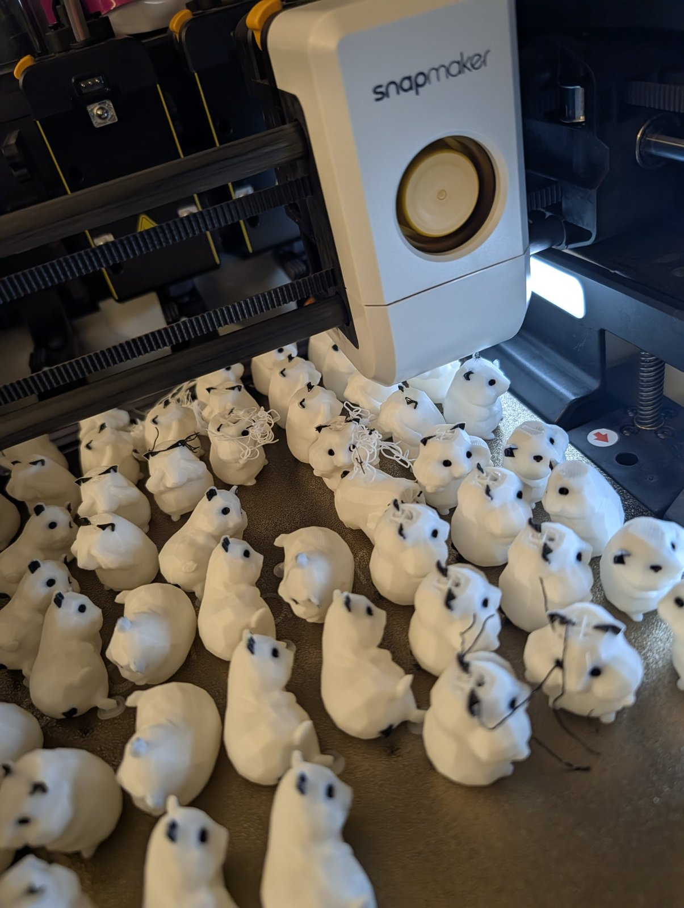
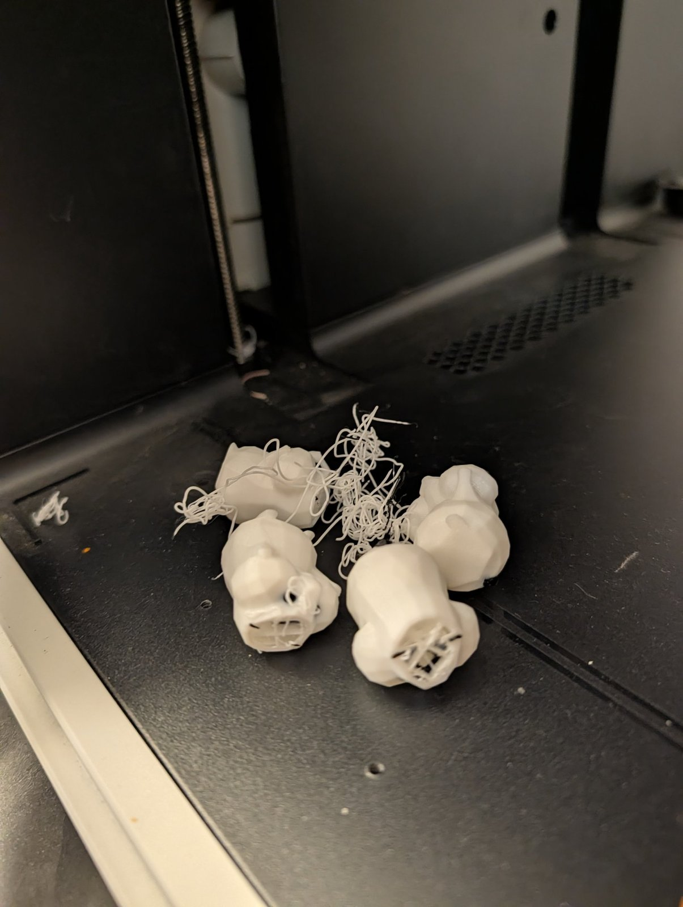
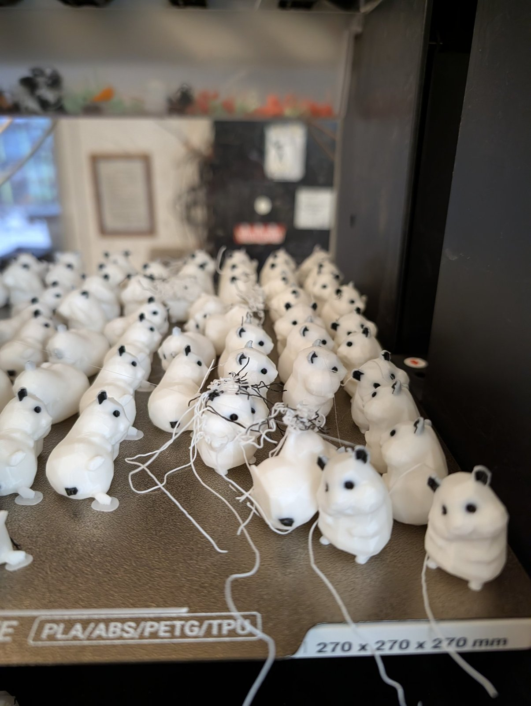
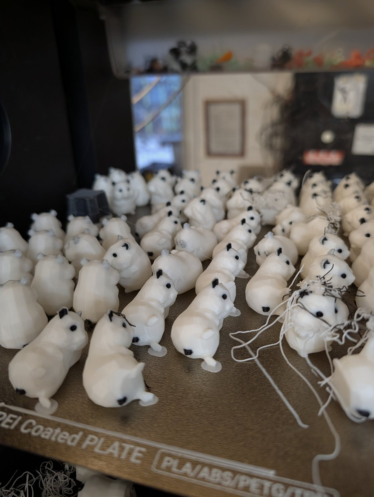
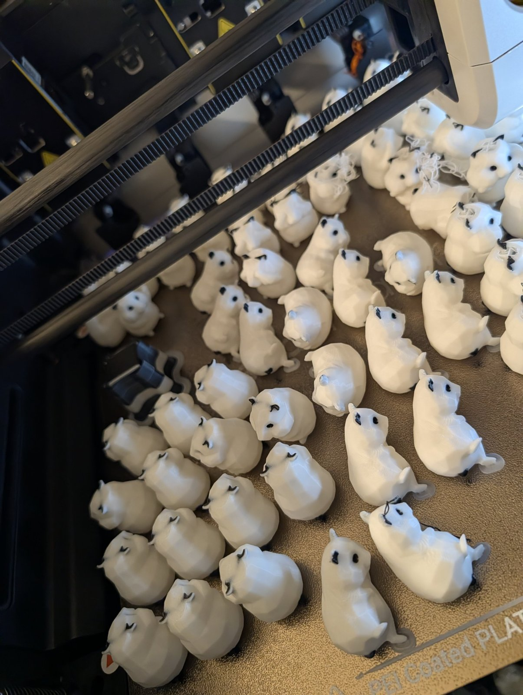

Nach den Herbstferien ist unser [Snapmaker U1]({{ '/ausstattung/snapmaker-u1/' | relative_url }}) wieder zurück in der 3D-Druck AG an der KTG. Falko hat ihn **standesgemäß mit dem Lastenrad** zur Schule gefahren.

{: .gallery}

Vorher wurden noch einmal **Hamster** gedruckt – eine ganze Druckplatte voll, weiß mit schwarzen Augen und Ohren.

{: .gallery}

Ein paar sind **sehr vermurkst** – mit Fadengewirr und offenen Stellen. Aber genau das war lustig: Mit den Schülerinnen und Schülern haben wir analysiert, was da schiefgegangen ist.

{: .gallery}
