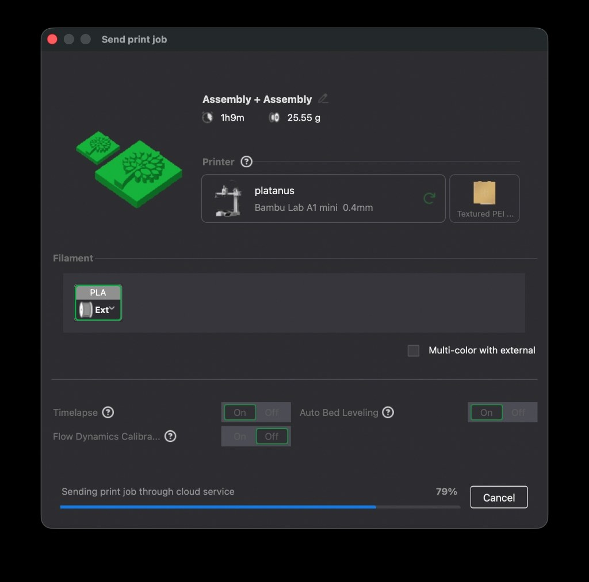
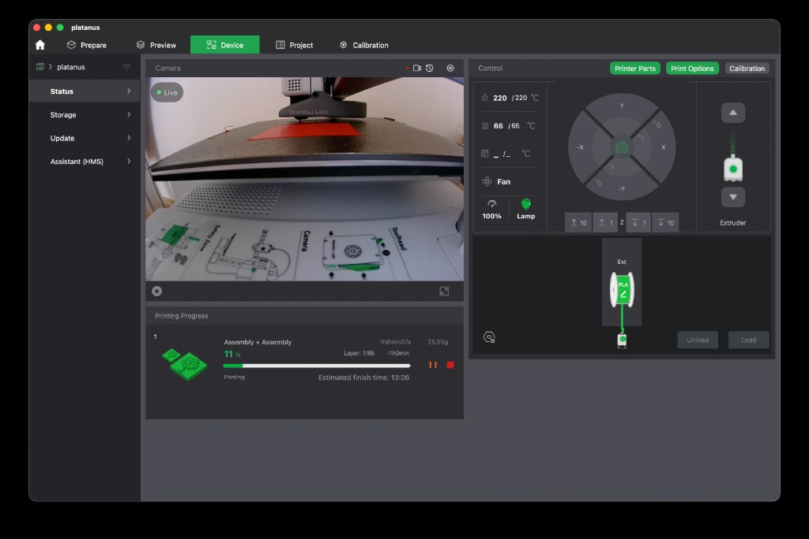

Nach der [Post von der Keramik AG]({{ '/news/2026/11/11/post-von-der-keramik-ag-und-ein-erster-schluesselanhaenger/' | relative_url }}) hat Falko in **Bambu Studio** mal einen ersten Entwurf für den Baum-Stempel (in zwei Größen) zusammengebaut und an den [Bambu Lab A1 mini]({{ '/ausstattung/bambu-lab-a1-mini-platanus/' | relative_url }}) der [Platanus Schule]({{ '/projekte/3d-druck-ag-platanus-schule/' | relative_url }}) geschickt.

Wir müssen aber noch mit **Katy** reden: **Eigentlich sollen die Kinder selbst konstruieren.** Vielleicht gehen wir am Mittwoch direkt rüber und treffen die Keramik AG gemeinsam.

{: .gallery}
