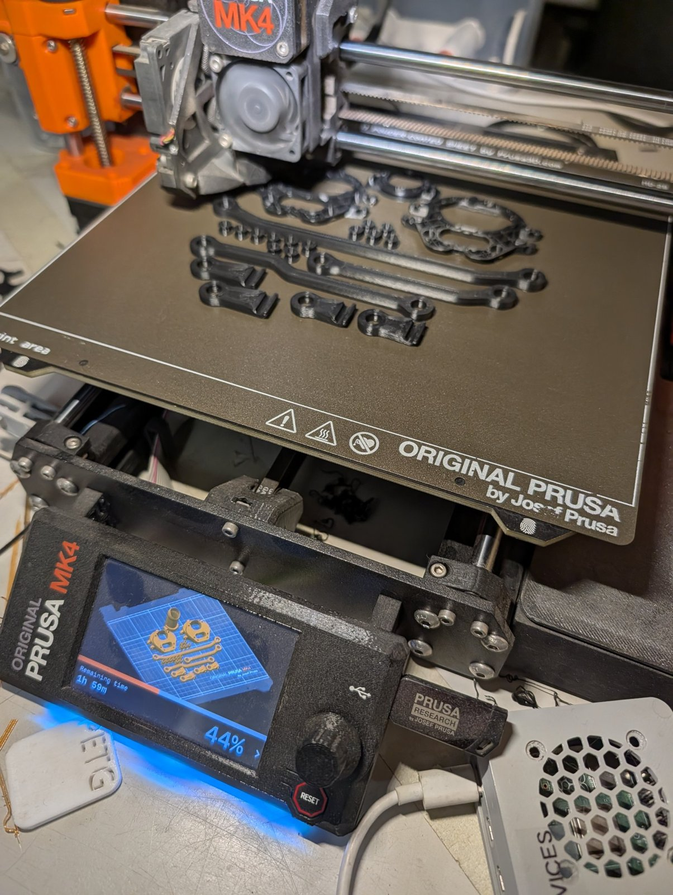
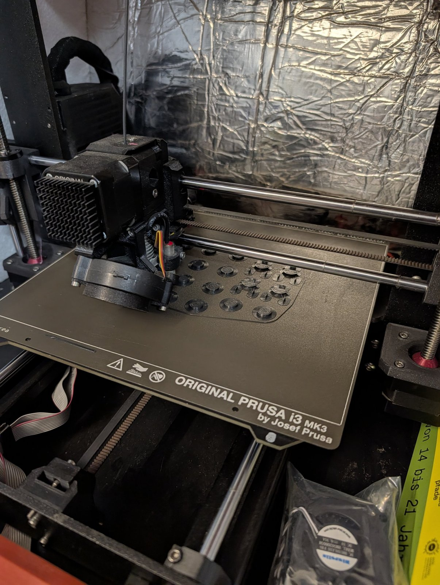
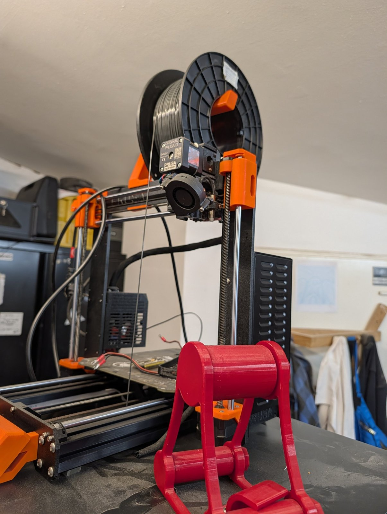

[Anton]({{ '/team/anton/' | relative_url }}) macht Fortschritte beim Bau seines [Mogsters]({{ '/projects/3dsets-mogster-bauen/' | relative_url }}#antons-mogster) – und dafür sind bei 35services gleich drei Drucker beschäftigt:

- Der [Prusa MK4]({{ '/equipment/prusa-mk4-mmu/' | relative_url }}) druckt **Teile für das Chassis**: Lenkhebel, Spurstangen, Achsträger und viele kleine Distanzstücke.
- Der [Prusa MK3S (xHain)]({{ '/equipment/prusa-mk3s-xhain/' | relative_url }}) im geschlossenen Bauraum druckt **Zahnräder** – leider bisher mit mäßigem Erfolg. Aber das ist eine andere Geschichte.
- Und der [Prusa MK3S (HeartLabs)]({{ '/equipment/prusa-mk3s-heartlabs/' | relative_url }}) wird gerade als **Filamenthalter** missbraucht – Entschuldigung: gebraucht. 😉

{: .gallery}
