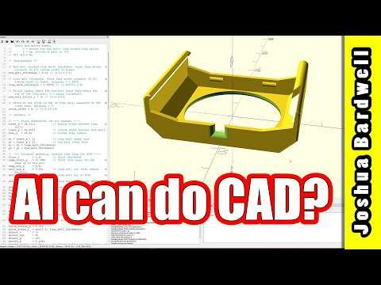

Ein cooler Typ hat ein tolles Video produziert: [Joshua Bardwell](https://www.youtube.com/@JoshuaBardwell) zeigt in **„Can't learn CAD? Use AI instead! Here's how…"**, wie man mit KI zu brauchbaren CAD-Modellen kommt, auch ohne klassische CAD-Kenntnisse. Sehr spannend für alle, die im Makespace etwas konstruieren wollen, aber vor CAD zurückschrecken.

<a class="video-link" href="https://www.youtube.com/watch?v=GnFJibc2G4w" target="_blank" rel="noopener">
  
  ▶ Video auf YouTube ansehen
</a>

### Werkzeug aus dem Video

- [mesh2solid](https://mesh2solid.thavision.com/) – wandelt ein Mesh (z. B. aus einem KI-Tool oder einem 3D-Scan) in einen sauberen CAD-Körper um.

### Zum Weiterdenken: 3D-Scan zurück zu CAD

Dasselbe Thema aus einer anderen Richtung – ein 3D-Scan ist erst mal nur eine Punktwolke oder ein Mesh; spannend wird es, wenn daraus wieder ein editierbares CAD-Modell wird:

- [ScanRuler](https://scanruler.com/) – ein kostenloses Werkzeug, um aus 3D-Scans wieder maßhaltige Teile abzuleiten.
- [CNC Kitchen: „ScanRuler – Free 3D Scan Reverse Engineering"](https://www.cnckitchen.com/blog/scanruler-free-3d-scan-reverse-engineering) – Vorstellung und Einordnung von ScanRuler.

Passt gut zu unserer Überlegung, [einen 3D-Scanner zu evaluieren]({{ '/projects/3d-scanner-evaluieren/' | relative_url }}) und zur laufenden [Recherche: KI-Tools für CAD]({{ '/projects/recherche-ki-tools-cad-openscad/' | relative_url }}).
