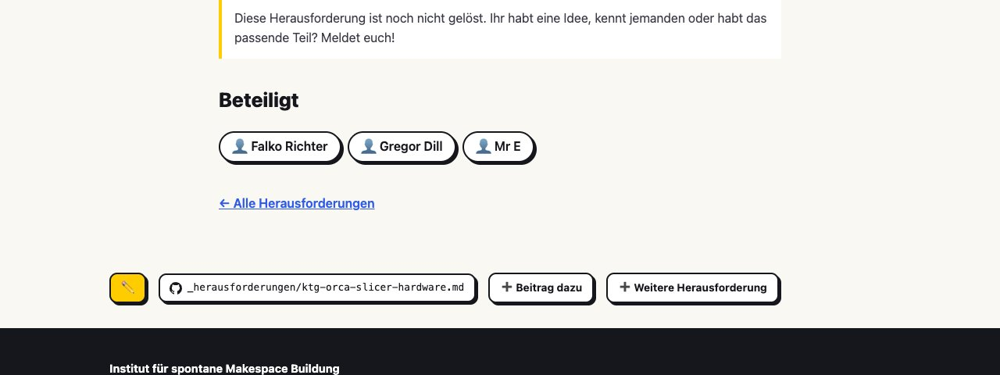
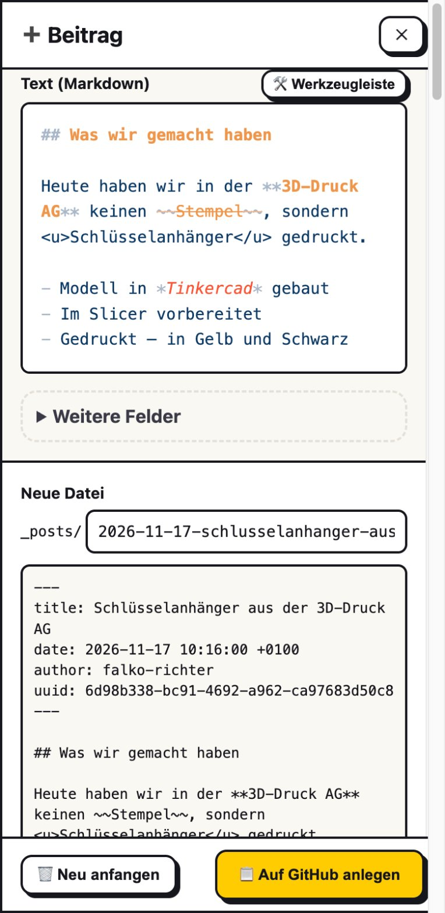
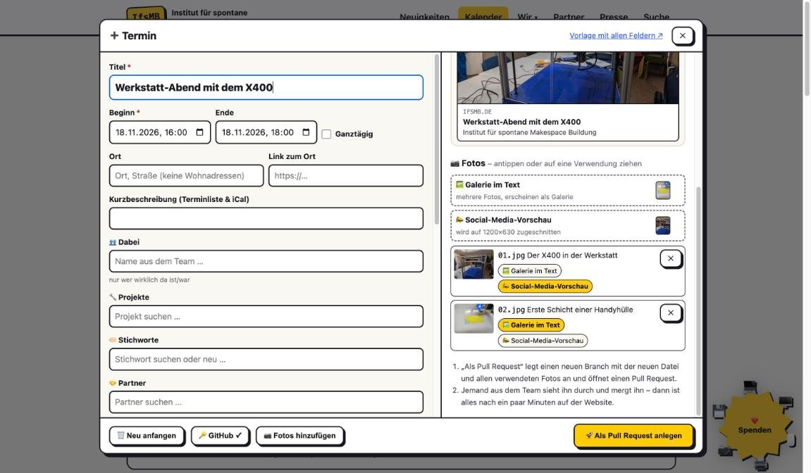

> **Update vom 18. November 2026:** Jetzt geht es noch einen großen Schritt weiter – mit GitHub verbunden, legen die Formulare den Vorschlag **selbst als Pull Request an, mit Fotos**. Kein Kopieren mehr. → [Zum Update](#direkt)

Auf ifsmb.de sollen nicht nur die erzählen, die sich mit GitHub auskennen. In den AGs, an den Schulen und in den Makespaces unserer Partner passiert jede Woche etwas, das es wert ist, aufgeschrieben zu werden – ein erster Druck, ein kaputtes Teil, ein Ausflug. Deshalb haben wir das Schreiben auf der Website deutlich einfacher gemacht: **Neue Beiträge, Termine und Projekte und Änderungen an bestehenden Seiten gehen jetzt direkt im Browser, in einem Formular mit richtigem Texteditor.**

### Unten auf jeder Seite: ✏️, GitHub und ➕

Am Ende jeder Seite steht eine Zeile mit Knöpfen:

- **✏️** öffnet die Seite zum Bearbeiten – als Formular mit allem, was zu ihr gehört: Titel, Datum, Beteiligte, Projekte, Stichworte, Verknüpfungen und der Text. Das geht bei Beiträgen, Terminen, Projekten, Geräten, Herausforderungen, Teamprofilen und Pressemitteilungen.
- **Das GitHub-Logo mit dem Dateinamen** führt zur Datei auf GitHub – für alle, die lieber dort arbeiten.
- **➕ …** legt etwas Neues an, zum Beispiel einen Beitrag zu einem Projekt oder eine weitere Herausforderung. Die Verbindung zur Seite, auf der du gerade bist, ist dann schon eingetragen.

{: .gallery}

Beim Bearbeiten wird nur das geändert, was du wirklich änderst. Alles andere in der Datei – Fotogalerien, Links, Kommentare – bleibt genau so, wie es war. Rechts im Formular siehst du immer die fertige Datei; geänderte Zeilen sind gelb markiert. Fürs Ausfüllen gibt es Auswahllisten und Vorschläge: Wer ein paar Buchstaben eines Namens, Projekts oder Stichworts tippt, bekommt passende Einträge angeboten.

### Ein Texteditor mit Werkzeugleiste

Der Text einer Seite ist [Markdown](https://de.wikipedia.org/wiki/Markdown) – einfache Zeichen wie Sternchen und Rauten für Fett und Überschriften. Damit man sich die nicht merken muss, ist das Textfeld jetzt ein Editor mit **Werkzeugleiste**: Fett, Kursiv, Durchgestrichen, Unterstrichen, Code, Link, Überschriften, Listen, Aufgabenlisten, Ein- und Ausrücken, Zitat und eine Vorschau. Text markieren, Knopf drücken, fertig. Die Formatierung siehst du schon beim Schreiben: Überschriften und Fettes sind hervorgehoben, Links und Code farbig.

{: .gallery}

**Auf dem Handy** ist der Platz knapp. Deshalb ist die Werkzeugleiste dort anfangs ausgeblendet, und du hast mehr Fläche zum Schreiben. Mit **🛠️ Werkzeugleiste** über dem Textfeld blendest du sie ein oder aus – dein Browser merkt sich die Wahl.

{: .gallery}

### Tastenkürzel

Wer viel schreibt, nimmt die Tastatur. Text markieren und:

| Was | Mac | Windows / Linux | Ergebnis im Text |
|---|---|---|---|
| **Fett** | <kbd>⌘</kbd> <kbd>B</kbd> | <kbd>Strg</kbd> <kbd>B</kbd> | `**fett**` |
| *Kursiv* | <kbd>⌘</kbd> <kbd>I</kbd> | <kbd>Strg</kbd> <kbd>I</kbd> | `*kursiv*` |
| ~~Durchgestrichen~~ | <kbd>⇧</kbd> <kbd>⌘</kbd> <kbd>X</kbd> | <kbd>Strg</kbd> <kbd>Umschalt</kbd> <kbd>X</kbd> | `~~durchgestrichen~~` |
| <u>Unterstrichen</u> | <kbd>⌘</kbd> <kbd>U</kbd> | <kbd>Strg</kbd> <kbd>U</kbd> | `<u>unterstrichen</u>` |
| `Code` | <kbd>⌘</kbd> <kbd>E</kbd> | <kbd>Strg</kbd> <kbd>E</kbd> | `` `code` `` |
| Link | <kbd>⌘</kbd> <kbd>K</kbd> | <kbd>Strg</kbd> <kbd>K</kbd> | `[Text](https://…)` |
| Überschrift 1, 2, 3 | <kbd>⌥</kbd> <kbd>⌘</kbd> <kbd>1</kbd> … <kbd>3</kbd> | <kbd>Strg</kbd> <kbd>Alt</kbd> <kbd>1</kbd> … <kbd>3</kbd> | `# Titel`, `## Titel`, `### Titel` |
| Nummerierte Liste | <kbd>⇧</kbd> <kbd>⌘</kbd> <kbd>7</kbd> | <kbd>Strg</kbd> <kbd>Umschalt</kbd> <kbd>7</kbd> | `1. Punkt` |
| Liste | <kbd>⇧</kbd> <kbd>⌘</kbd> <kbd>8</kbd> | <kbd>Strg</kbd> <kbd>Umschalt</kbd> <kbd>8</kbd> | `- Punkt` |
| Aufgabenliste | <kbd>⇧</kbd> <kbd>⌘</kbd> <kbd>9</kbd> | <kbd>Strg</kbd> <kbd>Umschalt</kbd> <kbd>9</kbd> | `- [ ] Aufgabe` |
| Zitat | <kbd>⇧</kbd> <kbd>⌘</kbd> <kbd>.</kbd> | <kbd>Strg</kbd> <kbd>Umschalt</kbd> <kbd>.</kbd> | `> Zitat` |
| Einrücken / Ausrücken | <kbd>⌘</kbd> <kbd>]</kbd> / <kbd>⌘</kbd> <kbd>[</kbd> | <kbd>Strg</kbd> <kbd>]</kbd> / <kbd>Strg</kbd> <kbd>[</kbd> | Liste eine Stufe tiefer/höher |
| Rückgängig | <kbd>⌘</kbd> <kbd>Z</kbd> | <kbd>Strg</kbd> <kbd>Z</kbd> | |

Noch einmal dasselbe Kürzel nimmt die Formatierung wieder weg. In einer Liste macht <kbd>Enter</kbd> automatisch den nächsten Punkt. Die Kürzel stehen auch im Tooltip, wenn du mit der Maus über einen Knopf fährst. Wer Markdown kennt, kann natürlich weiter alles von Hand tippen.

### So kommt dein Text auf die Website

1. Formular ausfüllen – zum Beispiel mit **➕ Beitrag** auf den [Neuigkeiten](/news/), **➕ Termin** im [Kalender](/calendar/), **➕ Projekt** bei den [Projekten](/projects/) oder **➕ Herausforderung** bei den [Herausforderungen](/challenges/). Dein Entwurf bleibt in deinem Browser gespeichert, bis du ihn abschickst.
2. **„📋 Auf GitHub anlegen“** (bzw. beim Bearbeiten **„📋 Auf GitHub speichern“**) kopiert die fertige Datei und öffnet GitHub. Bei neuen Seiten steht der Inhalt dort schon drin; beim Bearbeiten den ganzen Inhalt markieren (<kbd>⌘</kbd> <kbd>A</kbd> bzw. <kbd>Strg</kbd> <kbd>A</kbd>) und einfügen.
3. Unten auf **„Commit changes …“** klicken und **„Create a new branch … and start a pull request“** wählen.
4. Wir schauen kurz drüber. Sobald der Vorschlag übernommen ist, steht er nach ein paar Minuten auf der Website.

Dafür braucht es ein kostenloses GitHub-Konto. Wer keins hat oder nicht möchte: Schreib uns einfach (Kontakt im [Impressum](/impressum/)), dann tragen wir den Text ein.

### Neu: Direkt als Pull Request – mit Fotos
{: #direkt}

Seit dem 18. November geht es ohne Kopieren und Einfügen. Unten im Formular steht jetzt **🔑 GitHub verbinden**:

1. Einmal ein **GitHub-Token** erstellen – der Link dazu steht im Fenster. Es gilt nur für unser Repository und darf nur Dateien vorschlagen und Pull Requests anlegen. Token einfügen, fertig.
2. Danach heißt der Knopf **🚀 Als Pull Request anlegen** (beim Bearbeiten **🚀 Änderung als Pull Request**). Ein Klick legt einen neuen Branch mit deiner Datei an und öffnet den Pull Request – mit einer kleinen Prüfliste für die Durchsicht. Live geht weiterhin erst, was jemand aus dem Team übernommen hat.

**📷 Fotos hinzufügen** öffnet einen Foto-Editor direkt im Browser. Dort kannst du das Foto drehen, zuschneiden und **Bereiche unkenntlich machen** – Gesichter von Kindern, Autokennzeichen, Namen oder Zugangscodes werden grob verpixelt. In manchen Browsern schlägt der Editor QR-Codes und Gesichter sogar selbst vor; nachschauen musst du trotzdem. Eine kurze Beschreibung, was auf dem Foto zu sehen ist, ist Pflicht. Beim Speichern wird das Foto verkleinert und **ohne Standortdaten und andere Metadaten** neu gespeichert.

{: .gallery}

Danach liegt das Foto in einer kleinen Ablage im Formular. Per Antippen oder Ziehen entscheidest du, **wofür es gebraucht wird** – je nach Seite als Galerie im Text, als Titelbild oder Foto des Geräts, als Profilfoto, als Bild auf der Partnerkarte oder als **Vorschaubild für WhatsApp, Signal & Co.** (dafür wählst du einen eigenen Ausschnitt im Querformat). Ein Foto darf mehrere Aufgaben haben; hochgeladen wird nur, was auch verwendet wird.

{: .gallery}

Noch zwei Kleinigkeiten, die beim gemeinsamen Schreiben helfen:

- **Schon in Arbeit?** Wenn jemand dieselbe Seite gerade in einem offenen Pull Request ändert, zeigt das Formular das an – und mit **„In #… weiterarbeiten“** landet deine Änderung im selben Pull Request statt in einem zweiten.
- **Link zum Bearbeiten:** Solange das Formular offen ist, steht `#bearbeiten` in der Adresse. So kannst du jemandem direkt einen Link schicken, der die Seite gleich zum Bearbeiten öffnet.

Das erste Ergebnis ist schon online: Unser neuer Partner [Zazza Moabit / Pajas Kaffee]({{ '/partners/zazza/' | relative_url }}) kam genau so auf die Website. Videos gehen im Browser noch nicht – die schickt ihr bitte weiter an Falko.

Im Moment können das alle, die im Repository mitarbeiten dürfen; „Mit GitHub anmelden“ ohne Token und Vorschläge für alle anderen kommen später.

### Und der Datenschutz?

Der Editor ist [OverType](https://github.com/panphora/overtype) in der **Version 2.9.0**, ein freies Programm (MIT-Lizenz). Er liegt als Kopie auf unserem eigenen Server, wird erst geladen, wenn du ein Formular öffnest, und lädt selbst nichts von anderen Seiten nach. Dein Entwurf und die Einstellung der Werkzeugleiste bleiben nur in deinem Browser.

Für die direkten Pull Requests gilt dasselbe: Das Token bleibt in deinem Browser – nur so lange der Tab offen ist, außer du wählst „Auf diesem Gerät merken“ – und geht ausschließlich an GitHub. Erst wenn du dich verbindest, spricht deine Seite überhaupt mit GitHub; Besucher*innen ohne Verbindung schicken nichts dorthin. Fotos werden in deinem Browser bearbeitet, bevor sie hochgeladen werden. Details stehen im [Impressum](/impressum/) unter Datenschutz.

Wir sind gespannt auf eure Beiträge!
