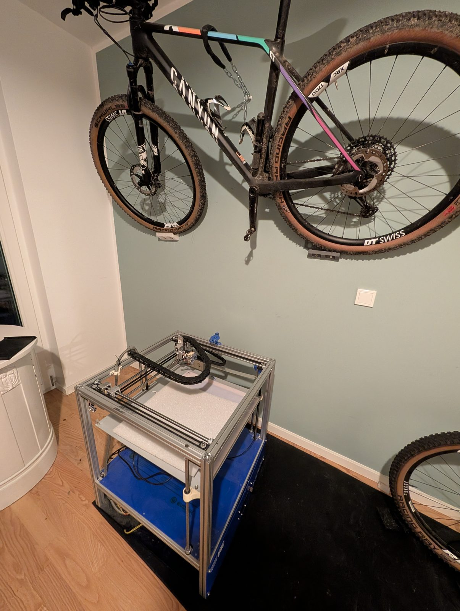
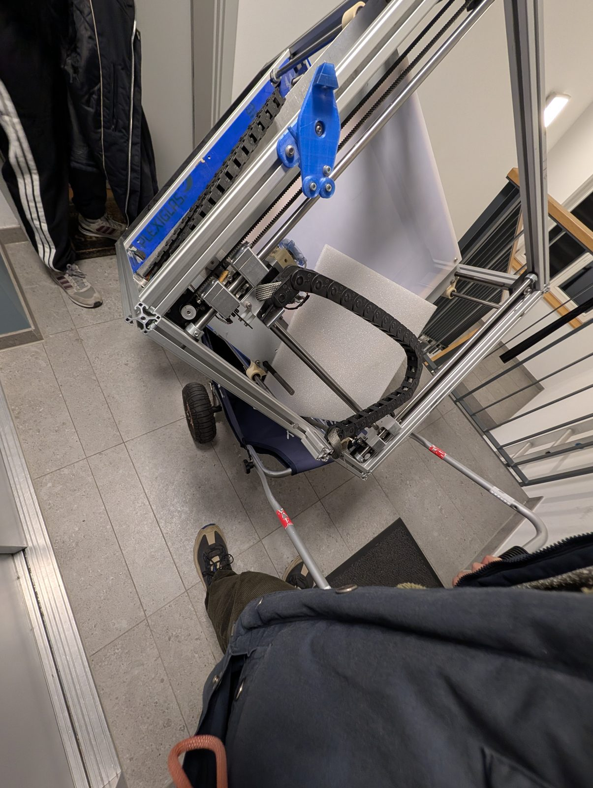
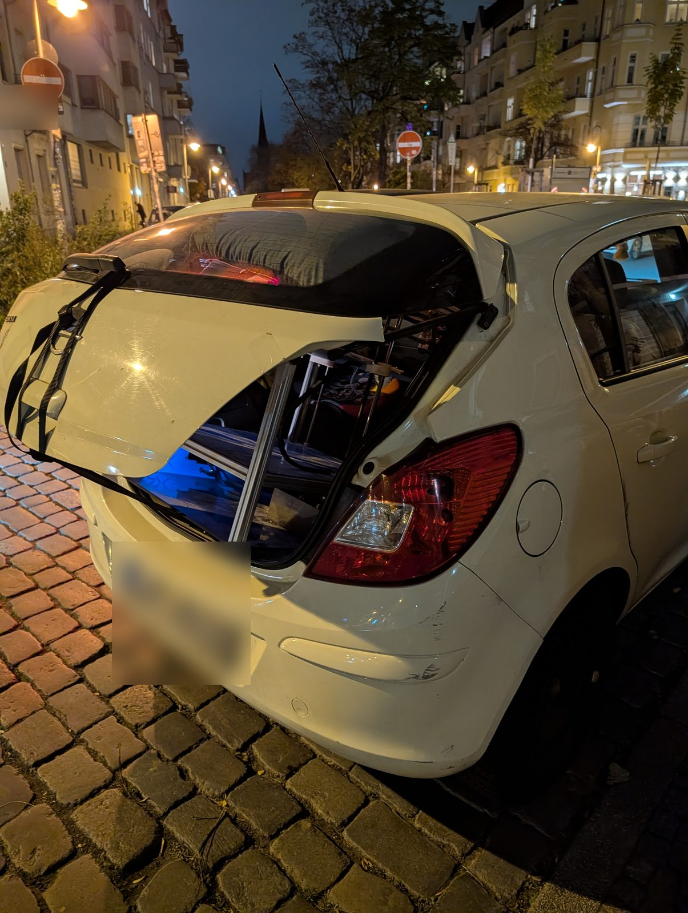
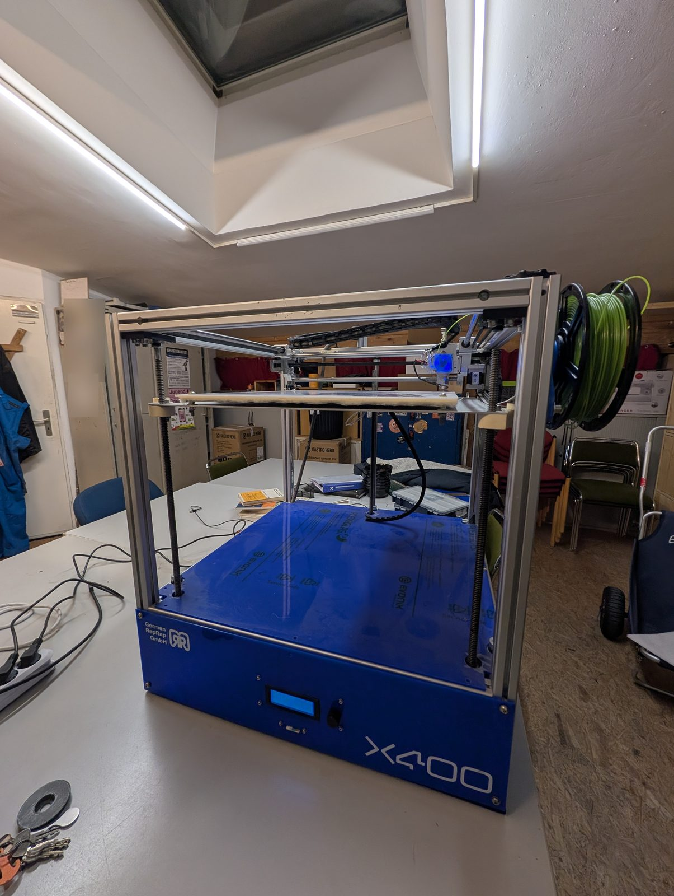
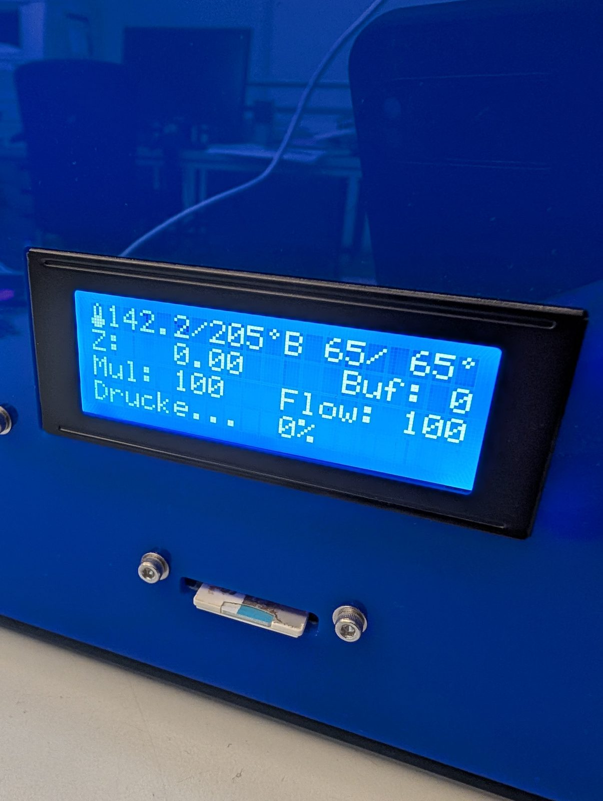
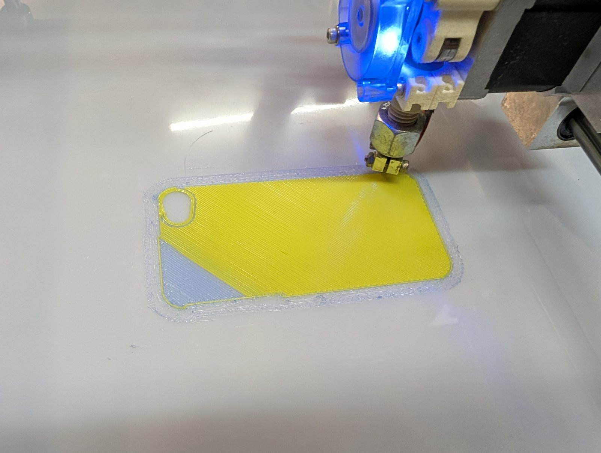

Falko hatte am Sonntagabend spontan Zeit und hat seinen alten Corsa in den Friedrichshain gefahren. Der Drucker hat dann doch nicht in den Kofferraum gepasst, er hat ihn trotzdem mitgenommen. Es ist immer gut, einen Spanngurt im Auto zu haben 👍

{: .gallery}

Noch am selben Abend stand der X400 in der Werkstatt – und druckt!

{: .gallery}

