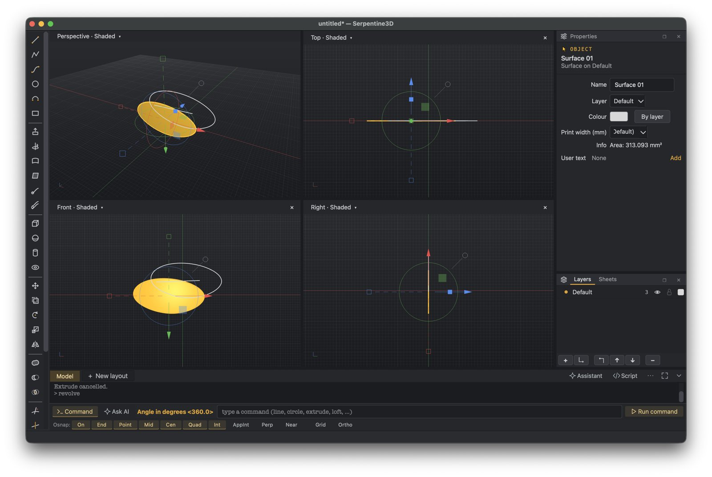

Falko sitzt gerade mit Flojo zusammen – und diese Zeichnung geht jetzt auf den Stiftplotter: „Gebrüder Luftdruck“, mit der Sprechblase „Luft raus? Mach neu!“.

Der Zeitraffer vom Plotten:

## Und in 3D: Serpentine3D

Außerdem haben wir mit **Serpentine3D** gearbeitet – das ist wohl ein Klon von Rhino 3D, und so sieht es auch aus: vier Ansichten (Perspektive, oben, vorne, rechts), eine Befehlszeile für `line`, `circle`, `extrude`, `loft` oder `revolve`, Objektfang wie bei Rhino – und bei jedem Objekt ein Feld „Print width (mm)“.

