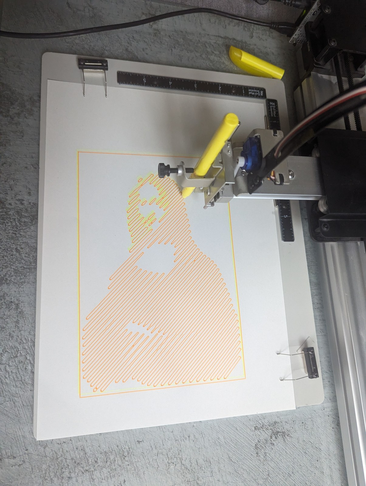
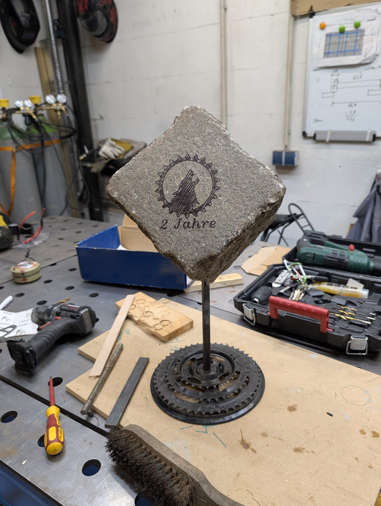
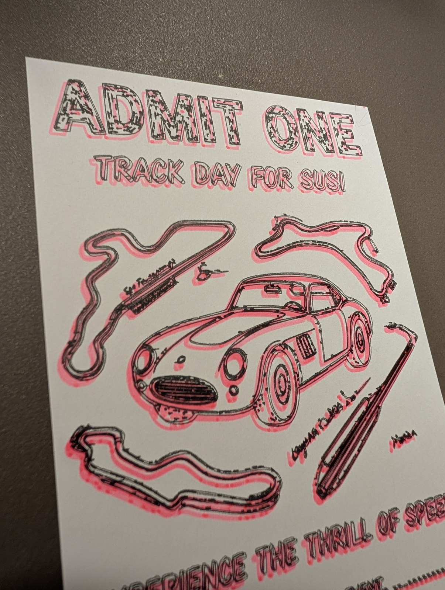
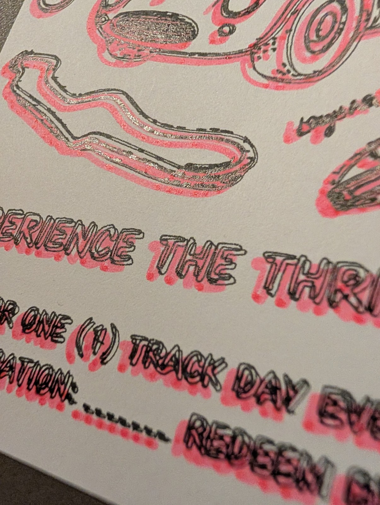

Im offenen GitHub-Repository **[35services/2d](https://github.com/35services/2d)** dokumentiert [Falko]({{ '/team/falko-richter/' | relative_url }}) seit **April 2024** die 2D- und Plotter-Projekte aus der Nachbarschaftswerkstatt [35services e. V.]({{ '/partner/35services/' | relative_url }}) – vor allem für unseren Stiftplotter **[AxiDraw V3]({{ '/ausstattung/axidraw-v3/' | relative_url }})**.

Anders als ein normaler Drucker setzt der Stiftplotter keine Pixel aufs Papier, sondern fährt **Vektorpfade** mit echten Stiften ab. Im Repo liegen deshalb nicht nur die fertigen SVG-Dateien, sondern auch die Zwischenschritte und Einstellungen: Wie wird aus einem Foto, einem Vereinslogo oder einem KI-Bild eine Zeichnung aus Linien?

{: .gallery}

## Unser Werkzeugkasten fürs Plotten

Über die Projekte hinweg hat sich ein fester Ablauf eingespielt:

1. **Vorlage in Linien übersetzen:** Fotos oder Grafiken werden mit **Vinilo** (Schraffuren, Spiralen, durchgehende Einlinien-Pfade) oder **Super Vectorizer** in SVG-Pfade umgewandelt.
2. **In Inkscape aufbereiten:** Hintergrundpfade entfernen, Ebenen nach Stiftfarben trennen, Füllmuster über `Gekachelte Klone` (`Create Tile Clones`) anlegen und Text mit **[Hershey Text](https://wiki.evilmadscientist.com/Hershey_Text)** in echte Einlinienschrift übersetzen (damit der Stift Buchstaben in einem Zug schreibt, statt nur ihre Umrisse nachzufahren).
3. **Plotten auf dem [AxiDraw V3]({{ '/ausstattung/axidraw-v3/' | relative_url }}):** Gezeichnet wird mit Finelinern, Textmarkern, Metallic-Stiften oder wasserfesten Markern (Sharpie) – nicht nur auf Papier, sondern auch auf ungewöhnlichen Oberflächen.

## Die Projekte im Repository

- **Mona Lisa in einer Linie** ([`mona-lisa/`](https://github.com/35services/2d/tree/main/mona-lisa), April 2024): Ein Kind aus der [3D-Druck AG an der KTG]({{ '/projekte/ktg-ag-jahr-1/' | relative_url }}) hatte gewettet, dass der AxiDraw keine Mona Lisa malen kann. Also wurde ein gemeinfreies Foto der Mona Lisa aus Wikimedia Commons in Vinilo in eine diagonale Schraffur aus einer einzigen Linie übersetzt und mehrfarbig geplottet – mehr dazu im Beitrag [„Wette eingelöst: Der AxiDraw malt die Mona Lisa in einer Linie“]({{ '/news/2024/04/19/der-axidraw-malt-die-mona-lisa/' | relative_url }}).
- **Gutscheine mit Kachelmustern & Logo-Tests** ([`gutschein/`](https://github.com/35services/2d/tree/main/gutschein), April 2024, und [`2024-07-03_diverses/`](https://github.com/35services/2d/tree/main/2024-07-03_diverses), Juli 2024): Rezept für mehrfarbige Gutscheine mit gekachelten Hintergründen in Inkscape sowie Vektorisierungs-Versuche mit dem Logo von 35services.
- **Wanderpokal zum 2. Geburtstag des RSV Steppenwolf** ([`steppenwolf_2Jahre/`](https://github.com/35services/2d/tree/main/steppenwolf_2Jahre), September 2025): Zum zweijährigen Bestehen des [Radsportvereins Steppenwolf](https://steppenwolf-berlin.de/) haben Falko (35services) und Daniel vom [Roter Stern Berlin e. V. (Radsportabteilung)](https://roter-stern.berlin/) eine Trophäe gebaut: ein echter Pflasterstein auf einem geschweißten Fuß aus alten Fahrrad-Kettenblättern. Das Vereinslogo (vektorisiert mit Super Vectorizer und Vinilo) und der Schriftzug „2 Jahre“ (Hershey Text) wurden mit dem AxiDraw V3 und einem schwarzen Sharpie-Marker direkt auf den Stein gezeichnet.
- **Track-Day-Gutschein aus KI-Entwurf & Plotter** ([`coupon_track_day/`](https://github.com/35services/2d/tree/main/coupon_track_day), Dezember 2025): Für seine Frau Susi hat Falko ein schwarz-weißes Gutschein-Motiv mit Rennwagen und Rennstrecken per Prompt entworfen, mit Super Vectorizer in Pfade zerlegt, in Inkscape bereinigt und in mehreren Durchgängen mit versetzten Farben auf starkes Papier geplottet.
- **Ideensammlung Plotten & Siebdruck** ([`plotting/`](https://github.com/35services/2d/tree/main/plotting), Januar–März 2026): Sammlung von Ideen, Links und Kontakten rund um Stift- und Schneidplotter – von 3D-Papierbasteleien über Abklebe-Schablonen zum Ätzen/Lackieren bis zu **Siebdruck mit dem Plotter** und dem Austausch mit befreundeten Werkstätten und Partnern wie [Philippe Bietenholz]({{ '/partner/' | relative_url }}#philippe-bietenholz) und [HeartLabs]({{ '/partner/' | relative_url }}#heartlabs).

Das Schwester-Repository für alle 3D-Druck-Projekte aus der Werkstatt ist **[35services/3d]({{ '/projekte/35services-3d/' | relative_url }})**.
