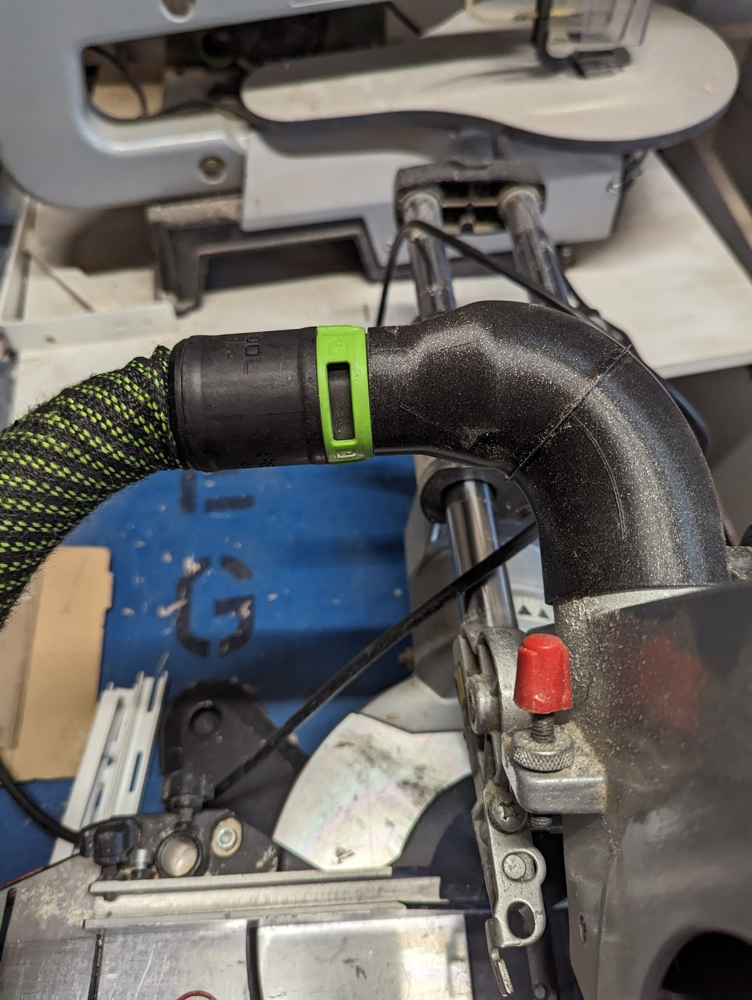
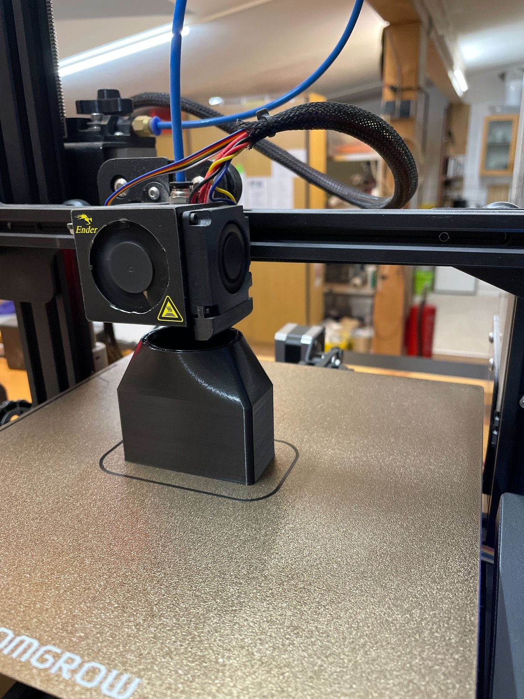
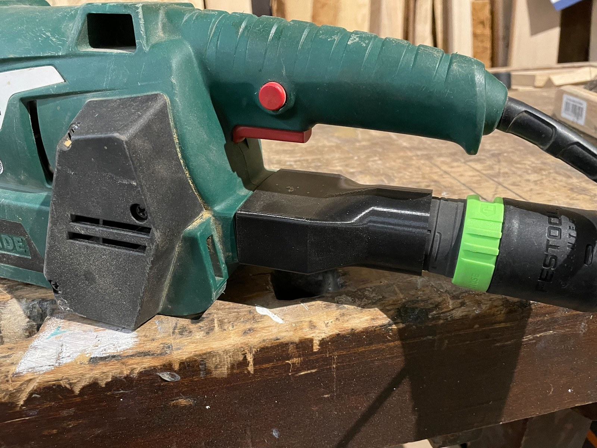
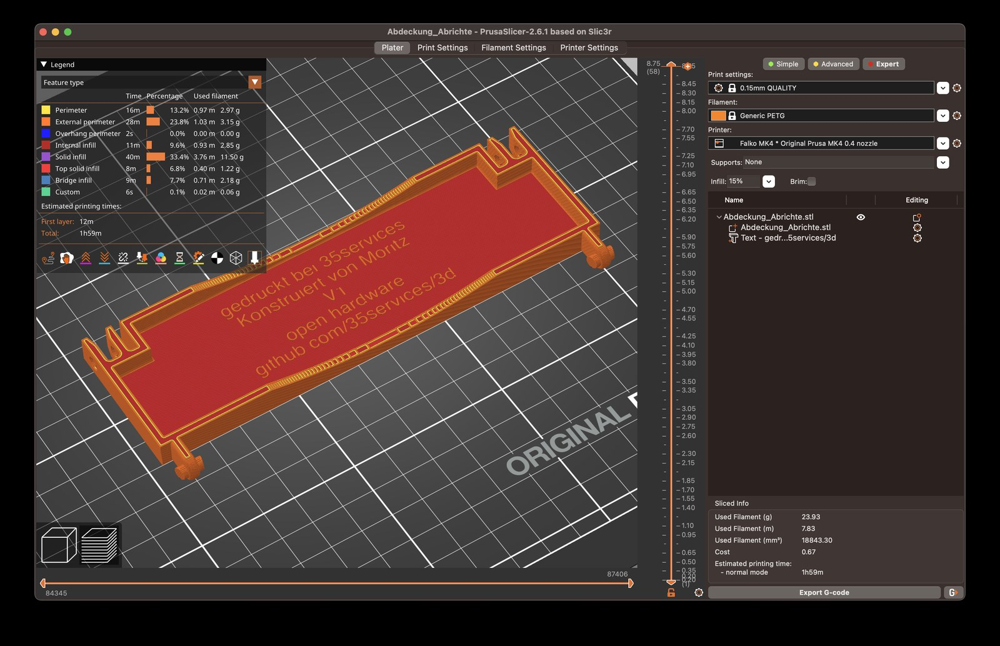
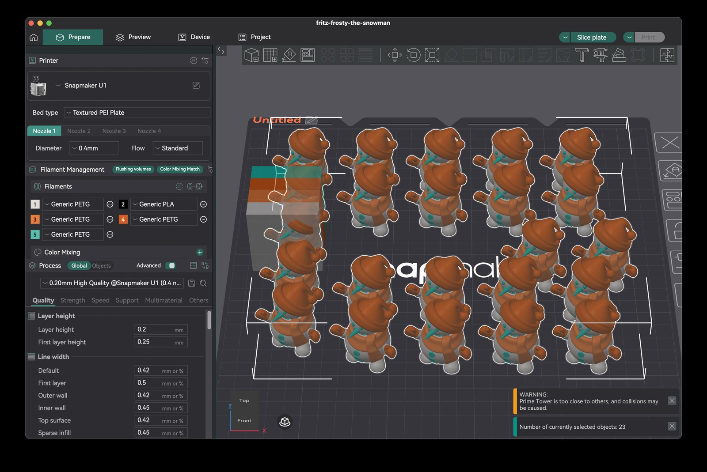

Im offenen GitHub-Repository **[35services/3d](https://github.com/35services/3d)** sammeln [Falko]({{ '/team/falko-richter/' | relative_url }}) und [Jan]({{ '/team/jan/' | relative_url }}) seit **November 2023** die 3D-Druck-Projekte rund um die Nachbarschaftswerkstatt [35services e. V.]({{ '/partner/35services/' | relative_url }}): eigene Konstruktionen, Druckdateien (`.stl`, `.step`, `.3mf`), Slicer-Profile und Notizen. Was in der Werkstatt entsteht, soll für alle nachdruckbar bleiben – und das Repo dient gleichzeitig als Gedächtnis, wann welches Projekt entstanden ist.

{: .gallery}

## Werkstatt-Helfer & Ersatzteile

Wenn in der offenen Werkstatt ein Anschluss nicht passt oder ein Teil an einer Maschine fehlt, wird es konstruiert und gedruckt:

- **Schutzabdeckung für die Abrichte** ([`Abrichte/`](https://github.com/35services/3d/tree/main/Abrichte), November 2023): Konstruiert von Moritz, in PETG auf dem [Prusa MK4]({{ '/ausstattung/prusa-mk4-mmu/' | relative_url }}) gedruckt – mit eingeprägtem Hinweis `gedruckt bei 35services · open hardware · github.com/35services/3d`.
- **Zettelhalter** ([`Zettelhalter/`](https://github.com/35services/3d/tree/main/Zettelhalter), November 2023): Ein Halter für Notizzettel in zwei Versionen für den Werkstattalltag.
- **Saugstutzen für die Metabo Kapp- und Gehrungssäge** ([`Metabo Kapp-Gährungssäge/`](https://github.com/35services/3d/tree/main/Metabo%20Kapp-G%C3%A4hrungss%C3%A4ge), Februar 2024): Ein gebogener Adapter zum Festool-Absaugschlauch – in zwei Hälften mit Brim gedruckt und am Brim zusammengeklebt, damit er ohne Stützstruktur sauber aus dem Drucker kommt.
- **Absaugadapter für den Parkside-Bandschleifer** ([`Parkside Bandschleifer/`](https://github.com/35services/3d/tree/main/Parkside%20Bandschleifer), Februar 2024): Verbindet den rechteckigen Auswurf des Bandschleifers mit dem runden Staubsaugerschlauch.
- **Handrad & Knebel für die Mini-Drehbank Rotwerk EDM 300** ([`mini-drehbank/`](https://github.com/35services/3d/tree/main/mini-drehbank), September 2026): Auf Basis einer Onshape-Vorlage von Holger hat Falko in [Onshape](https://cad.onshape.com/documents/3dcade1864ae362079d6317a/w/b821a9473fe010014d9f71cb/e/0eb2c477d6a30cfa9fca78de) eine Version gebaut, die sich komplett ohne Support drucken lässt.

{: .gallery}

## Ordnung in der Werkstatt: Gridfinity & openGrid

Im Ordner [`grids/`](https://github.com/35services/3d/tree/main/grids) (November 2025) sammeln wir Vorlagen und Generatoren für modulare Ordnungssysteme aus dem 3D-Drucker:

- **Gridfinity:** Grundplatten, Magnet-Basen und eine von Falko in [Tinkercad angepasste Box mit Ausschnitten](https://www.tinkercad.com/things/ezRlxyJyFKF-gf-extended-bin-3x3x12-s1x1-with-openings).
- **[openGrid](https://www.opengrid.world/):** Ein kleineres Raster, das sich direkt an die Wand oder sogar über Kopf unter Regale schrauben lässt – auf das Druckbett des [Prusa MK4]({{ '/ausstattung/prusa-mk4-mmu/' | relative_url }}) passt ein `7×8`-Raster am Stück. Falkos Auswahl liegt in einer eigenen [Printables-Sammlung](https://www.printables.com/@falkorichter_1026034/collections/2793569).

## 3D-Druck AG, Kiez & Mehrfarbdruck

Viele Projekte im Repo verbinden die Werkstatt direkt mit der [3D-Druck AG an der KTG]({{ '/projekte/3d-druck-ag-ktg/' | relative_url }}) und Nachbarschaftsaktionen:

- **Skiddi v3 & RC Excavator** ([`Skiddi/`](https://github.com/35services/3d/tree/main/Skiddi), Juni 2024): Für das [erste Jahr der KTG-AG]({{ '/projekte/ktg-ag-jahr-1/' | relative_url }}) haben Falko und [Jan]({{ '/team/jan/' | relative_url }}) hier die fertigen Druckplatten und G-Codes (PLA und flexibles TPU) für den [Prusa MK4]({{ '/ausstattung/prusa-mk4-mmu/' | relative_url }}) und den [Bambu Lab A1 mini]({{ '/ausstattung/bambu-lab-a1-mini/' | relative_url }}) abgelegt.
- **Druckplatten & Sammlungen der AG** ([`3d-druck-ag/`](https://github.com/35services/3d/tree/main/3d-druck-ag), ab November 2025): Vorbereitete `.3mf`-Dateien aus der AG (Print-in-Place-Bagger, Drachenreiter, Minecraft-Werkzeuge) und Links zu den Sammlungen auf [MakerWorld](https://makerworld.com/en/collections/35898265-ktg) und [Printables](https://www.printables.com/@falkorichter_1026034/collections/3703977).
- **Medaillen für die Grundschule** ([`medals/`](https://github.com/35services/3d/tree/main/medals), Mai 2026): Entwürfe für Sportfest-Medaillen (Weitsprung, Lauf, Wurf) – die Piktogramme wurden per KI entworfen und anschließend als SVG für den 3D-Druck vektorisiert.
- **Mehrfarbdruck & Schilder** ([`2d-3d-multicolor-prints/`](https://github.com/35services/3d/tree/main/2d-3d-multicolor-prints), Oktober 2025, und [`weihnachten/`](https://github.com/35services/3d/tree/main/weihnachten), November 2026): Experimente mit HueForge/FlatForge, [svg2solid](https://svg2solid.rknt.de/) und [MakeMySign](https://makerworld.com/en/makerlab/makeMySign) für Namensschilder und das Logo der Spreewölfe sowie eine volle Platte mehrfarbiger Schneemänner ([Printables Make](https://www.printables.com/make/2226416)) auf dem [Snapmaker U1]({{ '/ausstattung/snapmaker-u1/' | relative_url }}).

## Drucker, 3D-Scanner & Workshops

- **Creality CR-6 Max** ([`crealitycr6max/`](https://github.com/35services/3d/tree/main/crealitycr6max), Mai–Juli 2024): [Jan]({{ '/team/jan/' | relative_url }}) hat das PrusaSlicer-Profil für den großen CR-6 Max (400 × 400 mm Bauraum) beigesteuert; dazu stehen dort die Unterlagen für das Upgrade auf den Bondtech LGX Lite Arrow Extruder. Der Drucker wurde später an Falkos Vater weiterverkauft.
- **3D-Scannen** ([`wandpanel/`](https://github.com/35services/3d/tree/main/wandpanel), Februar 2024 – Februar 2026): Erste 3D-Scan-Versuche eines Wandpaneels – daraus ist später das Projekt [3D-Scanner evaluieren]({{ '/projekte/3d-scanner-evaluieren/' | relative_url }}) gewachsen.
- **CAD-Workshop & OctoPrint** ([`cad-workshop/`](https://github.com/35services/3d/tree/main/cad-workshop), Januar 2026, sowie `octoprint/` in der Git-Historie vom September 2026): Ideen für gemeinsame Konstruktions-Workshops und ein Docker-Compose-Setup für OctoPrint samt `ipOnConnect`-Plugin.

Das Schwester-Repository für den Stiftplotter und 2D-Projekte ist **[35services/2d]({{ '/projekte/35services-2d/' | relative_url }})**.
