Falko baut den **[Mogster 4x4 Tipper](https://3dsets.com/product/model-20-mogster-4x4-tipper/)** von 3DSets: einen ferngesteuerten Geländekipper im **Maßstab 1:8**.

Die Baupläne hat Falko gekauft – und sie seinem Papa **ganz uneigennützig zum Geburtstag geschenkt**. 😉

## Was den Mogster ausmacht

- **Portalachsen** für viel Bodenfreiheit im Gelände
- ein stabiler **Leiterrahmen** wie beim echten Vorbild
- eine **Kippmulde, die nach drei Seiten kippt**
- starke Untersetzung über Verteilergetriebe und Portalachsen – der Mogster ist zum langsamen Klettern gebaut, nicht zum Rasen

Alle Teile kommen aus dem 3D-Drucker. Dazu kommen Schrauben, Lager, Motor und Elektronik, die man separat kauft – die Bauanleitung verlinkt, was man braucht.

## Papas Mogster {#papas-mogster}

Fertig gebaut und in den Sommerferien 2026 ausgiebig gefahren: Papas Mogster in Hellblau klettert über Baumwurzeln, fährt Sandhügel hoch und transportiert sogar eine ganze Ladung Nüsse.

  <a href="/assets/images/projekte/3dsets-mogster-bauen/01.jpg" class="lightbox">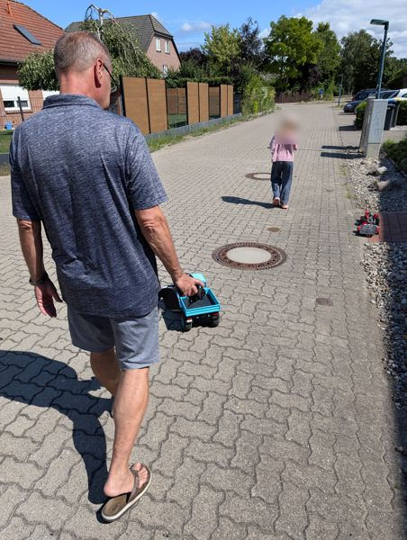</a>
  <a href="/assets/images/projekte/3dsets-mogster-bauen/02.jpg" class="lightbox">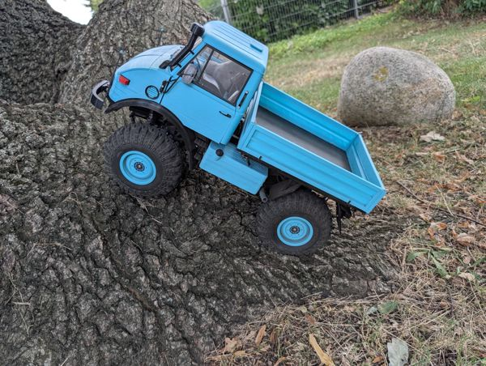</a>
  <a href="/assets/images/projekte/3dsets-mogster-bauen/03.jpg" class="lightbox">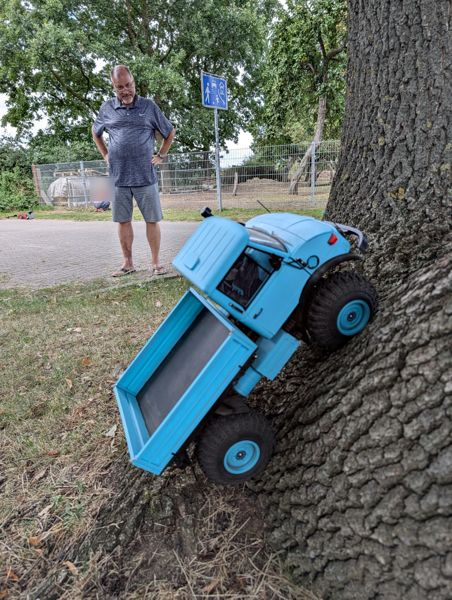</a>
  <a href="/assets/images/projekte/3dsets-mogster-bauen/04.jpg" class="lightbox">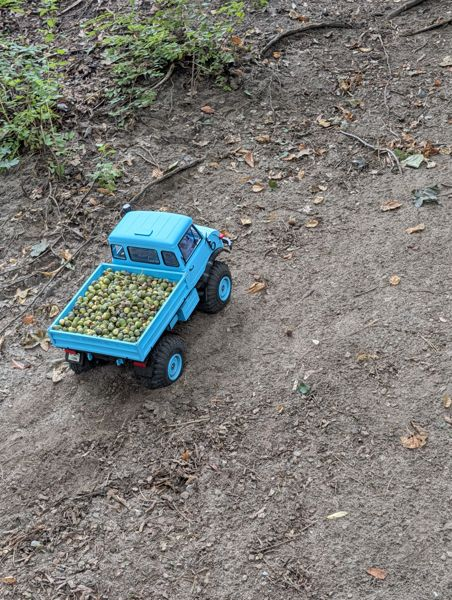</a>
  <a href="/assets/images/projekte/3dsets-mogster-bauen/05.jpg" class="lightbox">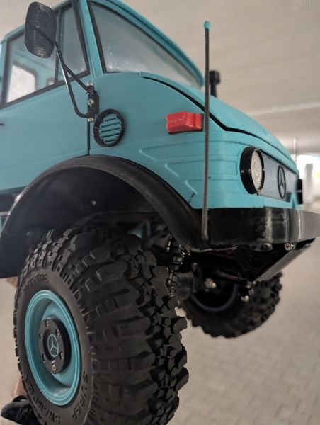</a>
  <a href="/assets/images/projekte/3dsets-mogster-bauen/06.jpg" class="lightbox">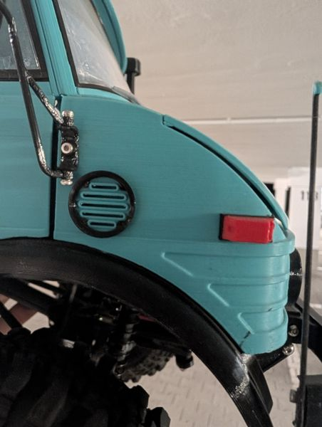</a>
  <a href="/assets/images/projekte/3dsets-mogster-bauen/07.jpg" class="lightbox">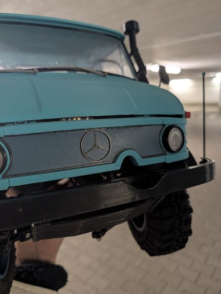</a>

<video class="post-video" controls preload="none" playsinline poster="/assets/video/projekte/3dsets-mogster-bauen/01.jpg" src="/assets/video/projekte/3dsets-mogster-bauen/01.mp4"></video>

## Erste Reparatur an Falkos Mogster {#erste-reparatur}

Falkos eigener Mogster ist gelb – und hat im Oktober 2026 die erste Reparatur gebraucht. Die **Portalachse hat eine Schwachstelle**: Das gedruckte Zahnrad im Portalgetriebe hält die hohe Kraft nicht immer aus und bricht. Also: Rad ab, Portalgehäuse auf, neues Zahnrad drucken und einbauen.

Für die Zukunft gibt es eine verstärkte Version des Zahnrads, die noch eingebaut werden muss: **[3D Sets Mogster Portal Gear Reinforced](https://www.printables.com/model/1861933-3d-sets-mogster-portal-gear-reinforced)** auf Printables.

  <a href="/assets/images/projekte/3dsets-mogster-bauen/reparatur/01.jpg" class="lightbox">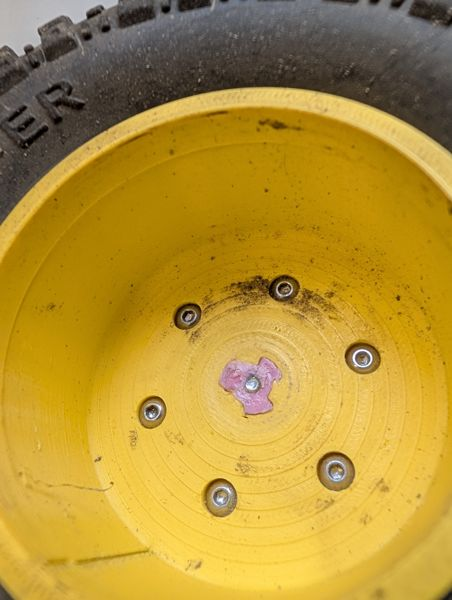</a>
  <a href="/assets/images/projekte/3dsets-mogster-bauen/reparatur/02.jpg" class="lightbox">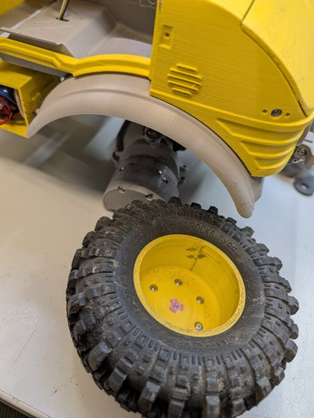</a>
  <a href="/assets/images/projekte/3dsets-mogster-bauen/reparatur/03.jpg" class="lightbox">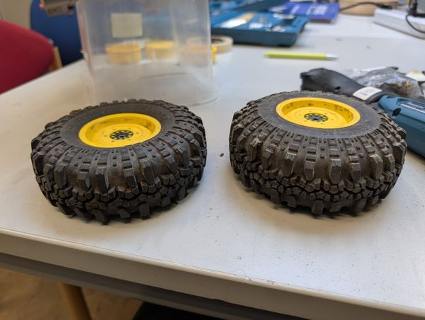</a>
  <a href="/assets/images/projekte/3dsets-mogster-bauen/reparatur/04.jpg" class="lightbox">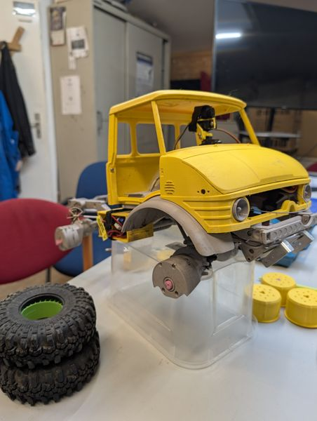</a>
  <a href="/assets/images/projekte/3dsets-mogster-bauen/reparatur/05.jpg" class="lightbox">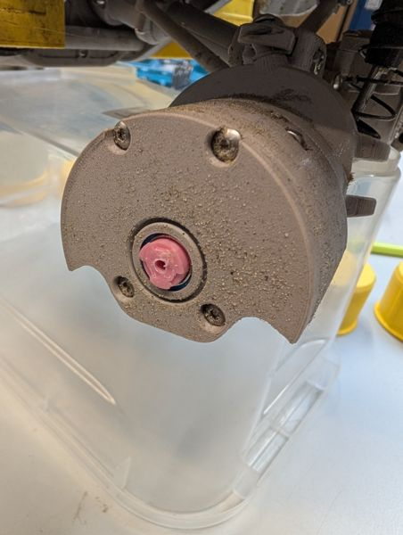</a>
  <a href="/assets/images/projekte/3dsets-mogster-bauen/reparatur/06.jpg" class="lightbox">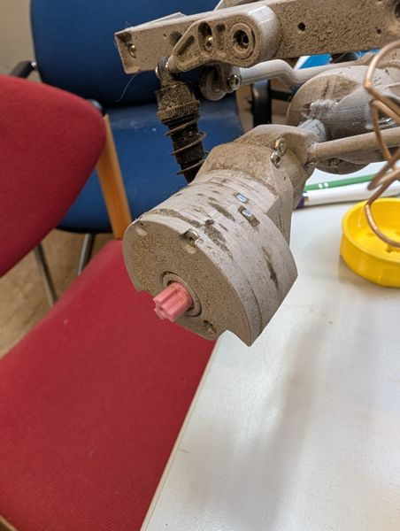</a>
  <a href="/assets/images/projekte/3dsets-mogster-bauen/reparatur/07.jpg" class="lightbox">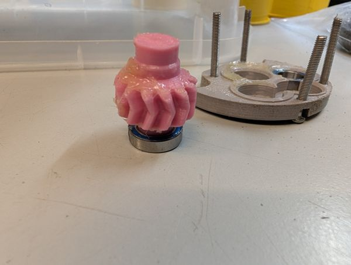</a>
  <a href="/assets/images/projekte/3dsets-mogster-bauen/reparatur/08.jpg" class="lightbox">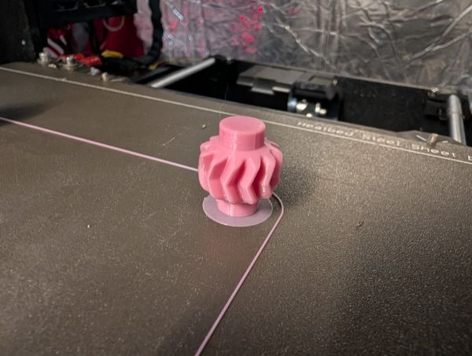</a>
  <a href="/assets/images/projekte/3dsets-mogster-bauen/reparatur/09.jpg" class="lightbox">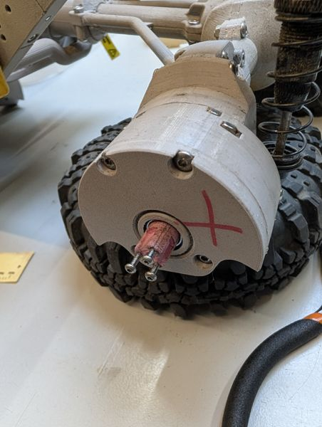</a>
  <a href="/assets/images/projekte/3dsets-mogster-bauen/reparatur/10.jpg" class="lightbox">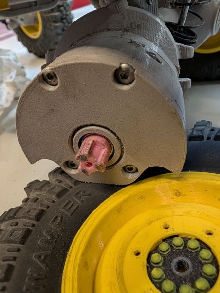</a>

## Die Mogster treffen aufeinander {#mogster-treffen}

Am 19. Oktober 2026 standen die beiden Mogster zum ersten Mal nebeneinander: Papas hellblauer Mogster – fertig, mit Pritsche – und Falkos gelber, bei dem hinten noch der nackte Leiterrahmen zu sehen ist.

Danach ging es für Falkos Mogster zum **ersten Praxistest** nach draußen: einen Sandhügel hinauf und durch Erde und Laub. Und an der Front sitzt ein kleiner, mit einem Servo bewegter **Kran**, der eine Holzlatte an einem Nagel einhakt und anhebt.

  <a href="/assets/images/projekte/3dsets-mogster-bauen/treffen/01.jpg" class="lightbox">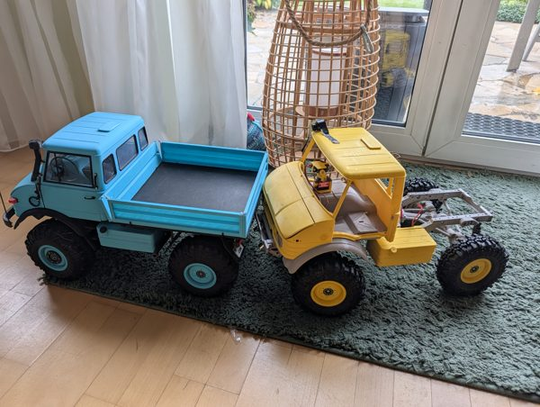</a>
  <a href="/assets/images/projekte/3dsets-mogster-bauen/treffen/02.jpg" class="lightbox">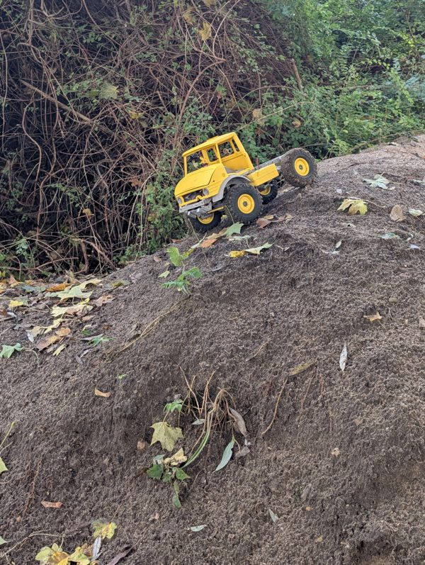</a>

<video class="post-video" controls preload="none" playsinline poster="/assets/video/projekte/3dsets-mogster-bauen/02.jpg" src="/assets/video/projekte/3dsets-mogster-bauen/02.mp4"></video>

<video class="post-video" controls preload="none" playsinline poster="/assets/video/projekte/3dsets-mogster-bauen/03.jpg" src="/assets/video/projekte/3dsets-mogster-bauen/03.mp4"></video>
