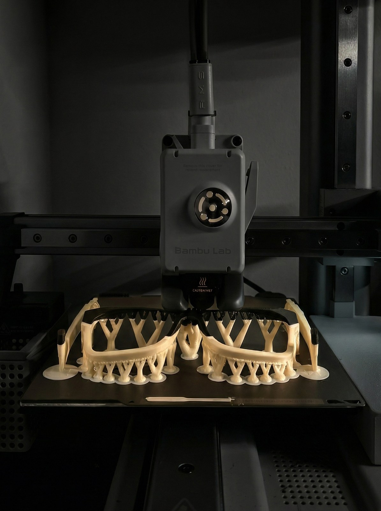
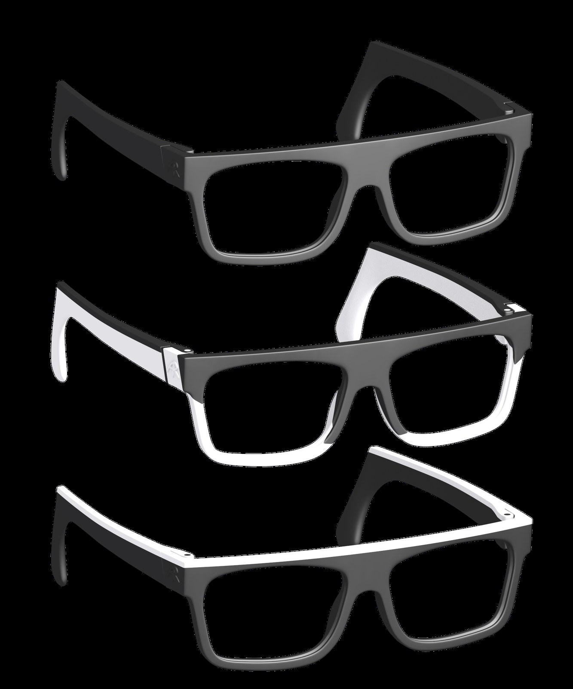
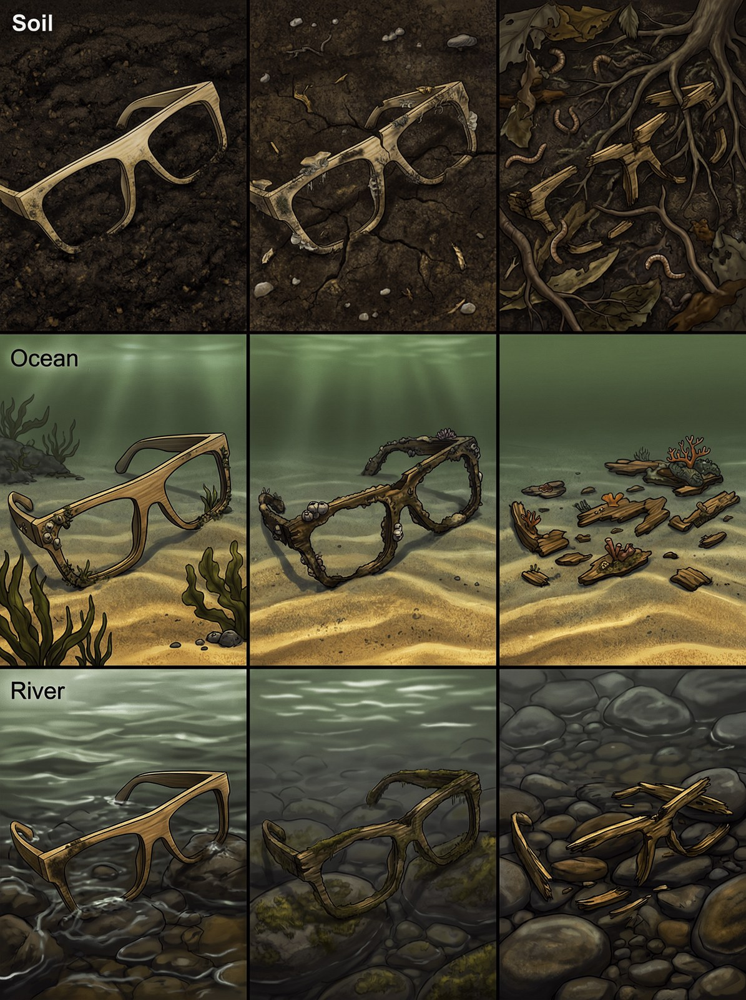

Unter **[augenrahmen.de](https://augenrahmen.de/)** entwirft und fertigt Alexander Brillenfassungen – nicht als Massenware, sondern als Einzelstück. Jeder Rahmen wird auf Abruf gedruckt, in Berlin, und lässt sich in Größe, Farbe und Muster an die Person anpassen, die ihn trägt.

{: .gallery}

## Das Material

Gedruckt wird mit **PHA** – einem Biopolymer, das von Mikroorganismen gebildet wird und deshalb unter normalen Umweltbedingungen abgebaut werden kann: im Boden und im Wasser, vollständig, ohne Mikroplastik und ohne Rückstände. Ein Brillenrahmen ist ein Alltagsgegenstand, der jahrelang getragen wird und irgendwann verloren geht oder kaputt ist. Ein Material, das dann nicht als Plastikmüll liegen bleibt, ist der eigentliche Kern des Projekts.

Bis dahin war es ein langer Weg: Über vier Jahre wurden Produktdesign, Ergonomie und Materialeigenschaften iterativ weiterentwickelt – von den ersten Formversuchen bis zu einem Rahmen, der im Alltag hält.

## Was sich einstellen lässt

Die Fassung ist kein Standardmaß: **Breite und Bügellänge**, **Farbe** und **Muster** werden pro Bestellung festgelegt. Dadurch ist jeder Rahmen ein Einzelstück, und es gibt keine Lagerware, die irgendwo übrig bleibt.

{: .gallery}

## Von der Datei zum Rahmen

Die 3D-Pipeline wurde in dieser Zeit von **3ds Max auf Blender** umgestellt – nicht aus Prinzip, sondern weil die Konstruktion damit reproduzierbarer wurde und sich Parameter wie Breite und Bügellänge sauber ableiten lassen. Auf der Website gibt es zusätzlich eine **AR-Anprobe**, mit der man die Fassung vor der Bestellung ins eigene Bild legen kann.

Seit Herbst 2026 ist das Produkt am Markt. Wer eine Fassung anschauen möchte, kann das bei **Silvia Briese** in der Augenoptik [Brille+Glas](https://brilleundglas-augenoptik.de) tun – dort liegen Rahmen zum Anprobieren.

## In der Schule

Im Oktober 2026 war Alexander zu Gast in den 3D-Druck-AGs der [Kurt-Tucholsky-Grundschule]({{ '/projects/3d-druck-ag-ktg/' | relative_url }}) und des [Rosalind-Franklin-Gymnasiums]({{ '/projects/3d-druck-ag-rosalind-franklin-gymnasium/' | relative_url }}) und hat gezeigt, wie aus einem Drucker ein Gegenstand wird, den man wirklich trägt – inklusive der Frage, was passiert, wenn man draufsetzt.

- [Alexander Riedel zu Besuch in der 3D-Druck AG an der KTG]({{ '/calendar/2026-10-05-augenrahmen-zu-besuch-in-der-ag/' | relative_url }})
- [Alexander Riedel zu Besuch in der 3D-Druck AG am Rosalind-Franklin-Gymnasium]({{ '/calendar/2026-10-06-augenrahmen-rosalind/' | relative_url }})

## Was noch offen ist

Die Fassungen sind für Erwachsene gedacht. Offen ist eine eigene Reihe für Kinder – dort wären die Anforderungen andere: kleinere Maße, robuster gegen Stöße, und ein Material, das auch nach einem Sturz auf den Schulhof noch sitzt.

{: .gallery}
