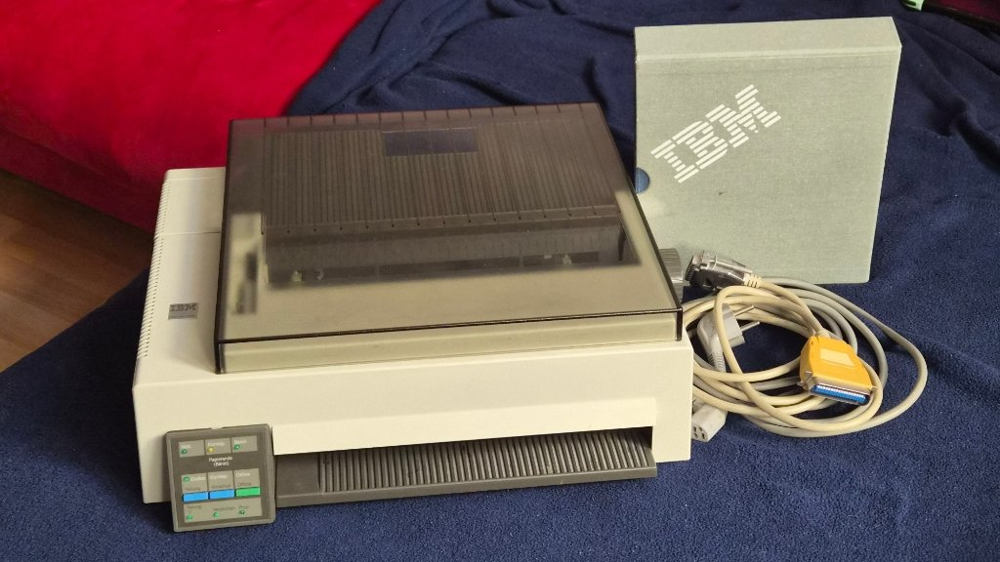

Ein **IBM Proprinter** ist kein Drucker, den man wegwirft. 24 Nadeln, ein robustes Stahlgestell, eine rauchgraue Abdeckung, die man hochklappen kann, um zu sehen, was im Inneren passiert – und ein Handbuch, das noch erklärt, wie man das Ding wartet.

Alexander hat das Gerät über Kleinanzeigen bekommen, samt Original-Handbuch und Centronics-Kabel. Aktuell bewegt sich allerdings kein Motor: Irgendwo scheint die **24-Volt-Leitung unterbrochen** zu sein. Als Nächstes geht es an die Fehlersuche in der Stromversorgung, damit die Schrittmotoren wieder Saft bekommen.

{: .gallery}

## Warum ein Nadeldrucker?

Weil er etwas kann, was kein Tinten- oder Laserdrucker kann: **Durchschläge**. Und weil das Geräusch dazugehört – ein Nadeldrucker klingt nach Arbeit.

Der eigentliche Grund ist aber ein anderer. In [Monocell]({{ '/projects/monocell/' | relative_url }}) gibt es einen Writer, der bereits auf genau diese Druckerfamilie vorbereitet ist: **PPDS**, also der Proprinter-Befehlssatz, 24-Nadel-Bitgrafik mit 180 dpi, Zeichensatz 2 für Umlaute, Seitenvorschübe. Der Textverarbeitung fehlt also nur noch der Drucker – und dem Drucker der Strom.

## Der zweite Schritt: ein Druckserver

Ein Nadeldrucker ist langsam. Deshalb soll er nicht an einem Rechner hängen, an dem man warten muss, sondern im Netz: Der Server nimmt Aufträge an und hält sie, bis der Drucker sie abarbeitet. Wege dorthin gibt es mehrere:

- **Parallelport an der UltraBase X6** des X61s – das Gerät ist nur eingedockt verfügbar, dafür ohne Adapter
- **USB-Parallel-Adapter** über `usblp`, der dann als `/dev/usb/lp0` auftaucht
- auf der Zielseite ein kleiner Empfänger, der **TCP 9100** annimmt und an das Gerät weiterreicht – ohne CUPS

Reizvoll wäre, gleich mitzudenken: Wenn der Server ohnehin läuft, kann er auch PDF und Text nach PPDS übersetzen, mit 80 Spalten und 180-dpi-Bändern. Dann druckt jedes Gerät im Haus auf dem Nadeldrucker – vom Telefon bis zum Laptop.
