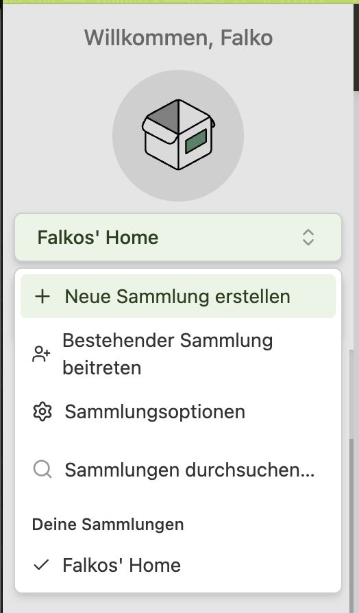
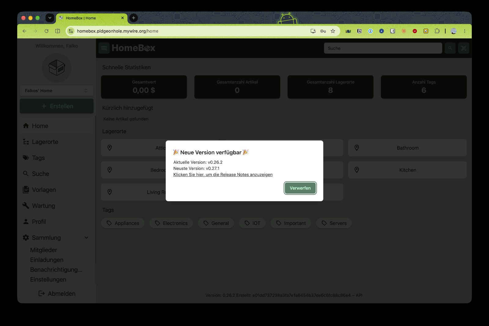
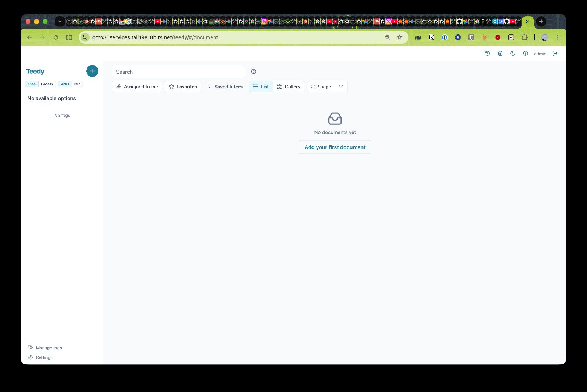
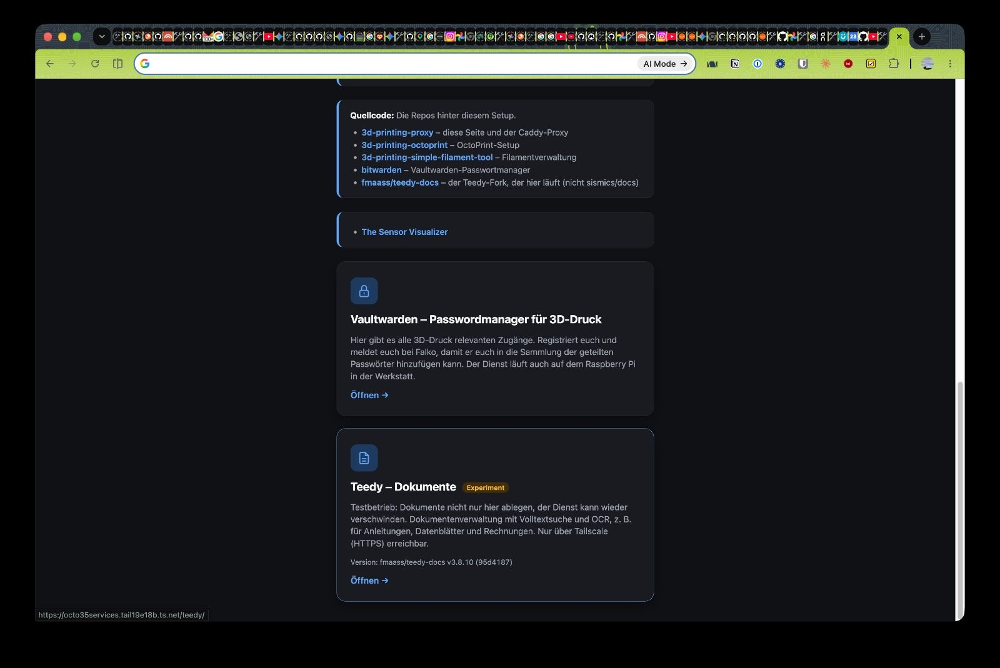

## Notizen

- [https://homebox.pidgeonhole.mywire.org/](https://homebox.pidgeonhole.mywire.org/) ist der Server
- [https://docs.fab-access.org/books/awesome-fabinfra/page/sammlung-systeme-fur-inventar-und-dokumentenverwaltung](https://docs.fab-access.org/books/awesome-fabinfra/page/sammlung-systeme-fur-inventar-und-dokumentenverwaltung) Es gibt tolle Recherche von Mario
- [https://octo35services.tail19e18b.ts.net/](https://octo35services.tail19e18b.ts.net/) hat Teedy
- [https://octo35services.tail19e18b.ts.net/teedy/#/document](https://octo35services.tail19e18b.ts.net/teedy/#/document) Teedy

## Timeline
- AJ betreibt den tollen server https://homebox.pidgeonhole.mywire.org gehört AJ
   - https://github.com/sysadminsmedia/homebox/releases
```
🎉 Neue Version verfügbar 🎉
Aktuelle Version: v0.26.2
Neuste Version: v0.27.1
```
- Falko und Jannis haben einen Login
- Jannis benutzt den Server
- AJ tritt zurück und Jannis hat privat Kontakt
- Falko und Jannis quatschen wie man ihn bei 35services betreiben kann, wie kann er wirklich allen zur verfügung stehen?
- backup funktioniert nicht - haben Falko und Jannis getestet
- Falko ist nicht in der 35services Sammlung


{: .gallery}

## Fotos



{: .gallery}

### Bestand exportiert - da stimmt was nicht
```
HB.import_ref,HB.parent_import_ref,HB.location,HB.tags,HB.asset_id,HB.archived,HB.url,HB.name,HB.quantity,HB.description,HB.insured,HB.notes,HB.purchase_price,HB.purchase_from,HB.purchase_date,HB.manufacturer,HB.model_number,HB.serial_number,HB.lifetime_warranty,HB.warranty_expires,HB.warranty_details,HB.sold_to,HB.sold_price,HB.sold_date,HB.sold_notes
,,,,000-008,false,/location/047d0c9b-a0fe-4fd2-898f-98c8a4e1aa57,Basement,1,,false,,0,,,,,,false,,,,0,,
,,,,000-004,false,/location/23eb5087-c8b6-4bd5-a627-a380aa692f3e,Bedroom,1,,false,,0,,,,,,false,,,,0,,
,,,,000-001,false,/location/27a91398-e561-4d18-961c-4cc278df799f,Living Room,1,,false,,0,,,,,,false,,,,0,,
,,,,000-006,false,/location/99270a4f-9a3e-4aaa-8228-b492b5aa6b90,Office,1,,false,,0,,,,,,false,,,,0,,
,,,,000-007,false,/location/a2711fca-2c2e-4899-b2aa-3d53ec454f45,Attic,1,,false,,0,,,,,,false,,,,0,,
,,,,000-003,false,/location/b205ad0b-80ab-41b5-930e-077ebb2a26a8,Kitchen,1,,false,,0,,,,,,false,,,,0,,
,,,,000-005,false,/location/bfb4f707-dce5-4a06-8460-b5ef0caf04a0,Bathroom,1,,false,,0,,,,,,false,,,,0,,
,,,,000-002,false,/location/e662a57a-6564-4d41-9eea-d88328bb7446,Garage,1,,false,,0,,,,,,false,,,,0,,

```
