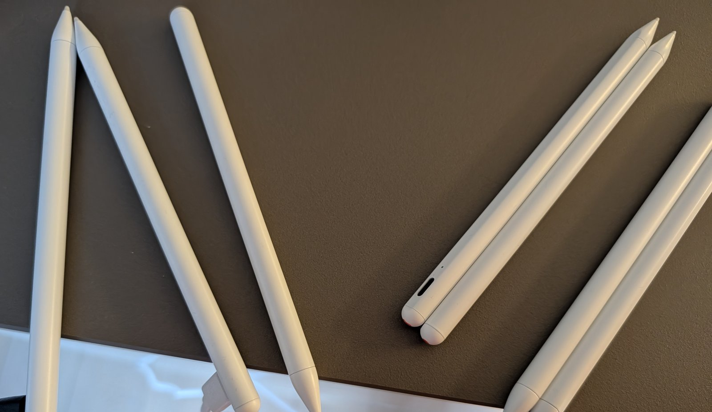

Wir haben dem Rosalind-Franklin-Gymnasium **20 Eingabestifte fürs iPad zum Testen ausgeliehen**. Sie stammen aus dem Projekt [iPad-Stifte wiederbeleben]({{ '/projekte/ipad-stifte-wiederbeleben/' | relative_url }}) an der Kurt-Tucholsky-Grundschule, wo viele Stifte lange ungenutzt herumlagen. Es sind **keine originalen Apple Pencils**, sondern einfache kompatible Stifte ohne Neigungs- und Druckerkennung.

Am Gymnasium gilt dasselbe Vorgehen:

1. **Alle aufladen.**
2. **Durchtesten:** Geht der Stift an, schreibt er zuverlässig auf dem iPad, hält der Akku die Ladung?
3. **Aussortieren**, was nicht mehr funktioniert – bei manchen Stiften ist der Akku leider tot.

{: .gallery}
