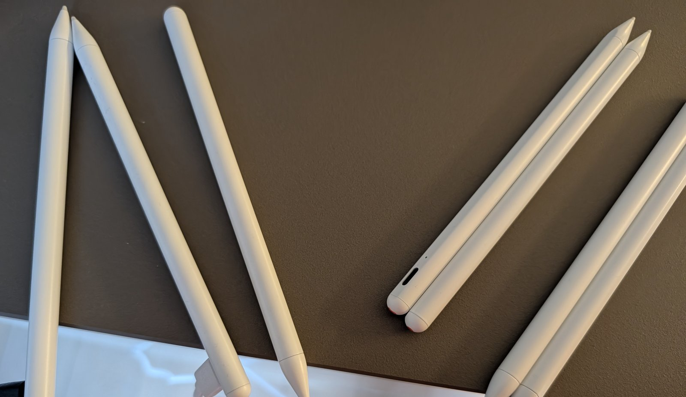

An der Kurt-Tucholsky-Grundschule liegen **ganz viele Eingabestifte fürs iPad** herum, die lange nicht benutzt wurden. Das sind **keine originalen Apple Pencils**, sondern einfache kompatible Stifte – **ohne Neigungs- und ohne Druckerkennung**. Zum Schreiben, Zeichnen und Tippen auf dem iPad sind sie aber ideal – und wir brauchen präzise Eingaben beim Arbeiten mit Tinkercad und CAD.

In der [3D-Druck AG]({{ '/projekte/3d-druck-ag-ktg/' | relative_url }}) holen wir sie wieder hervor:

1. **Alle aufladen.**
2. **Durchtesten:** Geht der Stift an, schreibt er zuverlässig auf dem iPad, hält der Akku die Ladung?
3. **Aussortieren**, was nicht mehr funktioniert – bei manchen Stiften ist der Akku leider tot.

Die Schulleitung freut sich, dass die Stifte vielleicht wieder genutzt werden können. Dafür müssen sie aber wirklich gründlich getestet sein.

Einen Teil der Stifte haben wir zum Testen ans Rosalind-Franklin-Gymnasium ausgeliehen: [iPad-Stifte testen am Rosalind-Franklin-Gymnasium]({{ '/projekte/ipad-stifte-rosalind-franklin-gymnasium/' | relative_url }}).

{: .gallery}
